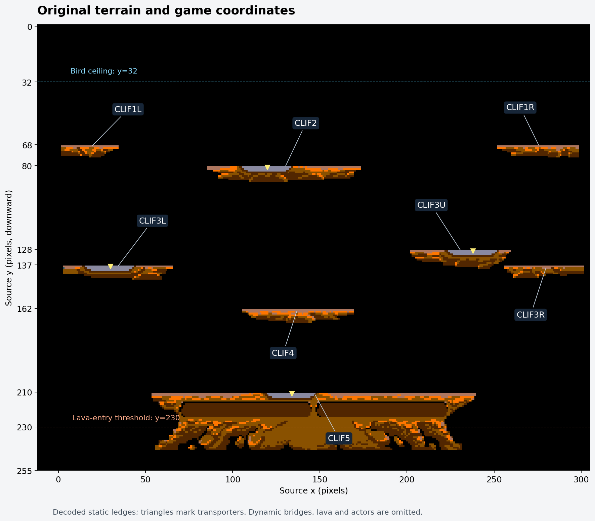
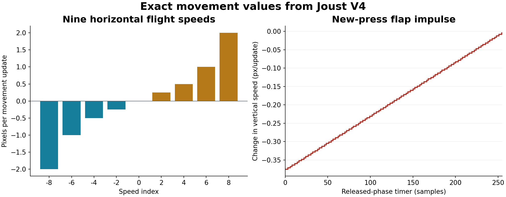
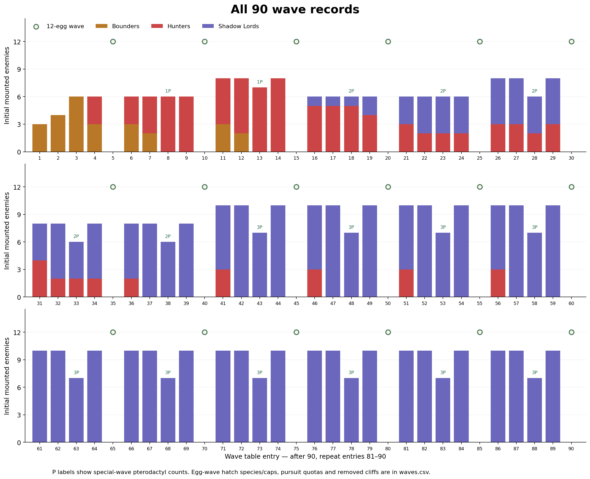
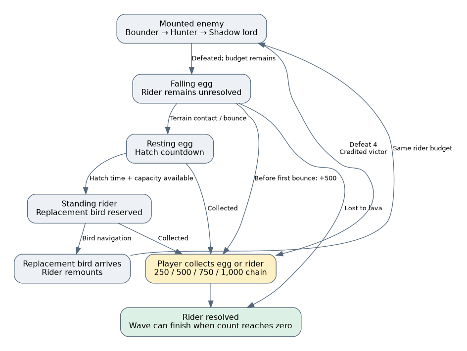
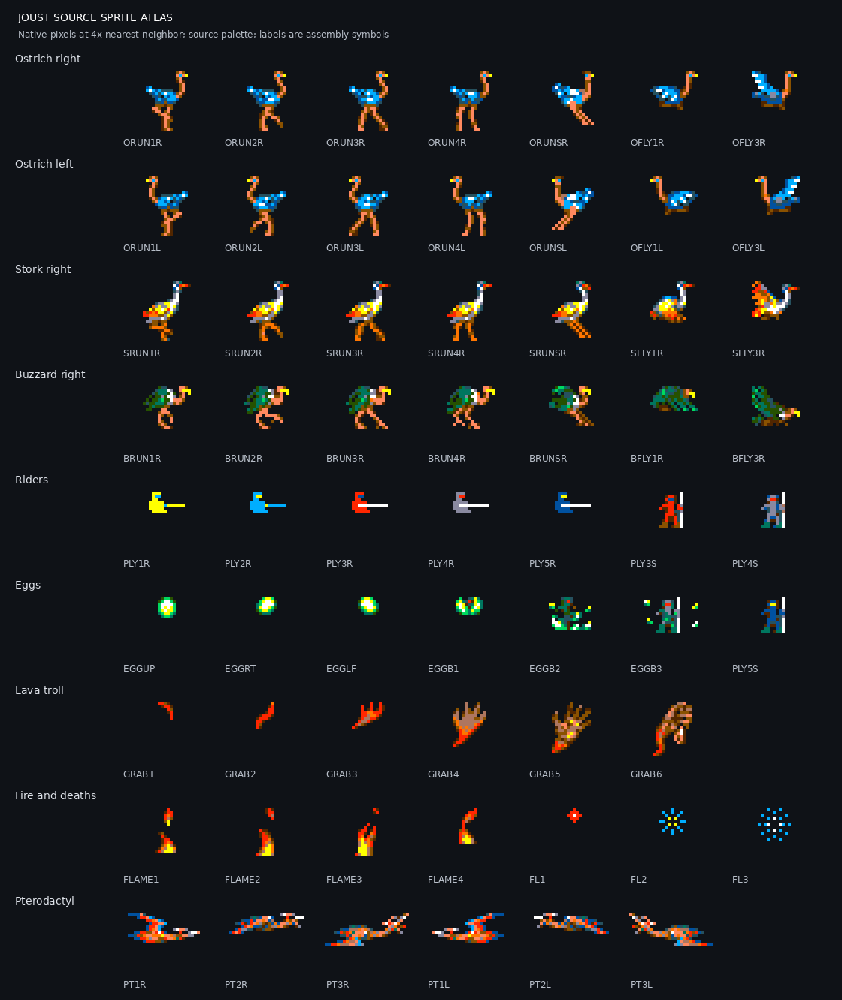
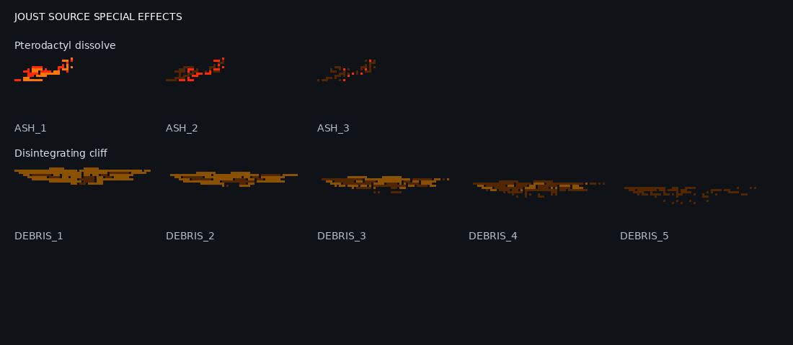
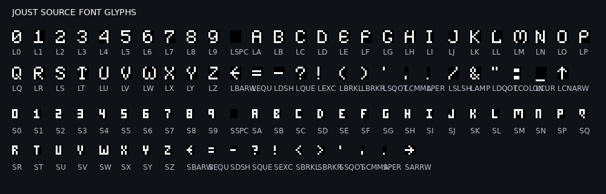
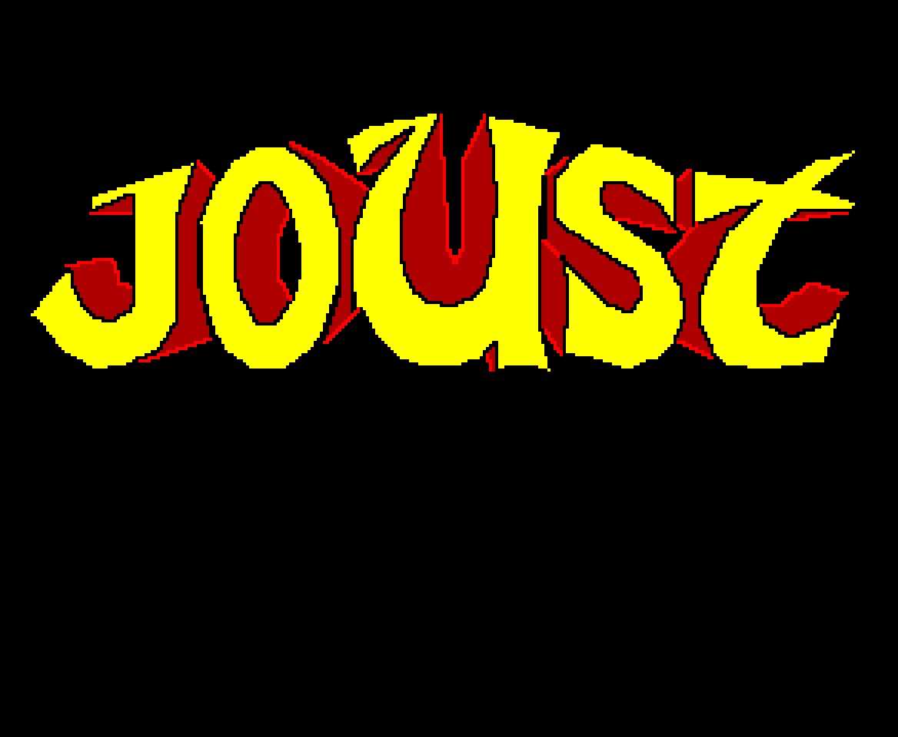

# Joust V4 — native Kotlin game specification

## Purpose and reference version

Build a complete, faithful, local one- or two-player Joust for Android TV / Google TV in Kotlin. The game simulation must implement the original rules directly. The delivered graphics, fonts, effects, sound recordings, numeric tables and source references are the implementation material. This is a build primer and asset package, not a completed Android application.

**Reference:** `synamaxmusic/joust`, commit `87e22aab945709fa107df609c0efcb839a17c1f9`, reviewed 14 November 2026. This repository reconstructs the final revision 4 of **Joust (1982)**. It is not a 1984 sequel or a modern reinterpretation. The supplied source snapshot fixes the reference version even if the upstream repository later changes. [Repository README](https://github.com/synamaxmusic/joust/blob/87e22aab945709fa107df609c0efcb839a17c1f9/README.md).

### Implementation contract

Preserve original movement, collision silhouettes, integer rounding, AI states, wave data, egg behavior, friendly fire, score ordering, respawn protection, art, animation and sound priorities. Retain quirks when they change a visible or playable result. Ground movement is an authored state machine; flying uses discrete impulses and speed choices. A generic physics engine or a continuously steering enemy will not reproduce this game.

Keep Kotlin gameplay code readable: `Bird`, `Egg`, `WaveState`, `PlayerState`, `TerrainState`, `SoundEvent` and explicit state machines are appropriate. The source labels in this document are evidence anchors and mappings to tables. They are not a requirement to reproduce the original language, storage layout, processor, graphics hardware or memory map in the Android app.

Three evidence levels are used throughout:

| Level | Meaning | How the build agent should use it |
|---|---|---|
| Extracted | Literal artwork, table entries, numbers and event records decoded from the pinned source. | Import directly; verify supplied hashes. |
| Reconstructed | Algorithms and transitions translated by reading source branches and arithmetic. | Implement precisely; validate with the named scenarios and source anchors. |
| Port choice | Android controls, lifecycle, display scaling, persistence and implementation structure. | Follow the stated defaults while keeping original game rules intact. |

No playable Kotlin clone, original-game differential replay, or physical-TV input-latency test was executed during this analysis. The verification record identifies what was actually checked. Specific remaining comparison work is listed at the end; the presence of exact data does not establish frame-for-frame equivalence of an implementation that has not yet been written.

### Files to read first

1. `START_HERE.md` — concise build-agent brief and completion requirements.
2. `docs/JOUST_GAME_SPEC.md` — this full specification; `docs/JOUST_GAME_SPEC.html` is the illustrated reading copy.
3. `assets/graphics/asset-manifest.json` — indexed pixels, palette, frame offsets, authored collision profiles, fonts and terrain.
4. `data/gameplay_tables.json`, `data/physics_tables.json`, `data/waves.csv` — exact game data.
5. `assets/audio/` — decoded sound recordings and their playback/coverage notes.
6. `reference/kotlin/` — small native math and input reference implementations; these are helpers, not a complete game engine.
7. `reference/source/` — pinned original reference files for resolving the cited branches and the remaining timing questions.

## Coordinate system, screen and presentation

Use source-pixel world coordinates. Positive x is right; positive y is down. Bird x is a left-side reference and bird y is a bottom reference, not a sprite center. Vertical position has a 1/256-pixel fraction. Different frames and species have different visual offsets from this reference; use the animation descriptors. A left-facing sprite cannot be assumed to be a centered mirror of the right-facing sprite. [Frame descriptors](https://github.com/synamaxmusic/joust/blob/87e22aab945709fa107df609c0efcb839a17c1f9/JOUSTI.ASM#L759-L857).

| Item | Required value or interpretation |
|---|---|
| Source drawing canvas | 304 × 256 source pixels. |
| Visible reference crop | x=6…297 and y=7…246 inclusive: 292 × 240 source pixels. |
| Bird horizontal wrap | Reference x in −10…292 inclusive; period **303**, independently of image width. |
| Ceiling | Bird bottom y=32; exact clamp/reflect behavior is in the movement section. |
| Lava entry | Candidate bird bottom y≥230 enters sinking; the visible lava surface is separately animated. |
| Player starting references | P1 `(100,210)` facing right; P2 `(200,210)` facing left. |
| Presentation aspect | Use a 4:3 game viewport as the default TV presentation, centered with side bars on a 16:9 panel. Keep a square-source-pixel inspection mode for asset/debug comparisons. |

The crop comes from the maintained original-game reference configuration, not from guessing the bounds of the art: [MAME reference at the reviewed revision](https://github.com/mamedev/mame/blob/b7163a8d5ef30a8f0e72e4808ada8f904367311f/src/mame/williams/williams.cpp#L1556). The 4:3 fitting policy is a port presentation choice. It never changes simulation coordinates or collision geometry.

For a TV target rectangle of width `W` and height `H`, use `viewH=min(H,3*W/4)` and `viewW=4*viewH/3`, center it, then map the cropped image into it. Preserve the whole game image; do not fill a 16:9 screen by cutting away the top or bottom. Turn off bitmap filtering when drawing source art. Render all world objects on the source pixel grid while retaining their fractional simulation positions, and perform final scaling only after composing the frame. Decorative CRT shaders, scanlines and smoothing are optional display features; the default reference image is the decoded art.

### Arena geometry



This figure is a reconstruction from the source artwork, not a captured gameplay frame. It shows the complete static ledge set and transporter locations. Bridges, burning fronts, lava animation, actors, text and wave-dependent cliff removal are dynamic. Use the runtime landing/solid maps from `physics_tables.json`; visible colored pixels are not a substitute for the game's collision data.

| Terrain | Art top-left x,y | Art size | Standing bird bottom y |
|---|---|---|---:|
| Top left `CLIF1L` | 2,69 | 34×7 | 68 |
| Top right `CLIF1R` | 252,69 | 48×7 | 68 |
| Upper middle `CLIF2` | 86,81 | 88×9 | 80 |
| Left middle `CLIF3L` | 2,138 | 64×8 | 137 |
| Upper right middle `CLIF3U` | 202,129 | 58×11 | 128 |
| Outer right middle `CLIF3R` | 254,138 | 48×7 | 137 |
| Lower middle `CLIF4` | 106,163 | 64×8 | 162 |
| Bottom island `CLIF5` | 54,211 | 186×2 top, plus decoded body | 210 |

The four transporter art origins are `(106,81)`, `(224,129)`, `(16,138)`, `(120,211)`; each is 28×3. Actor spawning uses the separate spawn reference coordinates and safety masks in the lifecycle section. [Terrain and transporter data](https://github.com/synamaxmusic/joust/blob/87e22aab945709fa107df609c0efcb839a17c1f9/JOUSTI.ASM#L54-L752).

## Time, deterministic updates and random choices

### Fixed tick and timers

Run the simulation independently of the Android display refresh. Original source comments usually use 60 ticks as one second. The reference display cadence is `8,000,000/(512*260)` = **60.09615384615385 ticks/second**, with a tick duration of **16,640,000 ns**. Use that duration for the fidelity default; keep every source delay as an integer number of its specified ticks or AI calls. Do not rescale a delay of 61 into a guessed “one second,” and do not run at 120 simulation updates per second because the TV renders at 120 Hz. [Reference cadence](https://github.com/mamedev/mame/blob/b7163a8d5ef30a8f0e72e4808ada8f904367311f/src/mame/williams/williams.cpp#L1556).

A frame accumulator may run zero, one or several fixed steps before rendering. Keep simulation ticks when catching up. When the app leaves the foreground or a controller disconnects, pause deliberately and reset the host-clock accumulator on resume; do not catch up minutes of absent gameplay. This pause behavior is an Android port choice. It does not alter how an unpaused tick behaves.

Not every actor state advances every tick. A delay belongs to the state or actor that owns it. Early enemies, hatching checks, score displays, cliff effects and wave monitoring have different call periods. Preserve countdown decrement-before-test behavior, and use the original update sequence when an actor changes state or creates another actor. The ordering audit below gives the recovered sequencing contract. [Scheduler and waits](https://github.com/synamaxmusic/joust/blob/87e22aab945709fa107df609c0efcb839a17c1f9/SYSTEM.ASM#L158-L255).

### Native data model

| Object | State the native implementation needs |
|---|---|
| Game | Active/attract/game-over state, credits/free-play setting, player count, fixed tick, ordered actor/tasks list, random state, current palette and sound sequencer. |
| Player | Controller assignment, score, reserve/total lives, next extra-life threshold, egg chain, survival deaths, player-kill/bounty flags, active bird and respawn request. |
| Bird | Species, ridden/riderless mode, facing, x integer and horizontal remainder, y in 1/256 pixels, vertical velocity, horizontal speed index, ground/air state, timers, bump displacements, wing/stride frame, collision flag/profile, visual offset and AI state. |
| Enemy rider | Intelligence level, remaining egg budget, pursuit-slot ownership, target slot, targeting timers, movement AI continuation and excursion counters. |
| Egg | Rider identity/intelligence/budget, x/y and velocity, first-bounce flag, resting/hatching/standing state, hatch timer, reserved replacement bird. |
| Wave | Display number, table entry, unresolved riders, active/reserved birds, current/requested pursuing count, introduction/drain state, special callback, baiter index/timer and dynamic difficulty values/countdowns. |
| Terrain | Active cliff flags, mutable landing and solid maps, bridge burn positions, lava display target/current position and troll state. |

Fields are conceptual. There is no need to preserve source storage offsets. There is a need to preserve distinctions such as unresolved riders versus currently mounted enemies, or reserve lives versus total lives including the active bird. [State definitions](https://github.com/synamaxmusic/joust/blob/87e22aab945709fa107df609c0efcb839a17c1f9/RAMDEF.ASM), [wave controller](https://github.com/synamaxmusic/joust/blob/87e22aab945709fa107df609c0efcb839a17c1f9/JOUSTRV4.ASM#L1875-L2229).

### Random behavior

Keep one shared deterministic random stream. The source draw function has two unsigned byte state components `H` and `L`. One draw computes:

```text
a = (L >> 3) XOR L
returnedByte = a >> 1
feedback = a AND 1
newH = (feedback << 7) OR (H >> 1)
newL = ((H AND 1) << 7) OR (L >> 1)
returnedBit = L AND 1
```

The old `L` supplies the returned bit. Source callers use either the returned byte, its bits, or the final bit; those interfaces are not interchangeable. Separately, the original clock perturbs the shared state with `H=(H+1)&255`, `L=(L-1)&255` at its subframe service points. Visual effects also consume random draws. [Draw function](https://github.com/synamaxmusic/joust/blob/87e22aab945709fa107df609c0efcb839a17c1f9/SYSTEM.ASM#L746-L754), [clock perturbation](https://github.com/synamaxmusic/joust/blob/87e22aab945709fa107df609c0efcb839a17c1f9/SYSTEM.ASM#L576-L585).

`reference/kotlin/JoustRandom.kt` supplies the draw and perturb operations separately. The exact interleaving of perturbations, gameplay calls and cosmetic calls has not been replay-validated here. Log those events during source comparison, then fix their order in the native scheduler. Seeding `Random.Default` once, omitting visual draws, or swapping this algorithm for a modern generator gives different enemy/spawn outcomes. A deterministic native replay must store starting random state, input samples, update ordering and settings.



The following movement section defines how and when to use these values. The impulse curve is the exact integer function, not a fitted physical model.

## Native gameplay ordering randomness and fidelity audit

This audit checks `physics_collision.md`, `ai_waves_scoring.md`, and the gameplay-table extractor against source commit `87e22aab945709fa107df609c0efcb839a17c1f9`. It supplies the update-order contract and shared random algorithm needed by a native Kotlin implementation. It does not prescribe an instruction interpreter or a hardware model.

### Update order is gameplay behavior

Keep an ordered, mutable list of gameplay work items. A work item has a category, a continuation state, and a sleep countdown. A bird, an egg, a collision pass, the wave director, and a transient effect are separate work items where the source treats them separately. Drawing can be implemented normally in Kotlin; the required ordering concerns gameplay state, timers, collision eligibility, spawning, and random draws.

The source runs **all primary work before secondary work**, while keeping one common list. Primary traversal starts at the head each tick. Secondary traversal resumes from its saved predecessor, so a deferred secondary item is not silently skipped or restarted. Within each category, traversal follows the current list order. A sleep countdown is decremented when that item is visited in its category; if it becomes zero, run its continuation until it sleeps or deletes itself. It is not a global timer decremented independently of that item's visits. A newly created item starts at countdown 1 unless the caller replaces that value. An explicit zero countdown wraps to 255 on the next decrement and wakes on the 256th visit; do not interpret zero as an immediate wake. [A01](https://github.com/synamaxmusic/joust/blob/87e22aab945709fa107df609c0efcb839a17c1f9/SYSTEM.ASM#L158-L255)[A02](https://github.com/synamaxmusic/joust/blob/87e22aab945709fa107df609c0efcb839a17c1f9/SYSTEM.ASM#L320-L408)

The native ordering contract is:

```text
begin gameplay tick
    advance queued sound-event timers
    visit primary work from list head in current list order
    resume secondary work from saved predecessor in current list order
    commit this tick's render state

visit(item, category)
    if item.category differs: advance without changing its countdown
    item.countdown = unsignedByte(item.countdown - 1)
    if item.countdown == 0:
        run item.continuation until sleep or removal

sleep(item, count, continuation)
    item.countdown = unsignedByte(count)
    item.continuation = continuation
    continue traversal after item

insertAfter(anchor, newItem)
    newItem.next = anchor.next
    anchor.next = newItem
    newItem.countdown = 1  // unless immediately overridden
```

This is a contract for a native task/state model, not a requirement to reproduce the source's storage layout. Use an explicit linked list or an equivalent structure whose mutations have the same ordering. A snapshot array of all actors taken at tick start changes same-tick spawning. [A01](https://github.com/synamaxmusic/joust/blob/87e22aab945709fa107df609c0efcb839a17c1f9/SYSTEM.ASM#L158-L255)[A02](https://github.com/synamaxmusic/joust/blob/87e22aab945709fa107df609c0efcb839a17c1f9/SYSTEM.ASM#L320-L408)

#### Normal play order

The relevant initial list positions are:

| Relative position | Category | Observable effect |
| --- | --- | --- |
| Player collision pass `PLYCOL` | Primary | Decrement target-immunity delays; resolve player 2/player 1 and player/opponent contacts against positions available before either player's movement this tick. |
| Player 2, when present | Primary | Sample player 2 input and perform its movement/state continuation. |
| Player 1 | Primary | Sample player 1 input and perform its movement/state continuation. |
| Opponent collision pass `OPPCOL` | Secondary | Resolve mounted-enemy/pterodactyl pairs before their movement continuations. |
| Wave director `CIA` | Secondary | Advance wave introduction/cleanup/monitoring; create enemies, eggs, or special-wave controllers at its own list position. |
| Director's following chain | Mostly secondary | Run enemies, eggs, pterodactyls, and their inserted continuations in current list order. |

Background effects, score-display work, and temporary effects can interleave with these positions; the listed relative gameplay ordering is the important contract. Player 2 precedes player 1 because both are inserted after the same initialization anchor. The later insertion becomes the earlier list node. Player collision detection is created afterward and inserted ahead of both players. Opponent collision detection is inserted before the wave director. These are consequences of creation rules, not player-number priority chosen by the port. Target slots are populated in activation order, so slot 1 is not guaranteed to be player 1; initial simultaneous activation can register player 2 first. [A02](https://github.com/synamaxmusic/joust/blob/87e22aab945709fa107df609c0efcb839a17c1f9/SYSTEM.ASM#L320-L408)[A03](https://github.com/synamaxmusic/joust/blob/87e22aab945709fa107df609c0efcb839a17c1f9/JOUSTRV4.ASM#L1014-L1078)

Do not replace this with “move every actor, then collide,” or “move and collide each actor individually.” In particular, a player collision resolved this tick may change an opponent's velocity, kill its rider, or create an egg before that opponent's secondary movement service. A target-delay timer reaching zero in the primary contact pass can make that target eligible for AI later in the same tick. [A03](https://github.com/synamaxmusic/joust/blob/87e22aab945709fa107df609c0efcb839a17c1f9/JOUSTRV4.ASM#L1014-L1078)[A04](https://github.com/synamaxmusic/joust/blob/87e22aab945709fa107df609c0efcb839a17c1f9/JOUSTRV4.ASM#L4811-L5216)

#### Insertions and removals

There are two operations: create after the currently executing work item, and create after an explicitly chosen actor. Preserve the chosen anchor:

| Event | Exact insertion anchor | Consequence |
| --- | --- | --- |
| Ordinary enemy introduction | Wave director | Newest introduced enemy is earlier in the director's chain than older surviving enemies. |
| Enemy defeated inside a player collision pass | Defeated enemy | The new egg follows that enemy, although the currently executing work item is the collision pass. |
| Resting egg begins hatching | Egg/rider | Its approaching replacement bird follows the egg. |
| Troll reaches for a bird | Victim's predecessor | Rear hand precedes the victim. |
| Troll grips a bird | Victim | Front gripping hand follows the victim. |
| Egg air-bonus popup | Ordinary egg-score popup | The extra 500 popup follows the main popup. |

Repeated insertion at a fixed anchor reverses creation order. If a new same-category item lies ahead of the active traversal cursor, its countdown can be decremented and its initial continuation run **during this pass**. Its initial continuation may itself immediately sleep; “runs this pass” does not mean it necessarily performs a motion update. An item inserted behind a cursor waits for that traversal to return. A primary item created during the secondary pass waits for the next primary pass. A secondary item created during primary work becomes eligible when the secondary cursor reaches it. [A02](https://github.com/synamaxmusic/joust/blob/87e22aab945709fa107df609c0efcb839a17c1f9/SYSTEM.ASM#L320-L408)[A05](https://github.com/synamaxmusic/joust/blob/87e22aab945709fa107df609c0efcb839a17c1f9/JOUSTRV4.ASM#L2186-L2212)

Remove a work item immediately from the live order. If it is the saved secondary predecessor, replace that saved pointer with the surviving predecessor. The current traversal resumes through the surviving predecessor's next link, so deleting the current item does not skip its successor. Disabling collisions is separate from deleting an actor: riderless mounts, collected eggs, dead pterodactyls, and popups can remain in the list after their contact eligibility is gone. [A01](https://github.com/synamaxmusic/joust/blob/87e22aab945709fa107df609c0efcb839a17c1f9/SYSTEM.ASM#L158-L255)[A02](https://github.com/synamaxmusic/joust/blob/87e22aab945709fa107df609c0efcb839a17c1f9/SYSTEM.ASM#L320-L408)

#### Pair traversal and simultaneous outcomes

`PLYCOL` searches forward from its own position for a live player, then pairs that player with each later collision-enabled item. With both players initially active, player 2 is the first outer participant. It resolves player 2 versus player 1 once, then player 2 versus following opponents; later it resolves player 1 versus following opponents. `OPPCOL` similarly examines later pairs but filters them to enemy/pterodactyl participants. Eggs are collected through the player pass, not opponent-versus-opponent contact. [A04](https://github.com/synamaxmusic/joust/blob/87e22aab945709fa107df609c0efcb839a17c1f9/JOUSTRV4.ASM#L4811-L5216)

Apply each outcome immediately. If the outer participant dies, stop its remaining pairs and resume with the next outer participant. The equal-lance-height player tie also takes this stop-current-participant route despite neither rider dying. A defeated inner participant can still have an animation work item, but its contact-enabled state is already clear. The next pair must see all preceding score, life, rider-count, and eligibility changes. These details affect multiple simultaneous contacts and cannot be replaced by gathering a set of contacts and resolving them in arbitrary order. [A04](https://github.com/synamaxmusic/joust/blob/87e22aab945709fa107df609c0efcb839a17c1f9/JOUSTRV4.ASM#L4811-L5216)

### Cadence boundary

Primary ticks have the project cadence defined in the main specification. Individual actor delays still matter: early enemies and falling eggs can use delay 2; the director's monitor uses delay 8; resting eggs use delay 12. These are counts of eligible service visits, not Android presentation frames. AI decisions occur when the bird's movement continuation calls its controller. A change to an AI continuation may take effect immediately by dispatching into another decision, or on the next controller call; do not impose one automatic transition per tick on every AI state. [A01](https://github.com/synamaxmusic/joust/blob/87e22aab945709fa107df609c0efcb839a17c1f9/SYSTEM.ASM#L158-L255)[A06](https://github.com/synamaxmusic/joust/blob/87e22aab945709fa107df609c0efcb839a17c1f9/JOUSTRV4.ASM#L5910-L6257)

The source can pause the secondary traversal at a deadline and resume it next tick. Thus a secondary sleep count may span extra primary ticks during load. The exact pattern of those deferrals has **not** been established by gameplay traces in this review. A native implementation can start with one complete ordered secondary pass per fixed tick, but that is an explicit timing baseline requiring comparison, rather than a demonstrated match to every overloaded original frame. Retain a secondary-resume cursor in the design so traced scheduling can be matched without changing game rules. Do not let the Kotlin renderer's variable frame time decide which AI actors receive service. [A01](https://github.com/synamaxmusic/joust/blob/87e22aab945709fa107df609c0efcb839a17c1f9/SYSTEM.ASM#L158-L255)

### Shared random sequence

The game uses one shared two-byte sequence with two outputs per draw: a value `r` in 0–127 and a one-bit output `b`. Some callers use only the bit; some use `r`; some combine them as `2*r+b`. A Kotlin `Random.nextInt(...)` substitution changes both distributions and later draw order. Use the included `JoustRandom.kt`, which is the following pure arithmetic reconstruction. [A07](https://github.com/synamaxmusic/joust/blob/87e22aab945709fa107df609c0efcb839a17c1f9/SYSTEM.ASM#L741-L754)

```text
oldHigh = highByte
oldLow = lowByte
mixed = (oldLow unsignedShiftRight 3) XOR oldLow
r = mixed unsignedShiftRight 1
b = oldLow AND 1
highByte = (oldHigh unsignedShiftRight 1) OR ((mixed AND 1) << 7)
lowByte = (oldLow unsignedShiftRight 1) OR ((oldHigh AND 1) << 7)
return (r, b)
```

A separate time event performs `highByte=(highByte+1)&255` and `lowByte=(lowByte-1)&255`. The byte operations wrap independently; this is not addition of 255 to the combined 16-bit state. The time event does not reset at wave transitions or new credits. The seed and the ordering of these events relative to draws must be recorded for a repeatable native replay. The exact original phase of those time events relative to every random call is not established here. The primitive arithmetic is exact; a seed alone does not establish an identical whole-game sequence. [A07](https://github.com/synamaxmusic/joust/blob/87e22aab945709fa107df609c0efcb839a17c1f9/SYSTEM.ASM#L741-L754)

For a simple source check, starting from high=`0x12`, low=`0x34`, one draw returns `(25,0)` and changes state to `(0x09,0x1A)`. Applying the time event first changes the initial state to `(0x13,0x33)`; the next draw returns `(26,1)` and leaves `(0x89,0x99)`.

#### Draw consumers

| Consumer | Exact use |
| --- | --- |
| Pterodactyl creation | One draw; its one-bit output selects left or right entry. |
| Transporter selection attempt | One draw after evaluating occupancy; the bit and the low bit of `r` select the first transporter in a fixed fallback search. Retry attempts consume additional draws. |
| First six egg-wave positions | One draw selects a ledge group via `floor(r*12/256)`; search backward with wrap for an unused group. Another draw selects a slot within that group's width using `floor((2*r+b)*width/256)+groupStart`. |
| Last six egg-wave positions | One draw selects `floor(r*138/256)` in 0–68; search forward with wrap for an unused slot. |
| First two egg-wave hatch times | Each creation consumes an additional draw. Replace base timer `t` with `t-floor(r*t/256)`. These draws are interleaved with placement, not performed afterward as a batch. |
| Lava bubbles | Consume the same generator. The selected bubble or surface-burst path has different subsequent waits, changing when the next draw occurs. Cosmetic bubble choices therefore influence later gameplay draws. |

The first six egg creations occur one at a time, with a sleep after each. The extra early-hatching draw happens inside creation before that sleep. Preserve this draw sequence and avoid shuffling a precomputed list with a library shuffle. Standard enemy pursuit is state-driven; it is not implemented as random turns. A separate `RADDR` consumer exists only on the failed integrity-check path and is not part of a valid-source normal game. [A08](https://github.com/synamaxmusic/joust/blob/87e22aab945709fa107df609c0efcb839a17c1f9/JOUSTRV4.ASM#L1423-L1444)

### Wave completion and score event ordering

The two end-of-wave conditions are separate:

1. The 8-visit monitor sees `NRIDER==0` and enters next-wave preparation. This happens before baiter countdown or aggression processing in that iteration.
2. Before actual introduction, `WATWAV` waits until the wave director's following chain is empty. Departing mounts, pterodactyls, score popups, and other work can delay this even after there are no unresolved riders.

The director resets both egg-chain counters, resets default caps/delay, increments the displayed wave number, and calls the previous wave's award callback **before** advancing to the next wave-table entry. Previous special-wave bonus flags therefore must survive until that callback, then the gladiator flags are cleared. New cliff changes and introductions follow. Do not perform all cleanup at the instant the last enemy mount loses its rider. [A09](https://github.com/synamaxmusic/joust/blob/87e22aab945709fa107df609c0efcb839a17c1f9/JOUSTRV4.ASM#L1889-L2248)

`EGGSCR` awards base egg score and the optional air bonus immediately, then decrements `NRIDER`, cancels a reserved approaching bird if present, disables the egg's contacts, and schedules the later visual popup path with delay 4. The displayed score popup is not the time at which points are earned. That remaining popup can still hold up `WATWAV`. [A10](https://github.com/synamaxmusic/joust/blob/87e22aab945709fa107df609c0efcb839a17c1f9/JOUSTRV4.ASM#L2952-L3094)

For a player joust death, disable victim contacts and rider; execute the victim death callback; then award the normal victim value to the victor. Inside the player death callback, reset egg-chain and survival flags, process the first gladiator bounty when applicable, award the victim 50 points, and decrement the auxiliary life total. The 50 can cross an extra-life threshold and prevent a last-life game over. On a gladiator kill, the bounty and normal 2,000 kill score are distinct successive awards. Preserve each threshold check rather than combining all participants' score changes into a post-tick summary. [A11](https://github.com/synamaxmusic/joust/blob/87e22aab945709fa107df609c0efcb839a17c1f9/JOUSTRV4.ASM#L4669-L4787)

### Corrections from this audit

The following corrections were applied to `ai_waves_scoring.md` or sent to the physics author for integration:

| Item | Correct native behavior | Source |
| --- | --- | --- |
| Seeking versus movement wrap | Replacement-bird seeking compares with period 302; actual bird movement wraps across 303 integer positions. | [A12](https://github.com/synamaxmusic/joust/blob/87e22aab945709fa107df609c0efcb839a17c1f9/JOUSTRV4.ASM#L3549-L3706) |
| Last egg auto-collection | The fourth defeat auto-collects the freshly created egg only when a victor exists. A lava death has no victor. | [A10](https://github.com/synamaxmusic/joust/blob/87e22aab945709fa107df609c0efcb839a17c1f9/JOUSTRV4.ASM#L2952-L3094) |
| Pterodactyl attack exit window | End the attack for `-13 <= savedX-ownX < 13`; the left endpoint is included and the right endpoint excluded. | [A13](https://github.com/synamaxmusic/joust/blob/87e22aab945709fa107df609c0efcb839a17c1f9/JOUSTRV4.ASM#L1178-L1220) |
| Troll gravity | Ordinary fresh-press flap impulse happens first. Captured integration adds `trollPull + (flapReleased?4:0)` rather than ordinary gravity. | [A14](https://github.com/synamaxmusic/joust/blob/87e22aab945709fa107df609c0efcb839a17c1f9/JOUSTRV4.ASM#L6608-L6700) |
| Troll escape position | Shared release always integrates `y+=vy`. Speed escape reaches it before integration and moves once; range escape reaches it after integration and moves twice that update. | [A14](https://github.com/synamaxmusic/joust/blob/87e22aab945709fa107df609c0efcb839a17c1f9/JOUSTRV4.ASM#L6608-L6700) |
| Score rendering | Seven score digits through millions are visible; the next high decimal digit is an overflow marker, not an eighth normal visible digit. | [A15](https://github.com/synamaxmusic/joust/blob/87e22aab945709fa107df609c0efcb839a17c1f9/JOUSTRV4.ASM#L7419-L7449) |

The troll double-integration case is especially easy to smooth away inadvertently. It comes directly from the branch to common release after the range test. The strict escape threshold remains `vy<-384`, and the rising pull endpoint remains `0x501`. [A14](https://github.com/synamaxmusic/joust/blob/87e22aab945709fa107df609c0efcb839a17c1f9/JOUSTRV4.ASM#L6608-L6700)

The following detailed physics descriptions were independently checked and agree with the source: ordinary 303-position wrapping; sampled flap edges and held/released gravity; ground takeoff's distinct initial lift; profile-row collision rather than visible-alpha collision; one-sided row scanning after the first horizontal separation; player versus opponent tie branch asymmetry; normal vertical reflection; top-of-cliff `floor((-vy-1)/2)` including `vy=0` becoming -1; enemy reserved-slot counting during hatching; and immediate egg scoring before delayed popup. These are source checks, not executed full-game replay results. [A04](https://github.com/synamaxmusic/joust/blob/87e22aab945709fa107df609c0efcb839a17c1f9/JOUSTRV4.ASM#L4811-L5216)[A06](https://github.com/synamaxmusic/joust/blob/87e22aab945709fa107df609c0efcb839a17c1f9/JOUSTRV4.ASM#L5910-L6257)[A10](https://github.com/synamaxmusic/joust/blob/87e22aab945709fa107df609c0efcb839a17c1f9/JOUSTRV4.ASM#L2952-L3094)[A12](https://github.com/synamaxmusic/joust/blob/87e22aab945709fa107df609c0efcb839a17c1f9/JOUSTRV4.ASM#L3549-L3706)[A14](https://github.com/synamaxmusic/joust/blob/87e22aab945709fa107df609c0efcb839a17c1f9/JOUSTRV4.ASM#L6608-L6700)

### Extraction reproducibility

`extract_gameplay_tables.py` is portable and uses only Python's standard library. Run it from any directory with explicit input/output paths:

```sh
python extract_gameplay_tables.py --source-dir reference/source --output-dir data
```

It now checks the exact source-file SHA-256 before producing pinned-commit citations. A changed or newline-normalized source file fails with a clear mismatch error, preventing altered data from being mislabeled as the frozen revision. The known original `JOUSTRV4.ASM` SHA-256 is `bc8b177d44e5bba5e5f9f4687c32c007309d9f476ca0e7f1b67cc413fe409ec3`.

Verification copied the script and original input into a fresh temporary directory, ran using relative input/output paths from that different working directory, and compared outputs byte-for-byte against the delivered files. Both matched. A deliberately modified input was rejected. Results and output hashes are in `extraction_verification.json`.

Assertions cover 90 wave records, repeat entry 81, 28 dynamic parameters with ten difficulty periods each, 69 egg positions in eight physical ledge ranges, six placement groups, and the fourteen live V4 baiter timings. Numeric expressions are parsed through a restricted AST evaluator rather than executed. CSV values and JSON tables are extracted; difficulty snapshots are explicitly derived by the source's signed per-wave update/clamp. On egg-wave rows the encoded enemy counts are hatch-species/capacity selectors, not extra initially spawned mounted enemies; that distinction is now stated in JSON metadata.

### Remaining fidelity boundaries and priority

| Priority | Specific remaining work for the native implementation | Why it matters |
| --- | --- | --- |
| P0 | Implement the live-list primary/secondary ordering and same-pass insertion rules above before tuning movement. | Changes simultaneous jousts, pursuit-slot acquisition, hatch timing, and new-wave cleanup. |
| P0 | Preserve each AI state's immediate dispatch versus next-call continuation. Use the detailed state tables together with the bundled named source routines; the prose summaries are not an executable AI implementation. | A one-call delay at each transition changes flap pulse lengths and enemy behavior even with correct constants. |
| P1 | Validate the unusual two-target chooser with source-reference traces at both wrap sides and after a target slot is removed/compacted. | The reconstructed chooser intentionally retains asymmetry; a conventional nearest-target implementation will differ. |
| P1 | Compare secondary-service deferral and actor visit counts in crowded waves to the initial complete-pass native timing baseline. | Original sleep counts are visitation-based and can stretch relative to primary ticks. |
| P1 | Record random state, random calls, and time-perturbation events together; include bubble draws. | Fixed input plus a nominal seed alone is insufficient for an exact original sequence. |
| P1 | Exercise standing-rider collection during the replacement bird's close-range window, a fourth defeat in lava, and egg collection during same-tick player death. | These combine immediate counters, cancellation, score thresholds, and delayed cleanup. |
| P1 | Exercise the two troll escape routes separately, including a range escape that moves twice. | Generic gravity/integration cleanup can remove this verified behavior. |
| P2 | Compare simultaneous popup overlap shortening and late-wave cleanup visuals after multiple egg catches. | Popup work affects both presentation and the following-chain drain condition. |

These are concrete implementation and validation targets. The extracted static data are complete for the tables they cover, and the arithmetic statements above are source-derived. This review has not executed a complete native game or established frame-identical end-to-end replays; the bundle should not be described as an already validated native clone.

### Audit evidence

- [A01](https://github.com/synamaxmusic/joust/blob/87e22aab945709fa107df609c0efcb839a17c1f9/SYSTEM.ASM#L158-L255) [Update traversal, sleeps and secondary resume, SYSTEM.ASM 158–255](https://github.com/synamaxmusic/joust/blob/87e22aab945709fa107df609c0efcb839a17c1f9/SYSTEM.ASM#L158-L255).
- [A02](https://github.com/synamaxmusic/joust/blob/87e22aab945709fa107df609c0efcb839a17c1f9/SYSTEM.ASM#L320-L408) [Removal and insert-after semantics, SYSTEM.ASM 320–408](https://github.com/synamaxmusic/joust/blob/87e22aab945709fa107df609c0efcb839a17c1f9/SYSTEM.ASM#L320-L408), [category and sleep macros, RAMDEF.ASM 8–40](https://github.com/synamaxmusic/joust/blob/87e22aab945709fa107df609c0efcb839a17c1f9/RAMDEF.ASM#L8-L40).
- [A03](https://github.com/synamaxmusic/joust/blob/87e22aab945709fa107df609c0efcb839a17c1f9/JOUSTRV4.ASM#L1014-L1078) [Gameplay work creation order, JOUSTRV4.ASM 1014–1078](https://github.com/synamaxmusic/joust/blob/87e22aab945709fa107df609c0efcb839a17c1f9/JOUSTRV4.ASM#L1014-L1078).
- [A04](https://github.com/synamaxmusic/joust/blob/87e22aab945709fa107df609c0efcb839a17c1f9/JOUSTRV4.ASM#L4811-L5216) [Collision traversal, joust and bounce branches, JOUSTRV4.ASM 4811–5216](https://github.com/synamaxmusic/joust/blob/87e22aab945709fa107df609c0efcb839a17c1f9/JOUSTRV4.ASM#L4811-L5216).
- [A05](https://github.com/synamaxmusic/joust/blob/87e22aab945709fa107df609c0efcb839a17c1f9/JOUSTRV4.ASM#L2186-L2212) [Enemy introduction, JOUSTRV4.ASM 2186–2212](https://github.com/synamaxmusic/joust/blob/87e22aab945709fa107df609c0efcb839a17c1f9/JOUSTRV4.ASM#L2186-L2212), [egg-after-victim creation 2952–3008](https://github.com/synamaxmusic/joust/blob/87e22aab945709fa107df609c0efcb839a17c1f9/JOUSTRV4.ASM#L2952-L3008), [replacement bird 3224–3292](https://github.com/synamaxmusic/joust/blob/87e22aab945709fa107df609c0efcb839a17c1f9/JOUSTRV4.ASM#L3224-L3292), [troll anchors 1642–1666 and 6764–6793](https://github.com/synamaxmusic/joust/blob/87e22aab945709fa107df609c0efcb839a17c1f9/JOUSTRV4.ASM#L1642-L1666), [troll activation anchor](https://github.com/synamaxmusic/joust/blob/87e22aab945709fa107df609c0efcb839a17c1f9/JOUSTRV4.ASM#L6764-L6793), [popup insertion 3383–3412](https://github.com/synamaxmusic/joust/blob/87e22aab945709fa107df609c0efcb839a17c1f9/JOUSTRV4.ASM#L3383-L3412).
- [A06](https://github.com/synamaxmusic/joust/blob/87e22aab945709fa107df609c0efcb839a17c1f9/JOUSTRV4.ASM#L5910-L6257) [Player and shared bird movement, JOUSTRV4.ASM 5910–6257](https://github.com/synamaxmusic/joust/blob/87e22aab945709fa107df609c0efcb839a17c1f9/JOUSTRV4.ASM#L5910-L6257), [AI state continuations 3723–4455](https://github.com/synamaxmusic/joust/blob/87e22aab945709fa107df609c0efcb839a17c1f9/JOUSTRV4.ASM#L3723-L4455).
- [A07](https://github.com/synamaxmusic/joust/blob/87e22aab945709fa107df609c0efcb839a17c1f9/SYSTEM.ASM#L741-L754) [Shared random draw, SYSTEM.ASM 741–754](https://github.com/synamaxmusic/joust/blob/87e22aab945709fa107df609c0efcb839a17c1f9/SYSTEM.ASM#L741-L754), [independent time perturbation 578–589](https://github.com/synamaxmusic/joust/blob/87e22aab945709fa107df609c0efcb839a17c1f9/SYSTEM.ASM#L578-L589).
- [A08](https://github.com/synamaxmusic/joust/blob/87e22aab945709fa107df609c0efcb839a17c1f9/JOUSTRV4.ASM#L1423-L1444) [Pter entry, JOUSTRV4.ASM 1423–1444](https://github.com/synamaxmusic/joust/blob/87e22aab945709fa107df609c0efcb839a17c1f9/JOUSTRV4.ASM#L1423-L1444), [transporter selection 5663–5716](https://github.com/synamaxmusic/joust/blob/87e22aab945709fa107df609c0efcb839a17c1f9/JOUSTRV4.ASM#L5663-L5716), [egg placement 2777–2824](https://github.com/synamaxmusic/joust/blob/87e22aab945709fa107df609c0efcb839a17c1f9/JOUSTRV4.ASM#L2777-L2824), [early hatch draws 2862–2905](https://github.com/synamaxmusic/joust/blob/87e22aab945709fa107df609c0efcb839a17c1f9/JOUSTRV4.ASM#L2862-L2905), [bubbles, SYSTEM.ASM 829–902](https://github.com/synamaxmusic/joust/blob/87e22aab945709fa107df609c0efcb839a17c1f9/SYSTEM.ASM#L829-L902), [integrity path, JOUSTRV4.ASM 7883–7898](https://github.com/synamaxmusic/joust/blob/87e22aab945709fa107df609c0efcb839a17c1f9/JOUSTRV4.ASM#L7883-L7898).
- [A09](https://github.com/synamaxmusic/joust/blob/87e22aab945709fa107df609c0efcb839a17c1f9/JOUSTRV4.ASM#L1889-L2248) [Inter-wave ordering and live-chain drain, JOUSTRV4.ASM 1889–2248](https://github.com/synamaxmusic/joust/blob/87e22aab945709fa107df609c0efcb839a17c1f9/JOUSTRV4.ASM#L1889-L2248).
- [A10](https://github.com/synamaxmusic/joust/blob/87e22aab945709fa107df609c0efcb839a17c1f9/JOUSTRV4.ASM#L2952-L3094) [Enemy final egg and immediate collection, JOUSTRV4.ASM 2952–3094](https://github.com/synamaxmusic/joust/blob/87e22aab945709fa107df609c0efcb839a17c1f9/JOUSTRV4.ASM#L2952-L3094), [popup delay and overlap handling 3329–3444](https://github.com/synamaxmusic/joust/blob/87e22aab945709fa107df609c0efcb839a17c1f9/JOUSTRV4.ASM#L3329-L3444).
- [A11](https://github.com/synamaxmusic/joust/blob/87e22aab945709fa107df609c0efcb839a17c1f9/JOUSTRV4.ASM#L4669-L4787) [Player death callbacks and bonuses, JOUSTRV4.ASM 4669–4787](https://github.com/synamaxmusic/joust/blob/87e22aab945709fa107df609c0efcb839a17c1f9/JOUSTRV4.ASM#L4669-L4787), [winner callback order 5057–5079](https://github.com/synamaxmusic/joust/blob/87e22aab945709fa107df609c0efcb839a17c1f9/JOUSTRV4.ASM#L5057-L5079).
- [A12](https://github.com/synamaxmusic/joust/blob/87e22aab945709fa107df609c0efcb839a17c1f9/JOUSTRV4.ASM#L3549-L3706) [Replacement-bird seeking 3549–3706](https://github.com/synamaxmusic/joust/blob/87e22aab945709fa107df609c0efcb839a17c1f9/JOUSTRV4.ASM#L3549-L3706), [movement wrapping 7272–7310](https://github.com/synamaxmusic/joust/blob/87e22aab945709fa107df609c0efcb839a17c1f9/JOUSTRV4.ASM#L7272-L7310).
- [A13](https://github.com/synamaxmusic/joust/blob/87e22aab945709fa107df609c0efcb839a17c1f9/JOUSTRV4.ASM#L1178-L1220) [Attack x window, JOUSTRV4.ASM 1178–1220](https://github.com/synamaxmusic/joust/blob/87e22aab945709fa107df609c0efcb839a17c1f9/JOUSTRV4.ASM#L1178-L1220).
- [A14](https://github.com/synamaxmusic/joust/blob/87e22aab945709fa107df609c0efcb839a17c1f9/JOUSTRV4.ASM#L6608-L6700) [Captured gravity and release integration, JOUSTRV4.ASM 6608–6700](https://github.com/synamaxmusic/joust/blob/87e22aab945709fa107df609c0efcb839a17c1f9/JOUSTRV4.ASM#L6608-L6700), [pull increase cap 6374–6397](https://github.com/synamaxmusic/joust/blob/87e22aab945709fa107df609c0efcb839a17c1f9/JOUSTRV4.ASM#L6374-L6397), [profile collision and cliff responses 6919–7145](https://github.com/synamaxmusic/joust/blob/87e22aab945709fa107df609c0efcb839a17c1f9/JOUSTRV4.ASM#L6919-L7145).
- [A15](https://github.com/synamaxmusic/joust/blob/87e22aab945709fa107df609c0efcb839a17c1f9/JOUSTRV4.ASM#L7419-L7449) [Score digit display, JOUSTRV4.ASM 7419–7449](https://github.com/synamaxmusic/joust/blob/87e22aab945709fa107df609c0efcb839a17c1f9/JOUSTRV4.ASM#L7419-L7449).

## Movement collision and player lifecycle

All behavior in this section is derived from commit `87e22aab945709fa107df609c0efcb839a17c1f9`. The target is a native Kotlin game. Source labels make each mechanic traceable.

### Gameplay state and units

Use the deterministic fixed gameplay tick specified in the timing section. Keep the order of collision resolution and actor updates stable, including newly spawned actors, because the first resolved contact can kill a participant and cancel its remaining contacts. Human movement updates once per ordinary gameplay tick; source comments conventionally call 60 ticks one second. Model grounded, flying with flap held, flying with flap released, protected spawn, riderless departure, and sinking as explicit gameplay states. [P01](https://github.com/synamaxmusic/joust/blob/87e22aab945709fa107df609c0efcb839a17c1f9/SYSTEM.ASM#L158-L255)[P04](https://github.com/synamaxmusic/joust/blob/87e22aab945709fa107df609c0efcb839a17c1f9/JOUSTRV4.ASM#L5910-L6257)

| Gameplay value | Required meaning |
| --- | --- |
| Position | Integer source pixels plus vertical and horizontal fractions quantized to 1/256 pixel. Y increases downward. |
| Vertical velocity | Integer units of 1/256 pixel per update. Negative rises, positive falls. |
| Horizontal speed index | One of `-8,-6,-4,-2,0,2,4,6,8`, selecting the speed table below. |
| Facing | Left or right, independent of current horizontal momentum while flying. |
| Flap input | Held/released state, with a new press only on released-to-held transition. |
| Flap timer | Number of sampled updates in the current wing-input phase, capped at 255. |
| Ground transition timer | Eight updates between changing ground states. |
| Ground stride timer | Delay until the next animation-dependent horizontal stride. |
| Wing display timer | Minimum down-wing display time, separate from whether a flap impulse is allowed. |
| Horizontal bump remainder | Residual pixel displacement, consumed by at most three pixels per movement update. |
| Vertical bump | Whole-pixel displacement consumed on the next airborne movement update. |
| Lance offset | Zero normally, +2 while skidding; pterodactyl uses -128. |
| Collision enabled | False while protected, before materialization finishes, and after death. |

Preserve 1/256-pixel quantization and floor rounding with Kotlin integers. One subtle transition detail affects the phase of fractional horizontal movement: flight starts with the old ground stride-countdown value as its horizontal remainder. Track this deliberately in a native port instead of assuming the remainder always starts at zero. [P03](https://github.com/synamaxmusic/joust/blob/87e22aab945709fa107df609c0efcb839a17c1f9/RAMDEF.ASM#L184-L214)[P04](https://github.com/synamaxmusic/joust/blob/87e22aab945709fa107df609c0efcb839a17c1f9/JOUSTRV4.ASM#L5910-L6257)[P07](https://github.com/synamaxmusic/joust/blob/87e22aab945709fa107df609c0efcb839a17c1f9/JOUSTRV4.ASM#L6429-L6696)

### Original controls

Each player has three game inputs: left, right, and flap. Start is separate. The horizontal conversion is:

| Left | Right | Direction |
| --- | --- | --- |
| 0 | 0 | 0 |
| 1 | 0 | -1 |
| 0 | 1 | +1 |
| 1 | 1 | 0 |

Both horizontal directions together are neutral. Holding flap does not produce repeated flaps. For Android, keep the current held state from callbacks and sample it on gameplay updates. Ignore key-repeat for flap impulses. An analog stick supplies direction after a dead zone, not proportional movement speed. [P05](https://github.com/synamaxmusic/joust/blob/87e22aab945709fa107df609c0efcb839a17c1f9/JOUSTRV4.ASM#L7249-L7301)

### Initial placement and ground state machine

Player 1 starts at `(100,210)` facing right on the ostrich. Player 2 starts at `(200,210)` facing left on the stork. Each player initially waits 60 ticks before consuming its current life, enabling enemy targeting, and initializing movement. Human movement then updates once per tick. [P06](https://github.com/synamaxmusic/joust/blob/87e22aab945709fa107df609c0efcb839a17c1f9/JOUSTRV4.ASM#L1019-L1049)

`PLYINT` initializes ground state `PLYBR`, zeroes vertical velocity, horizontal index, animation and movement counters, and bump accumulators, and then enables collisions. Ground movement follows this 13-state table. Inputs in its last three columns are relative to the current facing, not absolute left/right. `PACCX` becomes 8 whenever a transition changes state; a further state transition is normally deferred until this counter expires. Remaining in the same state does not reset that counter. Each state supplies a frame delay, stride behavior, three input-dependent successors, and a flight-speed index. [P04](https://github.com/synamaxmusic/joust/blob/87e22aab945709fa107df609c0efcb839a17c1f9/JOUSTRV4.ASM#L5910-L6257)[P08](https://github.com/synamaxmusic/joust/blob/87e22aab945709fa107df609c0efcb839a17c1f9/JOUSTRV4.ASM#L7150-L7245)

| State | Frame wait | Routine | Reverse input | Neutral input | Forward input | Flight index |
| --- | ---: | --- | --- | --- | --- | ---: |
| `PLYAR` | 8 | `REVR` | `PLYBR` | `PLYBR` | `PLYBR` | 0 |
| `PLYBR` | 0 | `STANDR` | `PLYAR` | `PLYBR` | `PLYCR` | 0 |
| `PLYCR` | 8 | `RUNR` | `PLYGR` | `PLYCR` | `PLYDR` | 2 |
| `PLYDR` | 4 | `RUNR` | `PLYCR` | `PLYDR` | `PLYER` | 4 |
| `PLYER` | 2 | `RUNR` | `PLYHR` | `PLYER` | `PLYFR` | 6 |
| `PLYFR` | 1 | `RUNR` | `PLYIR` | `PLYFR` | `PLYFR` | 8 |
| `PLYGR` | 2 | `RUNSR` | `PLYBR` | `PLYBR` | `PLYCR` | 2 |
| `PLYHR` | 2 | `SKIDR` | `PLYKR` | `PLYKR` | `PLYDR` | 4 |
| `PLYIR` | 2 | `SKIDR` | `PLYJR` | `PLYJR` | `PLYER` | 6 |
| `PLYJR` | 2 | `SKIDR` | `PLYKR` | `PLYKR` | `PLYDR` | 4 |
| `PLYKR` | 2 | `SKIDR` | `PLYLR` | `PLYLR` | `PLYDR` | 4 |
| `PLYLR` | 4 | `SKIDR` | `PLYMR` | `PLYMR` | `PLYCR` | 2 |
| `PLYMR` | 4 | `SKIDR` | `PLYBR` | `PLYBR` | `PLYCR` | 2 |

Consequences are deliberate requirements: releasing the stick while running preserves a running state and momentum; reversing must pass through the source's deceleration/skid states; `REVR` reverses facing; there is no generic acceleration-times-delta-time calculation. [P08](https://github.com/synamaxmusic/joust/blob/87e22aab945709fa107df609c0efcb839a17c1f9/JOUSTRV4.ASM#L7150-L7245)

On each grounded update, the program first checks a new flap press, then evaluates the state transition if allowed, then decrements `PTIMX`. A countdown result <=0 runs the state's stride routine and reloads its wait. A positive countdown normally leaves position unchanged, but a nonzero `PBUMPX` still forces a horizontal bump move. A state change zeroes `PTIMX` and therefore immediately runs the new stride routine. It updates the nominal `PVELX` from the state, negating it when facing left. [P04](https://github.com/synamaxmusic/joust/blob/87e22aab945709fa107df609c0efcb839a17c1f9/JOUSTRV4.ASM#L5910-L6257)

`RUNR` is coupled to the animation and footfalls:

| Situation | New `PFRAME` | Sprite | Positive-direction pixel stride |
| --- | ---: | --- | ---: |
| Enter running from standing/skid | 4 | `RUN1` | 0 |
| Continue from 4 | 3 | `RUN2` | 1 |
| Continue from 3 | 2 | `RUN3` | 2 |
| Continue from 2 | 1 | `RUN4` | 3 |
| Continue from 1 | 4 | `RUN1` | 2 |

Thus a sustained four-stride cycle advances eight pixels. At waits 8, 4, 2, and 1 it averages 0.25, 0.5, 1, and 2 pixels per player update. These averages do not replace the nonuniform strides. When the internal frame becomes 1, `PFEET` alternates clip/clop sounds. `RUNSR` uses a frame-dependent final stride: for `PFRAME` values -1,0,1,2,3,4 the strides are 0,0,2,4,1,1; it then switches to the standing picture and frame zero. `SKIDR` sets frame -1 and moves two pixels each time it is called. Entering skid starts its sound; entering `PLYLR` starts the end-of-skid sound. [P08](https://github.com/synamaxmusic/joust/blob/87e22aab945709fa107df609c0efcb839a17c1f9/JOUSTRV4.ASM#L7150-L7245)

After a ground move, the standing-support test is `LNDXTB[x] & LNDYTB[y+1] & 0x7f`. If zero, the actor begins falling immediately. An additional `CLIF3U` test uses `BCKXTB[x+6] & BCKYTB[y]`; it forces right-facing and sets the horizontal bump remainder to `abs(oldRemainder)+3`. [P04](https://github.com/synamaxmusic/joust/blob/87e22aab945709fa107df609c0efcb839a17c1f9/JOUSTRV4.ASM#L5910-L6257)

### Flight transition and wing logic

A new ground flap press only starts flight when the previous-flap latch is zero. `STFLY` sets `PVELY=-128` (-0.5 pixel/update), decrements integer y by one, clears the vertical fraction and vertical bump, enters the airborne state with normal gravity, and starts wing-down setup. This first lift is not an ordinary `ADDFLP` impulse. Landing sets the flap latch to one, so releasing before the next takeoff is required. [P04](https://github.com/synamaxmusic/joust/blob/87e22aab945709fa107df609c0efcb839a17c1f9/JOUSTRV4.ASM#L5910-L6257)

Walking off a ledge invokes `STFALL`: y velocity becomes zero, the vertical fraction and bump are cleared, normal gravity is selected, wing display hold is set to ten, and the flap timer becomes zero. The game chooses held/released wing logic from the current flap switch. It does not add an initial lift simply because the switch remains held. [P04](https://github.com/synamaxmusic/joust/blob/87e22aab945709fa107df609c0efcb839a17c1f9/JOUSTRV4.ASM#L5910-L6257)

Airborne updates first sample input, face the current horizontal input if nonzero, increment the flap timer up to 255, and then select held/released behavior. Horizontal input changes facing even when it does not yet change horizontal speed. [P07](https://github.com/synamaxmusic/joust/blob/87e22aab945709fa107df609c0efcb839a17c1f9/JOUSTRV4.ASM#L6429-L6696)

| Current flight state | Current flap | Effect |
| --- | --- | --- |
| Held/wing-down | Held | Integrate with gravity addition 0. No new impulse. |
| Held/wing-down | Released | Wing-up sound, reset `PTIMUP`, integrate with gravity addition 4. |
| Released/wing-up | Released | Integrate with gravity addition 4. |
| Released/wing-up | Pressed | Apply `ADDFLP`, integrate with gravity addition 0, reset `PTIMUP`, start wing-down setup. |

The wing-down display hold is five updates. A quick release may continue to display a down-wing picture while gravity is already using released behavior. A press while the display hold is still positive may show a fake wing-up image for one step before continuing. This display constraint is not a five-frame cooldown on flap impulses. Literal `FLY2` data exist, but the player chiefly displays `FLY1` and `FLY3`; do not substitute a generic interpolated three-frame wing cycle. [P04](https://github.com/synamaxmusic/joust/blob/87e22aab945709fa107df609c0efcb839a17c1f9/JOUSTRV4.ASM#L5910-L6257)

### Flight math

Let `vy` be vertical velocity in units of 1/256 pixel per update; `t` the released-phase timer at a new press; `j` horizontal input in {-1,0,+1}; and `q` the horizontal speed index. A flap applies:

```text
impulseQ8 = floor(96 * t / 256) - 96
vy += impulseQ8
candidate = q + 2*j
if -8 <= candidate <= 8:
    q = candidate
```

The coefficient is exactly 96 and the divisor exactly 256. The timer stops at 255. These constants preserve the measured strength of fast versus slow flapping. [P07](https://github.com/synamaxmusic/joust/blob/87e22aab945709fa107df609c0efcb839a17c1f9/JOUSTRV4.ASM#L6429-L6696)

| Release timer t | Impulse Q8 | Pixel/update delta |
| ---: | ---: | ---: |
| 0 | -96 | -0.375 |
| 1 | -96 | -0.375 |
| 2 | -96 | -0.375 |
| 4 | -95 | -0.37109375 |
| 8 | -93 | -0.36328125 |
| 16 | -90 | -0.3515625 |
| 32 | -84 | -0.328125 |
| 64 | -72 | -0.28125 |
| 128 | -48 | -0.1875 |
| 255 | -1 | -0.00390625 |

`t=0` is included as an arithmetic test vector; normal sampled airborne press transitions have incremented the timer. A single released sample followed by a pressed sample has `t=1` because the release transition resets it after `AIROVR`. Do not compute impulse from milliseconds. [P04](https://github.com/synamaxmusic/joust/blob/87e22aab945709fa107df609c0efcb839a17c1f9/JOUSTRV4.ASM#L5910-L6257)[P07](https://github.com/synamaxmusic/joust/blob/87e22aab945709fa107df609c0efcb839a17c1f9/JOUSTRV4.ASM#L6429-L6696)

The `FLYX` table is:

| q | Signed Q8 dx | Pixels per update |
| ---: | ---: | ---: |
| -8 | -512 | -2 |
| -6 | -256 | -1 |
| -4 | -128 | -0.5 |
| -2 | -64 | -0.25 |
| 0 | 0 | 0 |
| 2 | 64 | 0.25 |
| 4 | 128 | 0.5 |
| 6 | 256 | 1 |
| 8 | 512 | 2 |

Only an ordinary airborne press changes `q` through joystick acceleration. Facing can therefore point opposite the current motion. Enemy decisions use the same movement engine with different input-generating routines. [P07](https://github.com/synamaxmusic/joust/blob/87e22aab945709fa107df609c0efcb839a17c1f9/JOUSTRV4.ASM#L6429-L6696)[P08](https://github.com/synamaxmusic/joust/blob/87e22aab945709fa107df609c0efcb839a17c1f9/JOUSTRV4.ASM#L7150-L7245)

Normal gravity and integration use these steps in order:

```text
gravityQ8 = 4 + (flapReleased ? 4 : 0)
vy += gravityQ8
candidateYQ8 = yQ8 + vy + 256*bumpY
bumpY = 0
if floor(candidateYQ8 / 256) <= 32:
    bumpY = 1
    if vy < 0: vy = -vy
    candidateYQ8 = 32*256
if floor(candidateYQ8 / 256) >= 230:
    enterLavaState()       // Retain previous y for the first sinking frame.
else:
    yQ8 = candidateYQ8
    horizontalTotal = horizontalRemainder + flightSpeedQ8[q]
    dx = floor(horizontalTotal / 256)
    horizontalRemainder = horizontalTotal - 256*dx
    applyBumpAndWrap(dx)
```

The ceiling condition includes equality. It clamps y to exactly 32, reflects only rising velocity, and schedules a +1-pixel vertical bump for the following movement update. Ordinary player flight has no explicit maximum-rise or maximum-fall velocity clamp. [P07](https://github.com/synamaxmusic/joust/blob/87e22aab945709fa107df609c0efcb839a17c1f9/JOUSTRV4.ASM#L6429-L6696)[P09](https://github.com/synamaxmusic/joust/blob/87e22aab945709fa107df609c0efcb839a17c1f9/JOUSTRV4.ASM#L35-L48)

### Horizontal bump and wrapping

`WRAPX` consumes `PBUMPX` as a residual displacement, not velocity with friction. If residual >3, add +3 and subtract 3 from the residual; if residual <-3, add -3 and add 3 to the residual; otherwise add the remaining residual and clear it. Add the resulting displacement to x. [P05](https://github.com/synamaxmusic/joust/blob/87e22aab945709fa107df609c0efcb839a17c1f9/JOUSTRV4.ASM#L7249-L7301)

The inclusive x domain is `[-10,292]`. If the result is >292, subtract 303. If it is <-10, add 303. This is not width 304, 302, or the physical framebuffer width. Boundary examples: x=292 plus 1 becomes -10; x=-10 minus 1 becomes 292. The collision routine itself uses ordinary coordinate comparisons and does not introduce virtual cross-seam copies or shortest-wrapped distance. [P05](https://github.com/synamaxmusic/joust/blob/87e22aab945709fa107df609c0efcb839a17c1f9/JOUSTRV4.ASM#L7249-L7301)[P11](https://github.com/synamaxmusic/joust/blob/87e22aab945709fa107df609c0efcb839a17c1f9/JOUSTRV4.ASM#L4811-L5248)

### Landing and exact terrain candidate maps

`CKGND` checks landing before solid collision. It calculates `landingMask=LNDXTB[x] & LNDYTB[y]`. A nonzero value selects a landing/lava-troll handler. It does not test the sign of `vy`, so the exact candidate maps and ordering determine when a rising or falling actor can land. It snaps the integer y while retaining its fractional remainder; `STLAN` zeroes vertical velocity and chooses a ground state from `FRCONV[abs(q)]`. A zero horizontal speed retains facing; a nonzero speed determines facing. [P10](https://github.com/synamaxmusic/joust/blob/87e22aab945709fa107df609c0efcb839a17c1f9/JOUSTRV4.ASM#L6703-L6793)

| Landing bit | Candidate x ranges in template | Candidate integer y | Snapped y | Ground feature |
| ---: | --- | --- | ---: | --- |
| 0 | -32…26; 244…319 | 69…72 | 68 | Top left and top right ledges |
| 1 | 77…165 | 81…84 | 80 | Upper central ledge `CLIF2` |
| 2 | 193…251 | 129…132 | 128 | Upper part of right-middle ledge `CLIF3U` |
| 3 | -32…56; 241…319 | 138…141 | 137 | Left/right middle ledges |
| 4 | 97…160 | 163…166 | 162 | Lower middle ledge `CLIF4` |
| 5 | 45…230 | 211…227 | 210 | Bottom island `CLIF5` after bridge burn |
| 7 | -32…38; 239…319 | 203…255 | No landing | Lava-troll trigger region |

These are ranges of actor reference coordinates, not visible platform bounds. At game start the code ORs `0x20` into **every** x-table entry, making the bottom bridge support continuous. Burning restores bit 5 from `LNDXS3` as it advances. Cliff destruction removes the relevant bits from runtime x maps. Bit 6 is unused in the landing data, despite the comment describing it as lava trolls; the actual data and selection use bit 7. [P10](https://github.com/synamaxmusic/joust/blob/87e22aab945709fa107df609c0efcb839a17c1f9/JOUSTRV4.ASM#L6703-L6793)[P13](https://github.com/synamaxmusic/joust/blob/87e22aab945709fa107df609c0efcb839a17c1f9/JOUSTRV4.ASM#L7541-L7881)[P14](https://github.com/synamaxmusic/joust/blob/87e22aab945709fa107df609c0efcb839a17c1f9/JOUSTRV4.ASM#L977-L1005)

Landing speed conversion is `|q|=0→PLYBR`, `2→PLYCR`, `4→PLYDR`, `6→PLYER`, `8→PLYFR`. The source zeroes ground frame/acceleration counters to force immediate ground service and sets `PTIMUP=1`, requiring a release before takeoff. [P04](https://github.com/synamaxmusic/joust/blob/87e22aab945709fa107df609c0efcb839a17c1f9/JOUSTRV4.ASM#L5910-L6257)

If there is no landing candidate, broad-phase solid collision uses `BCKXTB[x] & BCKYTB[y]`. Exact source ranges:

| Bit | Solid feature | Candidate x | Candidate y | Collision profile origin x,y |
| ---: | --- | --- | --- | --- |
| 0 | `CLIF1L` | -32…35 | 75…94 | -32,69 |
| 1 | `CLIF1R` | 235…319 | 75…94 | 252,69 |
| 2 | `CLIF2` | 69…173 | 87…108 | 86,81 |
| 3 | `CLIF3U` | 185…259 | 135…158 | 202,129, using `CLIF3R` profile |
| 4 | `CLIF3L` | -32…65 | 144…164 | -32,138 |
| 5 | `CLIF3R` | 238…319 | 144…163 | 202,129 |
| 6 | `CLIF4` | 89…169 | 169…189 | 106,163 |
| 7 | `CLIF5` | 37…239 | 217…255 | 54,211 |

The full source arrays, bit ranges, ground states, and flight constants are machine-readable in the accompanying `physics_tables.json`. These arrays contain 352 x entries covering -32 through 319 and 256 y entries. Only the 256 gameplay rows belong in the y map. [P12](https://github.com/synamaxmusic/joust/blob/87e22aab945709fa107df609c0efcb839a17c1f9/JOUSTRV4.ASM#L6799-L7145)[P13](https://github.com/synamaxmusic/joust/blob/87e22aab945709fa107df609c0efcb839a17c1f9/JOUSTRV4.ASM#L7541-L7881)

### Silhouette collision model

Collision uses an authored horizontal interval on each silhouette scanline. Preserve these source profiles separately from the sprite artwork. Some rows are empty; the profile ends after its last defined row. All three flying ostrich frames share one silhouette for each facing direction; the stork shares the corresponding ostrich profiles. Using every visible nontransparent pixel as the collision mask changes gameplay. [P15](https://github.com/synamaxmusic/joust/blob/87e22aab945709fa107df609c0efcb839a17c1f9/JOUSTI.ASM#L5-L13)

The actor's broad-phase box is:

```text
x range = [x, x + 16]
ground y range = [integerY - 19, integerY]
air y range = [integerY - 19, integerY - 6]
```

A detailed silhouette may contain endpoint x+17 even though the broad-phase right edge is x+16. Keep both the box and the row intervals exactly as authored. Skidding changes lance height by +2. [P04](https://github.com/synamaxmusic/joust/blob/87e22aab945709fa107df609c0efcb839a17c1f9/JOUSTRV4.ASM#L5910-L6257)[P15](https://github.com/synamaxmusic/joust/blob/87e22aab945709fa107df609c0efcb839a17c1f9/JOUSTI.ASM#L5-L13)

After broad-phase overlap, align the two profiles by their top-row difference. Let first-profile interval be `[a,b]`, second be `[c,d]`, and horizontal displacement `dx=x2-x1`. Endpoint equality counts as contact. Preserve this scan algorithm, including its directional mode:

```text
mode = BOTH
for each aligned row from top to bottom:
    if either profile has ended: return NO_CONTACT
    if mode == BOTH:
        if either row is empty: continue
        if b < c + dx:
            mode = CHECK_RIGHT_AGAINST_LEFT
            continue
        if a > d + dx:
            mode = CHECK_LEFT_AGAINST_RIGHT
            continue
        return CONTACT_AT_THIS_ROW
    if either row is empty: return NO_CONTACT
    if mode == CHECK_RIGHT_AGAINST_LEFT and b >= c + dx:
        return CONTACT_AT_THIS_ROW
    if mode == CHECK_LEFT_AGAINST_RIGHT and a <= d + dx:
        return CONTACT_AT_THIS_ROW
return NO_CONTACT
```

Once the first horizontal gap is found, subsequent rows check only that boundary. Keep the first contact row for platform-response classification. This source-specific scan is cheap in Kotlin and removes the need to guess whether a generic polygon or bitmap collision routine is equivalent. [P11](https://github.com/synamaxmusic/joust/blob/87e22aab945709fa107df609c0efcb839a17c1f9/JOUSTRV4.ASM#L4811-L5248)[P12](https://github.com/synamaxmusic/joust/blob/87e22aab945709fa107df609c0efcb839a17c1f9/JOUSTRV4.ASM#L6799-L7145)

For a platform hit, let `actorRow` and `cliffRow` be the first contacted profile rows. Let `nearBirdBottom` mean at least one of the next four actor rows is empty or beyond the silhouette, and `cliffEndsNext` mean the next cliff row is empty or beyond the profile. Let `M=(cliffLeft+cliffRight)-(birdLeft+birdRight)+2*dx` at the contact row. Use these platform classifiers:

| Platform | First test | Next test | Remaining side decision |
| --- | --- | --- | --- |
| `CLIF1L`, `CLIF3L` | If `cliffRow==0 && nearBirdBottom`, top bounce. | If `cliffEndsNext`, underside bounce. | M<0: rightward side bounce; otherwise underside bounce. |
| `CLIF1R`, `CLIF3U` | If `cliffRow==0 && nearBirdBottom`, top bounce. | If `cliffEndsNext`, underside bounce. | M>=0: leftward side bounce; otherwise underside bounce. |
| `CLIF3R` | If actor integerY<=147 and `nearBirdBottom`, top bounce. | If `cliffEndsNext`, underside bounce. | M>=0: leftward side bounce; otherwise underside bounce. |
| `CLIF2`, `CLIF4`, `CLIF5` | If `cliffRow==0 && nearBirdBottom`, top bounce. | If `cliffEndsNext`, underside bounce. | M>=0: leftward side bounce; otherwise rightward side bounce. |

Evaluate these tests in the listed order. When a nonzero candidate mask contains more than one bit, preserve these exact dispatch rules; do not simply iterate every set bit:

```text
selectLanding(mask):
    if mask < 8:
        if mask == 2: return landingBit1
        if mask > 2:  return landingBit2
        return landingBit0
    if mask == 8: return landingBit3
    if mask < 32: return landingBit4
    if (mask & 32) != 0: return landingBit5
    return trollTrigger

selectSolid(mask):
    if (mask & 128) != 0: return solidBit7
    if mask < 8:
        if mask == 2: return solidBit1
        if mask > 2:  return solidBit2
        return solidBit0
    if mask == 8: return solidBit3
    middle = mask & 112
    if middle > 32: return solidBit6
    if middle < 32: return solidBit4
    return solidBit5
```

Runtime platform removal changes the candidate maps, not the authored profile. A rectangle's minimum-penetration normal is not equivalent to these classifiers. [P10](https://github.com/synamaxmusic/joust/blob/87e22aab945709fa107df609c0efcb839a17c1f9/JOUSTRV4.ASM#L6703-L6793)[P12](https://github.com/synamaxmusic/joust/blob/87e22aab945709fa107df609c0efcb839a17c1f9/JOUSTRV4.ASM#L6799-L7145)

### Joust outcome

Only collision-enabled actors enter contact resolution. Preserve the original stable actor ordering. If the current outer participant dies, skip its remaining pairs. The player tie path also ends that participant’s remaining pair checks for the current pass, despite neither rider dying. [P11](https://github.com/synamaxmusic/joust/blob/87e22aab945709fa107df609c0efcb839a17c1f9/JOUSTRV4.ASM#L4811-L5248)

Resolve pairs as follows:

| Pair | Outcome family |
| --- | --- |
| Player and egg | Collect egg; no height contest. |
| Player and player | Lance-height contest, including normal friendly fire. |
| Player and ridden buzzard | Lance-height contest. |
| Player and pterodactyl | First test narrow mouth kill; otherwise lance-height contest with pterodactyl's artificial high lance. |
| Opponent and opponent, including buzzard/pterodactyl | Bounce without killing one another. |

For an ordinary joust, compare `integerY + lanceOffset`. The smaller value wins. Fractional y is not part of this comparison. Equal values cause a thud and a bounce without death. Skid lowers the lance by two pixels. The pterodactyl uses a lance offset of -128, so it usually wins the ordinary height comparison. [P11](https://github.com/synamaxmusic/joust/blob/87e22aab945709fa107df609c0efcb839a17c1f9/JOUSTRV4.ASM#L4811-L5248)[P16](https://github.com/synamaxmusic/joust/blob/87e22aab945709fa107df609c0efcb839a17c1f9/JOUSTRV4.ASM#L1469-L1477)

The pterodactyl-mouth exception occurs only after silhouette contact. For the player U and pterodactyl X:

```text
relative = player.integerY + player.lanceOffset - ptero.integerY
if ptero.pose == 2:            // Third of its three poses
    require abs(relative - 8) <= 3
else:
    require abs(relative - 10) <= 2
require player.facing != ptero.facing
if ptero.x - player.x < 0:
    require player faces left
else:
    require player faces right
```

Passing kills the pterodactyl and bounces the player away. Failure falls through to the ordinary lance comparison. The three-pixel tolerance makes a seven-row window; the two-pixel tolerance makes a five-row window. Do not implement “any frontal hit kills pterodactyl.” [P11](https://github.com/synamaxmusic/joust/blob/87e22aab945709fa107df609c0efcb839a17c1f9/JOUSTRV4.ASM#L4811-L5248)

On a joust kill, disable the victim’s collisions, remove its rider, start riderless departure, invoke its death effects, and award its specified value to the victor. The mount remains and departs under its movement logic; an immediate whole-sprite deletion loses original behavior. [P11](https://github.com/synamaxmusic/joust/blob/87e22aab945709fa107df609c0efcb839a17c1f9/JOUSTRV4.ASM#L4811-L5248)

### Collision response math and quirks

For ordinary bird separation, the selected top actor receives `PBUMPY=-2`; if it was falling (`vy>0`), its new velocity is `floor(-vy/2)`. The selected bottom actor receives `PBUMPY=+2`; if it was rising (`vy<0`), the same negation-and-halving converts it downward. Existing velocities already going outward are retained. [P11](https://github.com/synamaxmusic/joust/blob/87e22aab945709fa107df609c0efcb839a17c1f9/JOUSTRV4.ASM#L4811-L5248)

For horizontally separated actors, identify physical left and right from `COLDX`:

```text
if left.q > 0:  left.q = -left.q + 2
if right.q < 0: right.q = -right.q - 2
right.bumpX = arithmeticShiftRight(-left.q + 2, 1)
left.bumpX  = arithmeticShiftRight(-(right.q + 2), 1)
left.faces = LEFT
right.faces = RIGHT
```

Keep the source’s update order when deriving each actor’s displacement from the other. If x positions are equal, no horizontal response is applied. Opponent-versus-opponent ties select the first actor as the upper participant; an ordinary player joust tie selects the second actor as the upper participant. Keep this deterministic tie rule rather than choosing randomly. [P11](https://github.com/synamaxmusic/joust/blob/87e22aab945709fa107df609c0efcb839a17c1f9/JOUSTRV4.ASM#L4811-L5248)

The pterodactyl/bird no-kill response moves only the bird: compare the sum of the two rough y bounds to determine up/down, use the same velocity reflection helpers, then overwrite vertical bump with ±5. Horizontal direction is chosen from the sum of the two x bounds; the bird is faced outward and an inward `q` is reflected with the source's two-index loss. Its residual horizontal bump is literally `-2*pterodactyl.q`. Preserve that expression even where a generic separation impulse would look more natural. [P11](https://github.com/synamaxmusic/joust/blob/87e22aab945709fa107df609c0efcb839a17c1f9/JOUSTRV4.ASM#L4811-L5248)

For background contact:

| Source route | Exact change |
| --- | --- |
| `BCRIT` | If q<0, q becomes -q-2. Set bumpX=q+6, then limit upward vy to at least -64 and set bumpY=+2. |
| `BCLFT` | If q>0, q becomes -q+2. Set bumpX=q-6, then limit upward vy to at least -64 and set bumpY=+2. |
| `BCBOT` | If vy<0, set `vy=floor(-vy/2)`. Set bumpY=+2. |
| `BCTOP` | If vy>=0, set `vy=floor((-vy-1)/2)`. Set bumpY=-2. If q==0, select q=-2 or +2 from the contact midpoint test. |

All routes produce the cliff-thud sound. Top contact at vy=0 produces -1 in 1/256-pixel velocity units. Keep this one-unit bias when implementing the bounce. [P12](https://github.com/synamaxmusic/joust/blob/87e22aab945709fa107df609c0efcb839a17c1f9/JOUSTRV4.ASM#L6799-L7145)

### Lava and the troll

Normal flight reaches the sinking state when the candidate integer y is >=`FLOOR+7=230`. This check precedes storing the candidate y and precedes x movement, so the first sinking frame starts from the previously stored y. The program writes the actor clipped at `FLOOR+1=224`, waits three ticks, erases it clipped, and checks whether the rider has begun to disappear. Only then does the rider die, with no victor. It increments integer y once per sinking cycle, continues until y>=244, waits 30 ticks, and invokes the recreate callback. [P07](https://github.com/synamaxmusic/joust/blob/87e22aab945709fa107df609c0efcb839a17c1f9/JOUSTRV4.ASM#L6429-L6696)

The troll trigger is table-driven and only creates a troll if `TTROLL==0`, no troll is already allocated, and the actor is a live player or enemy. A continuing troll target must remain airborne and at y>=198, and its x must satisfy x<=42 or x>=242. On capture, use the troll gravity rule below. [P10](https://github.com/synamaxmusic/joust/blob/87e22aab945709fa107df609c0efcb839a17c1f9/JOUSTRV4.ASM#L6703-L6793)[P17](https://github.com/synamaxmusic/joust/blob/87e22aab945709fa107df609c0efcb839a17c1f9/JOUSTRV4.ASM#L1646-L1727)

While captured:

```text
bumpX = 0; bumpY = 0; q = 0
vy += trollGravity + (released ? 4 : 0)
if vy < -384: releaseTroll()
else:
    yQ8 += vy
    if integerY >= 230:
        terminateTrollAndSink()
        return
    x = clamp(x, 8, 278)
    if victimNoLongerInTrollRegion: releaseTroll()

releaseTroll():
    awardEscapePointsIfAlive()
    releaseHandAndRestoreNormalGravity()
    yQ8 += vy
```

The break-free test is strictly less than -384 (-1.5 pixels/update). Flaps still apply their normal impulse before this gravity path. Successful release while alive awards 50 points and restores normal gravity. The release path always adds the current `vy` to y once. A speed-triggered escape therefore integrates y once in total; an escape triggered by leaving the valid region integrates **twice in the same update**, because the first integration has already occurred. Preserve that visible displacement. A captured actor that sinks has also already stored its new y, unlike ordinary flight's sinking transition. Capture initializes a 1,800-tick timer and copies dynamic `LAVGRA` into `CLVGRA`. After expiration, the separate hand process increases `CLVGRA` by one Q8 unit each update until it has reached `0x501`: the update at `0x500` still increases it once. [P07](https://github.com/synamaxmusic/joust/blob/87e22aab945709fa107df609c0efcb839a17c1f9/JOUSTRV4.ASM#L6429-L6696)[P17](https://github.com/synamaxmusic/joust/blob/87e22aab945709fa107df609c0efcb839a17c1f9/JOUSTRV4.ASM#L1646-L1727)[P18](https://github.com/synamaxmusic/joust/blob/87e22aab945709fa107df609c0efcb839a17c1f9/JOUSTRV4.ASM#L6374-L6397)

### Death lives and respawn

Each human has a remaining-reserve counter and an auxiliary counter that includes the active life. The reserve count is decremented when starting/respawning; the auxiliary count is decremented when dying. Keeping only one counter risks early/late game-over and incorrect UI icons. The original icon row shows at most five reserve icons; the life count caps at 255. [P19](https://github.com/synamaxmusic/joust/blob/87e22aab945709fa107df609c0efcb839a17c1f9/JOUSTRV4.ASM#L5340-L5420)

A player death resets that player's egg-chain counter, marks death for survival-wave scoring, schedules baiter removal with integer `5*60/8=37`, awards the dying player 50 points, creates the death effect, plays its sound, and removes the player from the two AI-target slots. If both auxiliary life counters are zero, game-over begins. Otherwise the surviving player's game continues; a player-specific game-over message runs for integer `3*60/8=22` groups of eight ticks. If a player is killed by an opponent during the early waves while `TTROLL` is still nonzero, `EMYTIM` becomes 2, slowing enemy movement; player timing remains 1. [P20](https://github.com/synamaxmusic/joust/blob/87e22aab945709fa107df609c0efcb839a17c1f9/JOUSTRV4.ASM#L4669-L4806)

After a normal joust death, the riderless mount follows `AUTOFF`, selecting target flight lines y=69,129,208. It heads in its facing direction, alternates brief flap inputs as needed, and departs when x<-7 or x>289. It erases itself, waits 60 ticks, sets x=150, and invokes the recreate callback. This means the time to respawn depends on the mount's departure, not a universal fixed death timer. [P21](https://github.com/synamaxmusic/joust/blob/87e22aab945709fa107df609c0efcb839a17c1f9/JOUSTRV4.ASM#L7996-L8044)

`CREP1`/`CREP2` consumes a reserve life. If no reserve is available, that player is finished. Otherwise the player takes a queue ticket. Players have priority over enemy transporter requests. On each tick the front player first prefers an entirely empty vertical region: bottom transporter, then right/left middle, then top. If that fails, all active objects are tested against transporter-specific safety intervals after a speed-dependent predicted-x adjustment. Non-hatching eggs with no requested bird are ignored. Transporters disabled or in use are excluded. [P22](https://github.com/synamaxmusic/joust/blob/87e22aab945709fa107df609c0efcb839a17c1f9/JOUSTRV4.ASM#L5443-L5732)

| Transporter | Spawn x | Spawn y |
| --- | ---: | ---: |
| Top `TR1ID` | 113 | 80 |
| Right middle `TR2ID` | 231 | 128 |
| Left middle `TR3ID` | 23 | 137 |
| Bottom `TR4ID` | 127 | 210 |

Speed prediction uses q-indexed offsets `[-60,-30,-15,-8,0,8,15,30,60]`. Its predictor wrap adjusts by `ERIGHT-ELEFT=302`, unlike movement's period 303. Do not normalize those two constants. The player safety interval uses ±90 pixels around each transporter plus the stated 14-pixel actor allowance; enemies use asymmetric 66/39-pixel allowances. After the source's `TRSMALL` countdown reaches zero, players use the smaller enemy safety intervals. If no completely empty region exists, a random starting transporter is selected and a fixed fallback sequence searches the available transporters. [P22](https://github.com/synamaxmusic/joust/blob/87e22aab945709fa107df609c0efcb839a17c1f9/JOUSTRV4.ASM#L5443-L5732)

The transporter materializes for 30 one-tick steps, revealing the figure with the original clipped-height and solid-color effects. The actor remains noncollidable. Then it waits for either a nonzero direction or pressed flap or inactivity timeout. `PFEET` starts at 32 and is immediately halved to 16; successive 75-tick phases halve it 8,4,2,1,0, giving 375 more ticks before automatic release. Exact blinking/color sequencing comes from `TREPL1`/`TREPL2`, `PLANTZ`, `PACCX`, and `PTIMX`. A held input can end the protected wait immediately, because the old edge-only checks are commented out. On exit, the transporter is freed, targeting is enabled, `PLYINT` restores a live collision state, and the already-sampled input is processed. [P22](https://github.com/synamaxmusic/joust/blob/87e22aab945709fa107df609c0efcb839a17c1f9/JOUSTRV4.ASM#L5443-L5732)[P23](https://github.com/synamaxmusic/joust/blob/87e22aab945709fa107df609c0efcb839a17c1f9/JOUSTRV4.ASM#L5733-L5906)

### Two player behavior

Both players occupy the same arena simultaneously, with independent controls, scores, reserve/auxiliary lives, egg-chain counters, and death flags. They collide and can kill one another in normal play. Ordinary player kills award 2,000 points through the player decision table's `DVALUE=0x20` and `SCRHUN`. The dead player also gets the normal 50-point death award. The stork uses distinct artwork but shares the ordinary physics and ostrich collision silhouettes. [P06](https://github.com/synamaxmusic/joust/blob/87e22aab945709fa107df609c0efcb839a17c1f9/JOUSTRV4.ASM#L1019-L1049)[P15](https://github.com/synamaxmusic/joust/blob/87e22aab945709fa107df609c0efcb839a17c1f9/JOUSTI.ASM#L5-L13)[P20](https://github.com/synamaxmusic/joust/blob/87e22aab945709fa107df609c0efcb839a17c1f9/JOUSTRV4.ASM#L4669-L4806)[P22](https://github.com/synamaxmusic/joust/blob/87e22aab945709fa107df609c0efcb839a17c1f9/JOUSTRV4.ASM#L5443-L5732)

A gladiator wave arms one bounty for the first player-on-player kill. That kill awards an additional 3,000 points and records which player won. This is additional to normal kill scoring. Later kills in the same wave do not retrigger it. The final-release `PATC11` clears these triggers at game start so an old game's gladiator state does not leak. Cooperative/survival scoring must use these per-player kill/death flags and the exact wave callbacks, not disable friendly fire. [P20](https://github.com/synamaxmusic/joust/blob/87e22aab945709fa107df609c0efcb839a17c1f9/JOUSTRV4.ASM#L4669-L4806)[P24](https://github.com/synamaxmusic/joust/blob/87e22aab945709fa107df609c0efcb839a17c1f9/JOUSTRV4.ASM#L2697-L2733)

### Required regression oracles

These are behavioral acceptance cases, not claimed runtime-tested recordings. Compare a Kotlin implementation against the original game using recorded inputs, screenshots, and per-tick movement expectations:

1. All four horizontal switch combinations, including both pressed, sampled with held/released flap.
2. Ground acceleration through B→C→D→E→F; release while running; reverse from each speed; skid sound and frame offsets.
3. Frame-accurate nonuniform running strides and the carried horizontal subpixel phase when entering air.
4. Ground takeoff's -128 initial velocity versus ordinary flap impulses after 1,2,4,8,16,32,64,128,255 release samples.
5. Held flap never repeating; facing reversing without an immediate speed change; rapid press/release during the five-frame animation hold.
6. Exact ceiling equality y=32, fractional motion accumulation, and absence of invented vertical clamps.
7. x=-10/292 boundaries, ±3 residual bump consumption, and collision behavior around the wrap seam.
8. Every pixel offset around each landing x/y boundary, including rising contact and the bridge's runtime bit-5 mutation.
9. Exhaustive row-profile collision offsets for all source bird, egg, pterodactyl, and terrain profiles; retain the first contact row.
10. Same-height tie in both linked-list orders; skid lance +2; ordinary player friendly fire; pterodactyl mouth windows and facing tests.
11. Terrain top collision at vy=0, proving the one-unit upward result -1; side collisions at each q.
12. Sinking starts from the last stored y, delayed death when the rider clips, and exact 3-tick/30-tick waits.
13. Troll escape at vy=-384 (still held) versus -385 (released), x=42/43/241/242, the extra y integration on range-triggered escape, 1,800-tick escalation, final `CLVGRA=0x501`.
14. Riderless departure and respawn queue order with two players; materialization, held-input exit, and 375-tick inactivity timeout.
15. Reserve versus active-life accounting; death awarding 50 points; initial early-wave enemy slowdown; one-time gladiator bounty and next-game reset.

### Evidence index for this section

- [P01](https://github.com/synamaxmusic/joust/blob/87e22aab945709fa107df609c0efcb839a17c1f9/SYSTEM.ASM#L158-L255) [Primary and secondary scheduler, sleep counts and continuation PCs, SYSTEM.ASM 158–255](https://github.com/synamaxmusic/joust/blob/87e22aab945709fa107df609c0efcb839a17c1f9/SYSTEM.ASM#L158-L255).
- [P02](https://github.com/synamaxmusic/joust/blob/87e22aab945709fa107df609c0efcb839a17c1f9/RAMDEF.ASM#L165-L214) [Process macros and block fields, RAMDEF.ASM 6–43 and 165–214](https://github.com/synamaxmusic/joust/blob/87e22aab945709fa107df609c0efcb839a17c1f9/RAMDEF.ASM#L165-L214).
- [P03](https://github.com/synamaxmusic/joust/blob/87e22aab945709fa107df609c0efcb839a17c1f9/RAMDEF.ASM#L184-L214) [Movement fields and aliases, RAMDEF.ASM 184–214](https://github.com/synamaxmusic/joust/blob/87e22aab945709fa107df609c0efcb839a17c1f9/RAMDEF.ASM#L184-L214).
- [P04](https://github.com/synamaxmusic/joust/blob/87e22aab945709fa107df609c0efcb839a17c1f9/JOUSTRV4.ASM#L5910-L6257) [Player ground and flight continuations, JOUSTRV4.ASM 5910–6257](https://github.com/synamaxmusic/joust/blob/87e22aab945709fa107df609c0efcb839a17c1f9/JOUSTRV4.ASM#L5910-L6257).
- [P05](https://github.com/synamaxmusic/joust/blob/87e22aab945709fa107df609c0efcb839a17c1f9/JOUSTRV4.ASM#L7249-L7301) [Control sampling and bump/wrap arithmetic, JOUSTRV4.ASM 7249–7301](https://github.com/synamaxmusic/joust/blob/87e22aab945709fa107df609c0efcb839a17c1f9/JOUSTRV4.ASM#L7249-L7301).
- [P06](https://github.com/synamaxmusic/joust/blob/87e22aab945709fa107df609c0efcb839a17c1f9/JOUSTRV4.ASM#L1019-L1049) [Initial player placement, JOUSTRV4.ASM 1019–1049](https://github.com/synamaxmusic/joust/blob/87e22aab945709fa107df609c0efcb839a17c1f9/JOUSTRV4.ASM#L1019-L1049), [initial delay and PLYTIM](https://github.com/synamaxmusic/joust/blob/87e22aab945709fa107df609c0efcb839a17c1f9/JOUSTRV4.ASM#L5601-L5601).
- [P07](https://github.com/synamaxmusic/joust/blob/87e22aab945709fa107df609c0efcb839a17c1f9/JOUSTRV4.ASM#L6429-L6696) [Impulse, air overhead, gravity and lava integration, JOUSTRV4.ASM 6429–6696](https://github.com/synamaxmusic/joust/blob/87e22aab945709fa107df609c0efcb839a17c1f9/JOUSTRV4.ASM#L6429-L6696).
- [P08](https://github.com/synamaxmusic/joust/blob/87e22aab945709fa107df609c0efcb839a17c1f9/JOUSTRV4.ASM#L7150-L7245) [Flight speed and ground-state tables, stride routines, JOUSTRV4.ASM 7150–7245](https://github.com/synamaxmusic/joust/blob/87e22aab945709fa107df609c0efcb839a17c1f9/JOUSTRV4.ASM#L7150-L7245).
- [P09](https://github.com/synamaxmusic/joust/blob/87e22aab945709fa107df609c0efcb839a17c1f9/JOUSTRV4.ASM#L35-L48) [Geometry and unused velocity definitions, JOUSTRV4.ASM 35–48](https://github.com/synamaxmusic/joust/blob/87e22aab945709fa107df609c0efcb839a17c1f9/JOUSTRV4.ASM#L35-L48), [gravity initialization](https://github.com/synamaxmusic/joust/blob/87e22aab945709fa107df609c0efcb839a17c1f9/JOUSTRV4.ASM#L952-L965).
- [P10](https://github.com/synamaxmusic/joust/blob/87e22aab945709fa107df609c0efcb839a17c1f9/JOUSTRV4.ASM#L6703-L6793) [Landing and troll creation, JOUSTRV4.ASM 6703–6793](https://github.com/synamaxmusic/joust/blob/87e22aab945709fa107df609c0efcb839a17c1f9/JOUSTRV4.ASM#L6703-L6793).
- [P11](https://github.com/synamaxmusic/joust/blob/87e22aab945709fa107df609c0efcb839a17c1f9/JOUSTRV4.ASM#L4811-L5248) [Collision lists, silhouette checks, jousting and bounces, JOUSTRV4.ASM 4811–5248](https://github.com/synamaxmusic/joust/blob/87e22aab945709fa107df609c0efcb839a17c1f9/JOUSTRV4.ASM#L4811-L5248).
- [P12](https://github.com/synamaxmusic/joust/blob/87e22aab945709fa107df609c0efcb839a17c1f9/JOUSTRV4.ASM#L6799-L7145) [Terrain dispatch, collision normal tests, bounces and BPCOL, JOUSTRV4.ASM 6799–7145](https://github.com/synamaxmusic/joust/blob/87e22aab945709fa107df609c0efcb839a17c1f9/JOUSTRV4.ASM#L6799-L7145).
- [P13](https://github.com/synamaxmusic/joust/blob/87e22aab945709fa107df609c0efcb839a17c1f9/JOUSTRV4.ASM#L7541-L7881) [Literal background and landing masks, JOUSTRV4.ASM 7541–7881](https://github.com/synamaxmusic/joust/blob/87e22aab945709fa107df609c0efcb839a17c1f9/JOUSTRV4.ASM#L7541-L7881).
- [P14](https://github.com/synamaxmusic/joust/blob/87e22aab945709fa107df609c0efcb839a17c1f9/JOUSTRV4.ASM#L977-L1005) [Runtime landing-map initialization, JOUSTRV4.ASM 977–1005](https://github.com/synamaxmusic/joust/blob/87e22aab945709fa107df609c0efcb839a17c1f9/JOUSTRV4.ASM#L977-L1005), [bridge burn](https://github.com/synamaxmusic/joust/blob/87e22aab945709fa107df609c0efcb839a17c1f9/JOUSTRV4.ASM#L5253-L5288).
- [P15](https://github.com/synamaxmusic/joust/blob/87e22aab945709fa107df609c0efcb839a17c1f9/JOUSTI.ASM#L5-L13) [COFF and silhouette data, JOUSTI.ASM 5–13](https://github.com/synamaxmusic/joust/blob/87e22aab945709fa107df609c0efcb839a17c1f9/JOUSTI.ASM#L5-L13), [ostrich/stork tables and profiles 759–857](https://github.com/synamaxmusic/joust/blob/87e22aab945709fa107df609c0efcb839a17c1f9/JOUSTI.ASM#L759-L857).
- [P16](https://github.com/synamaxmusic/joust/blob/87e22aab945709fa107df609c0efcb839a17c1f9/JOUSTRV4.ASM#L1469-L1477) [Pterodactyl artificial lance, JOUSTRV4.ASM 1469–1477](https://github.com/synamaxmusic/joust/blob/87e22aab945709fa107df609c0efcb839a17c1f9/JOUSTRV4.ASM#L1469-L1477).
- [P17](https://github.com/synamaxmusic/joust/blob/87e22aab945709fa107df609c0efcb839a17c1f9/JOUSTRV4.ASM#L1646-L1727) [Troll capture and valid victim region, JOUSTRV4.ASM 1646–1727](https://github.com/synamaxmusic/joust/blob/87e22aab945709fa107df609c0efcb839a17c1f9/JOUSTRV4.ASM#L1646-L1727).
- [P18](https://github.com/synamaxmusic/joust/blob/87e22aab945709fa107df609c0efcb839a17c1f9/JOUSTRV4.ASM#L6374-L6397) [Final-release troll patches, JOUSTRV4.ASM 6374–6397](https://github.com/synamaxmusic/joust/blob/87e22aab945709fa107df609c0efcb839a17c1f9/JOUSTRV4.ASM#L6374-L6397).
- [P19](https://github.com/synamaxmusic/joust/blob/87e22aab945709fa107df609c0efcb839a17c1f9/JOUSTRV4.ASM#L5340-L5420) [Life counter increment/decrement, JOUSTRV4.ASM 5340–5420](https://github.com/synamaxmusic/joust/blob/87e22aab945709fa107df609c0efcb839a17c1f9/JOUSTRV4.ASM#L5340-L5420), [score structure RAMDEF.ASM 267–272](https://github.com/synamaxmusic/joust/blob/87e22aab945709fa107df609c0efcb839a17c1f9/RAMDEF.ASM#L267-L272).
- [P20](https://github.com/synamaxmusic/joust/blob/87e22aab945709fa107df609c0efcb839a17c1f9/JOUSTRV4.ASM#L4669-L4806) [Player death and game-over handling, JOUSTRV4.ASM 4669–4806](https://github.com/synamaxmusic/joust/blob/87e22aab945709fa107df609c0efcb839a17c1f9/JOUSTRV4.ASM#L4669-L4806).
- [P21](https://github.com/synamaxmusic/joust/blob/87e22aab945709fa107df609c0efcb839a17c1f9/JOUSTRV4.ASM#L7996-L8044) [Automatic riderless departure, JOUSTRV4.ASM 7996–8044](https://github.com/synamaxmusic/joust/blob/87e22aab945709fa107df609c0efcb839a17c1f9/JOUSTRV4.ASM#L7996-L8044).
- [P22](https://github.com/synamaxmusic/joust/blob/87e22aab945709fa107df609c0efcb839a17c1f9/JOUSTRV4.ASM#L5443-L5732) [Safe spawn selection, decision tables and transporter positions, JOUSTRV4.ASM 5443–5732](https://github.com/synamaxmusic/joust/blob/87e22aab945709fa107df609c0efcb839a17c1f9/JOUSTRV4.ASM#L5443-L5732).
- [P23](https://github.com/synamaxmusic/joust/blob/87e22aab945709fa107df609c0efcb839a17c1f9/JOUSTRV4.ASM#L5733-L5906) [Materialization and protected idle sequence, JOUSTRV4.ASM 5733–5906](https://github.com/synamaxmusic/joust/blob/87e22aab945709fa107df609c0efcb839a17c1f9/JOUSTRV4.ASM#L5733-L5906).
- [P24](https://github.com/synamaxmusic/joust/blob/87e22aab945709fa107df609c0efcb839a17c1f9/JOUSTRV4.ASM#L2697-L2733) [Gladiator setup/cleanup, JOUSTRV4.ASM 2697–2733](https://github.com/synamaxmusic/joust/blob/87e22aab945709fa107df609c0efcb839a17c1f9/JOUSTRV4.ASM#L2697-L2733), [game-start reset patch 6282–6284](https://github.com/synamaxmusic/joust/blob/87e22aab945709fa107df609c0efcb839a17c1f9/JOUSTRV4.ASM#L6282-L6284).

## Enemy behavior waves scoring and hazards

This section specifies the final version 4 rules of the **1982** arcade game for a native Kotlin implementation. Preserve the revision 3 and 4 gameplay changes, especially pterodactyl targeting and lava-troll pull. Unless explicitly marked as derived, constants and transitions come from the cited source at commit `87e22aab945709fa107df609c0efcb839a17c1f9`. Durations are simulation visits, independent of Android display frames; primary and secondary update order and sleep visitation rules are specified in the scheduling audit. Parenthetical seconds use the game's nominal 60 ticks per second; tick counts are authoritative.

The associated `gameplay_tables.json` contains all 90 wave records, all 28 dynamic adjustment records, all 69 egg wave positions, the baiter timing table, and derived default difficulty snapshots. `waves.csv` provides the complete human-readable wave inventory. These decoded data can directly initialize the native game and serve as regression oracles.

### Essential behavioral invariants

- Enemy types use the same movement rules as the player. Their AI produces a horizontal command −1, 0 or +1 and a flap command 0 or 1. Movement then applies the ordinary acceleration and flap mechanics.
- Each bird has a current AI state, a state timer, and persistent targeting fields. A species is a collection of these states; one generic chase loop is insufficient.
- Bounders, hunters, and shadow lords initially follow horizontal patrol lines. A rider switches to its species-specific pursuing states when the wave grants a pursuing slot. A shadow lord can initially be patrolling.
- `NSMART` counts currently pursuing riders and `WSMART` sets the requested number. When a patrolling enemy sees fewer pursuers than the requested quota, it claims a slot, marks itself pursuing, and runs its pursuing decision immediately. Which enemy claims the slot depends on entity update order. A remount promotes the rider independently of this quota.
- `NRIDER` counts unresolved enemy riders, including eggs and standing riders. `NENEMY` counts active and reserved birds. A wave ends when `NRIDER == 0`, not when there are no flying mounted enemies.
- Enemy defeats promote the resulting egg's intelligence from bounder to hunter to shadow lord. An individual rider starts with an egg budget of 4. The fourth defeat automatically collects its last egg when a victor exists; a lava death has no victor and retains the ordinary egg path.
- Pterodactyls spawned by special waves and pterodactyls spawned by the elapsed-time baiter mechanism are different behaviors. Store an explicit pterodactyl category: special-wave or baiter. Do not apply all V4 patches to both.

Sources: [decision records](https://github.com/synamaxmusic/joust/blob/87e22aab945709fa107df609c0efcb839a17c1f9/JOUSTRV4.ASM#L5542-L5577), [line tracking and promotion](https://github.com/synamaxmusic/joust/blob/87e22aab945709fa107df609c0efcb839a17c1f9/JOUSTRV4.ASM#L3690-L3750), [enemy defeat](https://github.com/synamaxmusic/joust/blob/87e22aab945709fa107df609c0efcb839a17c1f9/JOUSTRV4.ASM#L2952-L3008), [wave monitor](https://github.com/synamaxmusic/joust/blob/87e22aab945709fa107df609c0efcb839a17c1f9/JOUSTRV4.ASM#L2094-L2130).

### Factory settings and initial conditions

| Setting | Exact source value | Behavior |
|---|---:|---|
| Lives per credit | `$05` packed BCD | 5 lives |
| Extra life interval | `$20` packed BCD | Every 20,000 points |
| Master difficulty | `$05` | Difficulty 5, middle starting band |
| Initial gravity | 4 | Shared normal gravity increment |
| Bridge countdown | 3 | Bridges start burning at entry to wave 3 |
| Troll countdown after bridges | 1 | Troll becomes eligible at entry to wave 4 |
| Initial enemy movement wait | 1 | Later set to 2 during wave 1 and 2 enemy creation |
| Player target delay | 90 ticks | Newly active players are not immediately valid AI targets |
| Initial lava display level | `$EA` = 234 | Per-wave target rises by 5 until `$E0` = 224 |
| Transporter safety narrowing countdown | 13 | Decremented on inter-wave entry; narrow safety table is used when it reaches 0 |
| Dynamic adjustment countdowns | 2 | The first scheduled adjustment occurs entering wave 3 |

`TB12REV3.ASM` factory settings, rather than a remembered arcade configuration, define the reference configuration. The live on-screen lives icon count is capped at five visible icons, although internal lives can exceed five. `INCLIV` saturates the auxiliary life total at 255. Distinguish reserve lives from the total lives including the active bird; their decrements happen at different lifecycle stages.

Sources: [factory values](https://github.com/synamaxmusic/joust/blob/87e22aab945709fa107df609c0efcb839a17c1f9/TB12REV3.ASM#L132-L150), [game initialization](https://github.com/synamaxmusic/joust/blob/87e22aab945709fa107df609c0efcb839a17c1f9/JOUSTRV4.ASM#L865-L976), [life increment](https://github.com/synamaxmusic/joust/blob/87e22aab945709fa107df609c0efcb839a17c1f9/JOUSTRV4.ASM#L5340-L5383).

### Dynamic difficulty arithmetic

Each dynamic parameter specifies three starting values, one final value, an increment, and ten wave intervals. Starting values apply to difficulty bands 0–3, 4–6, and 7–9. The wave interval is selected by the exact difficulty 0–9. Keep a value and an independent countdown for each parameter.

Initialization selects the difficulty band and sets every countdown to 2. At each transition after wave 1, decrement a nonzero countdown. If the result is zero, reload the selected difficulty nibble and apply the signed increment with the original signed clamp:

```text
if increment >= 0:
    candidate = signed16(value + signed8(increment))
    value = candidate if candidate < signed16(endpoint) else endpoint
else:
    candidate = signed16(value + signed8(increment))
    value = candidate if candidate > signed16(endpoint) else endpoint
```

Do not reinterpret this as a distance-to-endpoint step. For example, `HUUPVY` and `SHUPVY` use increment `$20` with endpoints more negative than their initial values. The positive-increment clamp jumps them to the endpoint on the first adjustment. That is the V4 gameplay behavior. A zero period, if supplied by modified data, would cause an update at every following wave; all shipped nibbles here are nonzero.

In the table below, values are signed integers in each parameter's native units. Velocity and excursion values use 1/256-pixel units; ranges use pixels, and delays use the AI or timer calls described in their respective sections. Period columns list difficulties 0–9 in order. Source symbols are retained only to identify the corresponding constants.

| Parameter | Start 0–3 | Start 4–6 | Start 7–9 | Increment | Final value | Wave intervals at difficulties 0–9 |
|---|---:|---:|---:|---:|---:|---|
| `LAVTIM` | 11 | 6 | 4 | -1 | 1 | 15, 10, 8, 6, 4, 4, 3, 3, 2, 1 |
| `LAVGRA` | 4 | 6 | 8 | +2 | 45 | 15, 10, 8, 6, 4, 3, 3, 3, 2, 1 |
| `LNTLAV` | 16 | 8 | 4 | -1 | 1 | 15, 10, 8, 6, 4, 4, 3, 3, 2, 1 |
| `EGGWT` | 96 | 64 | 32 | -2 | 16 | 15, 15, 12, 10, 8, 6, 4, 3, 2, 1 |
| `EGGWT2` | 94 | 56 | 34 | -4 | 8 | 12, 10, 5, 3, 10, 5, 2, 5, 2, 1 |
| `BODNRG` | 14 | 14 | 12 | -1 | 11 | 15, 15, 15, 15, 15, 15, 15, 8, 4, 2 |
| `BODNDI` | -4096 | -3584 | -2048 | +32 | -256 | 4, 2, 1, 1, 4, 2, 1, 4, 2, 1 |
| `BODNVY` | 128 | 256 | 512 | +32 | 768 | 4, 2, 1, 1, 15, 8, 1, 3, 2, 1 |
| `BOUPRG` | -15 | -14 | -12 | +1 | -11 | 15, 15, 15, 15, 15, 15, 15, 8, 4, 2 |
| `BOUPDI` | 4096 | 3584 | 2048 | -32 | 256 | 4, 2, 1, 1, 4, 2, 1, 4, 2, 1 |
| `BOUPWD` | 3 | 2 | 1 | -1 | 1 | 15, 10, 8, 6, 4, 4, 3, 3, 2, 1 |
| `BOUPWU` | 10 | 8 | 6 | -1 | 2 | 15, 10, 8, 6, 4, 4, 3, 3, 2, 1 |
| `BOLETM` | 32 | 21 | 16 | -1 | 2 | 7, 7, 6, 6, 4, 4, 3, 3, 2, 1 |
| `HUDNRG` | 15 | 14 | 12 | -1 | 11 | 15, 15, 15, 15, 15, 15, 15, 10, 2, 2 |
| `HUDNDI` | -4096 | -3584 | -2048 | +32 | -256 | 15, 15, 15, 15, 15, 15, 8, 4, 2, 2 |
| `HUDNVY` | 256 | 512 | 768 | +32 | 896 | 15, 15, 15, 15, 15, 15, 8, 4, 8, 4 |
| `HUUPRG` | -15 | -14 | -12 | +1 | -11 | 15, 15, 15, 15, 15, 15, 15, 8, 2, 2 |
| `HUUPDI` | 4096 | 3584 | 2048 | -32 | 256 | 15, 15, 15, 8, 15, 15, 8, 4, 2, 2 |
| `HUUPWD` | 3 | 2 | 1 | -1 | 1 | 15, 15, 15, 8, 15, 15, 8, 3, 2, 2 |
| `HUUPWU` | 10 | 8 | 6 | -1 | 2 | 15, 15, 15, 8, 15, 15, 8, 3, 2, 2 |
| `HUUPVY` | -128 | -256 | -512 | +32 | -512 | 15, 15, 15, 15, 15, 15, 8, 4, 8, 4 |
| `HULETM` | 32 | 21 | 16 | -1 | 2 | 15, 15, 15, 8, 8, 4, 3, 3, 2, 2 |
| `SHDNRG` | 20 | 16 | 14 | -1 | 12 | 15, 15, 15, 15, 15, 15, 15, 10, 8, 2 |
| `SHUPRG` | -20 | -32 | -14 | +1 | -12 | 15, 15, 15, 15, 15, 15, 15, 10, 8, 2 |
| `SHUPVY` | -16 | -512 | -768 | +32 | -1024 | 15, 15, 15, 15, 15, 15, 15, 10, 8, 4 |
| `SHUPTM` | 20 | 10 | 8 | -1 | 2 | 15, 15, 15, 15, 15, 15, 15, 10, 8, 2 |
| `SHLETM` | 32 | 21 | 16 | -1 | 2 | 15, 15, 15, 15, 15, 15, 15, 10, 8, 2 |
| `SHCLTM` | 10 | 8 | 6 | -1 | 2 | 15, 15, 15, 15, 15, 15, 15, 10, 6, 1 |

Initial difficulty-5 semantics: troll animation 6 ticks/frame, pull increment 6, AI troll check interval 8 calls, normal egg wait 64 × 12 ticks, egg-wave wait 56 × 12 ticks (halved before assignment with two living players), bounder/hunter long ascent/descent excursion magnitude 14 pixels in 8.8 units, bounder level reconsideration 21 calls, hunter level reconsideration 21 calls, shadow lord short-range target reconsideration 10 calls. The `PJOY` state and its counter ordering determine the exact number of calls; do not turn these descriptive values into new real-time timers.

Sources: [record layout and macro](https://github.com/synamaxmusic/joust/blob/87e22aab945709fa107df609c0efcb839a17c1f9/JOUSTRV4.ASM#L199-L214), [initialization](https://github.com/synamaxmusic/joust/blob/87e22aab945709fa107df609c0efcb839a17c1f9/JOUSTRV4.ASM#L927-L950), [per-wave adjustment](https://github.com/synamaxmusic/joust/blob/87e22aab945709fa107df609c0efcb839a17c1f9/JOUSTRV4.ASM#L1887-L1933), [all dynamic values](https://github.com/synamaxmusic/joust/blob/87e22aab945709fa107df609c0efcb839a17c1f9/JOUSTRV4.ASM#L7305-L7334), [RAM layout](https://github.com/synamaxmusic/joust/blob/87e22aab945709fa107df609c0efcb839a17c1f9/RAMDEF.ASM#L368-L427).

### Wave configuration and progression



Each wave specifies bounder, hunter and shadow-lord counts, a pursuing-enemy quota, whether pursuit begins during introduction, a special-wave mode, a special-wave pterodactyl count, and which cliffs are removed. The complete decoded configuration is in `gameplay_tables.json` and `waves.csv`.

For egg waves, the species counts instead select the hatch species and concurrent hatch limit. If hunters are listed, use hunters; otherwise use bounders if listed; otherwise use shadow lords. The chosen count is the maximum simultaneous active/reserved birds. Every egg wave initially places **12 eggs**, regardless of this limit.

The six modes are ordinary, first-wave introduction, team-or-survival, gladiator, egg, and pterodactyl. Wave-specific removed cliffs can be `CLIF1L`, `CLIF1R`, `CLIF2`, and `CLIF4`. `CLIF3U`, `CLIF3L`, `CLIF3R`, and the central part of `CLIF5` remain outside that removal configuration.

The main wave sequence is:

1. Enter `IWAVE`: decrement transporter narrowing countdown, update all dynamic difficulty records, and raise the lava target if permitted. Initial wave 1 starts at `IWAVE2` instead.
2. Decrement the bridge countdown or, after it is zero, the troll countdown. Wave 3 creates two bridge-burning processes; wave 4 enables trolls and creates the outer flame processes.
3. Reset both players' egg-chain counters, `WSMART`, `WENEMY=255`, and `EMYTIM=1`.
4. Increment the displayed wave number modulo 100. Run the previous special wave's completion callback and clear gladiator triggers.
5. Advance the wave table pointer. After entry 90, jump to entry 81. Display number and table entry are separate; after 90, the screen can show 91 while executing table entry 81.
6. Compare the previous and new cliff-status bits and start the corresponding cliff creation/destruction. This also changes collision and landing tables.
7. If early pursuit is enabled, set the pursuing quota immediately. Invoke the special-wave setup.
8. Standard introductions wait through `WAVDEL`, then `WATWAV` waits for previous wave processes to drain. It is not sufficient to observe `NRIDER==0` and spawn immediately.
9. Introduce all bounders, then all hunters, then all shadow lords. `WCREATE` sleeps **61 ticks before each spawn**, increments `NENEMY` and `NRIDER`, sets the species and buzzard image, sets egg budget 4, and starts nonpursuing. It sets `EMYTIM=2` if `TBRIDGE!=0`.
10. `WBEGIN` installs the wave's pursuing quota for a running game even when early-pursuit status was clear. Thus early pursuit controls pursuing behavior **during introduction**, not whether that wave ever pursues. Initialize baiter timers and begin the 8-tick wave monitor.
11. Every monitor iteration checks `NRIDER==0` first. Only with at least one `NENEMY` does it decrement the 112-iteration aggression counter. At expiry, increase `WSMART`, saturating at 255, then reset 112. This is 896 ticks, approximately 14.93 seconds of counted iterations, rather than exactly 15 seconds.

The complete wave table is in `waves.csv` and `gameplay_tables.json`. The final row is the 90th entry even though its source comment incorrectly repeats `WAVE 80`.

Sources: [wave schema](https://github.com/synamaxmusic/joust/blob/87e22aab945709fa107df609c0efcb839a17c1f9/JOUSTRV4.ASM#L172-L197), [controller and spawning](https://github.com/synamaxmusic/joust/blob/87e22aab945709fa107df609c0efcb839a17c1f9/JOUSTRV4.ASM#L1875-L2229), [all 90 entries](https://github.com/synamaxmusic/joust/blob/87e22aab945709fa107df609c0efcb839a17c1f9/JOUSTRV4.ASM#L2436-L2546), [special dispatch](https://github.com/synamaxmusic/joust/blob/87e22aab945709fa107df609c0efcb839a17c1f9/JOUSTRV4.ASM#L2586-L2617).

### Special-wave rules

| Wave type | Entry conditions and behavior | Award |
|---|---|---|
| Team | The type-4 routine finds both auxiliary life totals nonzero. It clears `PLYG1/2`, tracks player-on-player kills, and evaluates both flags at completion. Enemy-inflicted deaths alone do not cancel this team award. | 3,000 to each player who still has lives if neither player killed the other during the wave. |
| Survival | Type-4 routine finds either player out of lives. It clears `PLYD1/2`. At completion the remaining player must still have lives and must have had no deaths. | 3,000 to the surviving qualifying player. |
| Gladiator | Type-6 routine runs only if both players have lives at entry. It sets both `PLYG` flags to `$FF`. The first player-on-player kill wraps the winner's flag to zero, triggering the bounty; then both triggers are cleared and the winner is marked `$80`. | 3,000 bounty **in addition to** the normal 2,000 player kill score, for 5,000 on the first qualifying kill. Later player kills score the normal 2,000. |
| Egg | Type-8 routine creates 12 eggs at source-defined legal positions. It uses the wave record for hatch species, concurrent hatch cap, and pursuing quota. | Ordinary egg-chain scoring, including collection of standing riders. |
| Pterodactyl | Type-10 routine creates a secondary `PTERWV` controller after the introductory delay and prior-process drain. It sleeps 65 ticks before each of the entry's 1, 2, or 3 pterodactyls; the final controller itself becomes the last pterodactyl. Normal riders are also introduced. | 1,000 per killed pterodactyl. |

A player death resets that player's egg chain and increments their survival death counter before other death processing. Player-on-player kill counters follow the victor's `DGLAD` pointer; they are not indexed by the victim. At the next wave the previous wave's award callback runs before the old gladiator flags are unconditionally cleared.

Sources: [team and survival](https://github.com/synamaxmusic/joust/blob/87e22aab945709fa107df609c0efcb839a17c1f9/JOUSTRV4.ASM#L2628-L2693), [gladiator setup and completion](https://github.com/synamaxmusic/joust/blob/87e22aab945709fa107df609c0efcb839a17c1f9/JOUSTRV4.ASM#L2697-L2733), [bounty award inside death](https://github.com/synamaxmusic/joust/blob/87e22aab945709fa107df609c0efcb839a17c1f9/JOUSTRV4.ASM#L4669-L4719), [normal kill award after death callback](https://github.com/synamaxmusic/joust/blob/87e22aab945709fa107df609c0efcb839a17c1f9/JOUSTRV4.ASM#L5057-L5079).

### Line tracking and targeting

`LINET` selects one of three target bottom-coordinate lines: 69 (`$45`), 129 (`$81`), or 208 (`$D0`). The branch boundaries are 101 and 161 because the line selection adds `$20`. It always commands its facing direction. If below the selected line and not already rising, it produces a one-call flap and installs `LNTOFP` to release flap on the next call. At `LNTLAV`-spaced checks it also notices a troll immediately preceding it in the linked process list and starts an upward flap.

A player becomes a target at `STPLY1/STPLY2`, with a 90-tick target delay. `PLYCOL` decrements the target delays once per tick. On death, the first target slot is compacted from the second slot and the corresponding remaining delay is copied. These are transient active-bird pointers, not fixed player numbers.

The original two-player target selector is not a conventional Euclidean, Manhattan, or wrapped-distance nearest-player test. Its integer comparisons contain asymmetries. For fidelity use the reconstructed selection function below and verify it against two-player replays, especially across the wrap seam. Do not silently substitute a nearest-distance calculation.

```kotlin
// p1/p2 are the active target slots, in registration order.
// Ineligible targets have a nonzero target-delay timer.
fun chooseTarget(self: Bird, p1: Bird?, p2: Bird?): Bird? {
    if (p1 == null) return null
    if (p1.targetDelay != 0) {
        return p2?.takeIf { it.targetDelay == 0 }
    }
    if (p2 == null || p2.targetDelay != 0) return p1
    fun u8(v: Int) = v and 255
    fun u16(v: Int) = v and 65535
    fun xComparison(player: Bird): Int {
        val px = u16(player.x)
        val sx = u16(self.x)
        val delta = u16(px - sx)
        return if (px >= sx) u16(-delta - 2) else delta
    }
    var firstMetric = u8(-kotlin.math.abs(p1.bottomY - self.bottomY))
    val firstX = xComparison(p1)
    if (firstX < 256 && firstX <= firstMetric) firstMetric = firstX
    return if (u8(xComparison(p2)) < firstMetric) p1 else p2
}
```

This function preserves the effective original selection result, including its asymmetric x comparison. It is a source-derived reconstruction requiring differential confirmation, rather than a newly designed targeting rule.

Source: [line tracking](https://github.com/synamaxmusic/joust/blob/87e22aab945709fa107df609c0efcb839a17c1f9/JOUSTRV4.ASM#L3690-L3750), [target selection](https://github.com/synamaxmusic/joust/blob/87e22aab945709fa107df609c0efcb839a17c1f9/JOUSTRV4.ASM#L4462-L4532), [target registration and removal](https://github.com/synamaxmusic/joust/blob/87e22aab945709fa107df609c0efcb839a17c1f9/JOUSTRV4.ASM#L4655-L4665), [target countdown](https://github.com/synamaxmusic/joust/blob/87e22aab945709fa107df609c0efcb839a17c1f9/JOUSTRV4.ASM#L4857-L4863).

### Bounder pursuing state machine

The exact routines occupy `BOUNDR` through `BOLAV4`. `DYLEN=14`. `PPOSY` is the integer bottom position used for target separation; `PVELY` and long excursion `PDIST` are 8.8 signed quantities. Default difficulty-5 initial values are range +14/−14 pixels, excursion −3584/+3584 raw (−14/+14 pixels), downward limiting velocity +256 raw (1 pixel per movement), wings down 2 calls, wings up 8 calls, and level reconsideration 21 calls.

| Routine group | Exact control role |
|---|---|
| `BOUNDR` | Check for troll on `LNTLAV` cadence, select target, compare vertical integer separation. No valid target or separation inside `[BOUPRG,BODNRG)` goes to level behavior. Larger positive separation descends; more-negative separation ascends. |
| `BODN/BODN1` | Set negative excursion budget `BODNDI`. While descending, add positive `PVELY` to it until it reaches or crosses zero; landing also returns to the brain. If fall velocity reaches `BODNVY`, begin a 2-call flap pulse. |
| `BODN2` | Continue accounting for descending displacement, hold flap while the timer is positive, then release and return to `BODN1`. |
| `BOUNUP/BOUP` | Check `BCKXTB[x] & BCKYTB[y−14]`; if blocked, use level behavior. Otherwise set positive excursion `BOUPDI` and begin ascent pulses. |
| `BOUP1/BOUP2` | Account for negative `PVELY` until the positive excursion goes negative. Alternate `BOUPWD` calls flap-held and `BOUPWU` calls flap-released. Return to the brain when the excursion completes. |
| `BOLEV/BOLEV1/BOLEV2` | Save own bottom line and sampled target velocity; reconsider after `BOLETM`. Use brief flaps according to current vertical direction and saved line. Preserve the exact `CMP/BLO` branch ordering; the comments “above” and “below” are inconsistent in places. |
| `BOLEVB` | If sampled target `PVELX` equals own `PVELX`, decrement `PRDIR`; on the source's signed branch conditions it may complement `PFACE`. Do not replace this with continuous pursuit. |
| `BODIRL` | At or below y=211 (`$D3`), while not rising, switch into repeated emergency ascent. |
| `BOLAVA/BOLAV1/BOLAV2` | Alternate flap/release until above y=211 or already rising, then dispatch through the species `DSMART`. This is shared by hunter and shadow-lord paths. |

During level behavior below the bottom cliff, a bounder can be lured downward if the selected player's unwrapped x coordinate is within **±63 pixels**. Otherwise it attempts an upward flap. Bounder horizontal commands generally continue its facing direction; this is not a shortest-route direct pursuit of player x.

Source: [entire bounder state machine](https://github.com/synamaxmusic/joust/blob/87e22aab945709fa107df609c0efcb839a17c1f9/JOUSTRV4.ASM#L3753-L3972).

### Hunter pursuing state machine

Hunter is called “advanced bounder” and uses `B2UNDR` and its `B2*` state family. Its initial difficulty-5 values are vertical range +14/−14, excursion magnitude 14 pixels, downward velocity threshold 2 pixels per move, upward threshold −1 pixel per move, wings down 2 calls, wings up 8 calls, and 21-call level reconsideration. Use the dynamic table after adjustments, not these initial descriptions.

| Routine group | Exact difference from bounder |
|---|---|
| `B2UNDR/B2DNST/B2DN1/B2DN2` | Species-specific descent excursion and fall threshold. The initial descent uses the release path; preserve state/timer ordering. |
| `B2UNUP/B2UPST/B2UP1/B2UP2` | Waits for `HUUPWU`; when the timer expires it keeps timer at 1 until `PVELY >= HUUPVY`, then starts a `HUUPWD` pulse. |
| `B2UP3/B2UP3A/B2UP4` | If the cliff probe 14 pixels above is blocked, remember own y and wait up to 21 calls, repeatedly checking for clearance. It uses `$0040` as the falling-speed comparison in this avoidance state. |
| `B2DIR` | Predict the vertical probe offset from the high byte of the 16-bit value `PVELY << 3`. Probe 31 pixels left or right (`B2XLEN=31`) against the background tables. If blocked, face away, set an 8-call `B2AV` avoidance interval, and begin with a flap. |
| `B2DIRA/B2FDIR` | A nonzero horizontal bump overrides facing direction. Return ±1 from the resulting facing sign. |
| `B2LEV*` | Uses hunter level timer and sampled target velocity; level behavior can lure it toward lava only within **±45 pixels** horizontally. |
| `B2AV` | Releases flap and continues facing until its timer expires, then returns to `B2UNDR`. |

The predicted y probe is `signedHighByte(wrap16(vyRaw * 8))`, preserving the original truncation and sign. Collision and landing tables, including dynamically removed cliffs, are the environment representation consumed by this AI.

Source: [entire hunter state machine](https://github.com/synamaxmusic/joust/blob/87e22aab945709fa107df609c0efcb839a17c1f9/JOUSTRV4.ASM#L3973-L4225).

### Shadow-lord pursuing state machine

Shadow lord uses `SHADOW` and `SH*` states. Default initial difficulty 5 is downward long-range threshold 16 pixels, upward long-range threshold −32 pixels, upward velocity threshold −2 pixels per move, short target-tracking decision interval 10 calls, own-level reconsideration 21 calls, and cliff avoidance 8 calls. Note that `SHUPRG` is `$FFE0` (−32) for the middle band, not −14; the highest starting band is `$FFF2` (−14). Preserve the table.

| Routine group | Behavior |
|---|---|
| `SHADOW` | Troll check, player selection, vertical range decision. No target goes to own-level tracking; a nearby target goes to `SHLEP`. |
| `SHDN/SHDN2` | A short sequence releasing flap while descending, then returning to the brain. The below-cliff emergency check uses horizontal speed sign at this point; do not replace it with a vertical-speed sign check merely because that would seem more intuitive. |
| `SHUNUP/SHUPST/SHUP1` | Check for a cliff 14 pixels above. Alternate a released flap call with a conditional flap when `PVELY >= SHUPVY`, returning to the main brain quickly. |
| `SHLEP/SHLEP1/SHLEP2` | Track the sampled **player's** y, not own y. Below the player or near lava, emit a pulse; release on the following state. Reconsider after `SHUPTM`. |
| `SHLEV/SHLEV1/SHLEV2` | With no valid player, preserve own y and use `SHLETM`. |
| `SHDIR` | Avoid lava below `$D0` while falling; otherwise perform the same 31-pixel, shifted-velocity cliff probe as hunter. |
| `SHDICL/SHAV` | Reverse facing and use dynamic `SHCLTM`, followed by the main brain. |
| `SHDIRB` | If horizontal velocity is nonzero, issue horizontal command 0 to preserve speed; only when stopped does it use facing-command logic. |
| `SHUP3/SHUP3A/SHUP4` | Wait for overhead cliff clearance, with a fixed 21-call reconsideration interval and `$0040` falling comparison, analogous to hunter. |

Source: [entire shadow-lord state machine](https://github.com/synamaxmusic/joust/blob/87e22aab945709fa107df609c0efcb839a17c1f9/JOUSTRV4.ASM#L4226-L4455).

### Egg life cycle and remounting



An enemy rider has these gameplay states:

```text
mounted enemy
    → defeated
    → falling egg of next enemy type
    → bouncing egg
    → resting egg
    → hatching egg plus arriving riderless buzzard
    → standing rider plus arriving buzzard
    → remounting
    → mounted pursuing enemy
```

Collection can terminate any egg or standing-rider stage. Falling into lava also terminates the rider. A newly defeated mounted enemy keeps its original bird briefly as a departing riderless bird; that bird is a different object from the replacement buzzard that later arrives to collect the hatched rider.

On a mounted enemy defeat:

1. Decrement the mounted-enemy count and, if it was pursuing, the pursuing count.
2. Spawn an egg at `(enemy.x + 4, enemy.bottomY − 8)`. Copy the enemy's vertical velocity and discrete horizontal speed. Clear its bump impulses, animation counters, and first-bounce flag.
3. Promote its future mounted type, capped at shadow lord.
4. Copy the rider's remaining egg budget and subtract one. Its unresolved-rider count stays unchanged while it is an egg.
5. If the new budget is zero **and a victor exists**, immediately run the normal egg-collection routine for the victor. Because the fresh egg has not bounced, this also qualifies for the +500 air bonus. The score display is delayed through the ordinary collected-egg animation path.

Source: [defeat and promotion](https://github.com/synamaxmusic/joust/blob/87e22aab945709fa107df609c0efcb839a17c1f9/JOUSTRV4.ASM#L2952-L3008).

#### Falling and bouncing

The egg uses the shared gravity increment and horizontal speed lookup. Vertical state is retained at 1/256-pixel precision:

```text
vy = wrapSigned16(vy + gravity)
yFixed = wrap16(yFixed + vy + (verticalBump << 8))
verticalBump = 0
```

At the ceiling y=32, an upward velocity is negated, position is reset to y=32 with zero fraction, and a one-pixel downward bump is scheduled. After the ordinary screen wrapping step, eggs have an additional x wrap: values above 288 subtract 284; values below 4 add 284. This maintains their 4–288 wrap interval without imposing a generic full-screen width.

Eggs update after the current enemy movement delay, which can be 2 ticks during early slowdown. Their rough collision footprint uses bottom y, top `y−6`, and right edge `x+6`. Landing and cliff-side checks use the same source-derived terrain occupancy tables as birds, with egg-specific probe offsets; a new implementation must preserve those probes rather than reusing the player's box.

On landing:

- Mark the egg as having bounced; it can no longer earn the +500 air-catch bonus, even if it later leaves the ledge.
- Align to the ledge's top.
- Move the discrete horizontal speed two units toward zero (`vIndex−=2` if positive, `vIndex+=2` if negative).
- If `vy >= 0`, change it to `−arithmeticShiftRight(vy,2)`, retaining exact integer rounding.
- Continue bouncing if the resulting `vy < −32` raw or horizontal speed is nonzero. Otherwise enter the resting timer.

A falling egg reaching bottom y≥227 (`FLOOR+4`) is lost and decrements the unresolved-rider count.

Sources: [egg motion and wrapping](https://github.com/synamaxmusic/joust/blob/87e22aab945709fa107df609c0efcb839a17c1f9/JOUSTRV4.ASM#L3111-L3151), [collision and bounce](https://github.com/synamaxmusic/joust/blob/87e22aab945709fa107df609c0efcb839a17c1f9/JOUSTRV4.ASM#L3154-L3223).

#### Resting, hatching, and standing

A normally landed egg starts `EGGWT`. Each resting iteration waits 12 ticks, verifies that the supporting ledge still exists, then decrements the timer. If support disappeared because a bridge or cliff changed, the egg falls again. At timer expiry, hatching is allowed only if the active/reserved enemy count is below `WENEMY`; otherwise the countdown is held at 1 and checked again after 12 ticks.

At hatch start, reserve one enemy slot and spawn the replacement riderless buzzard. It initially has maximum horizontal speed index ±8, zero vertical velocity, the promoted species, and the egg's remaining budget. If egg x>151 it arrives from x=−9 heading right; otherwise it arrives from x=291 heading left. Its initial bottom y is:

| Egg bottom y | Incoming buzzard bottom y |
|---:|---:|
| >187 | 179 |
| >105 through 187 | 104 |
| ≤105 | 69 |

The hatching animation rows are `(frame offset, collision height, duration ticks)`:

| Stage | Frame offset | Height | Duration |
|---|---:|---:|---:|
| Wiggle left | 6 | 6 | 7 |
| Upright | 0 | 6 | 3 |
| Wiggle right | 12 | 6 | 7 |
| Upright pause | 0 | 6 | 67 |
| Hatch 1 | 18 | 6 | 7 |
| Hatch 2 | 24 | 11 | 7 |
| Hatch 3 | 30 | 11 | 7 |
| Hatch 4 | 36 | 11 | Terminal marker |

After the last table row, wait another 7 ticks, display the standing rider in the promoted species' color, and refresh it every 8 ticks until collected or remounted. The terminal table value 0 is a state transition marker, not an indefinitely displayed zero-duration frame.

Sources: [resting and replacement bird setup](https://github.com/synamaxmusic/joust/blob/87e22aab945709fa107df609c0efcb839a17c1f9/JOUSTRV4.ASM#L3224-L3293), [hatch playback](https://github.com/synamaxmusic/joust/blob/87e22aab945709fa107df609c0efcb839a17c1f9/JOUSTRV4.ASM#L3294-L3320), [animation data](https://github.com/synamaxmusic/joust/blob/87e22aab945709fa107df609c0efcb839a17c1f9/JOUSTRV4.ASM#L3535-L3545).

#### Replacement buzzard navigation

The replacement bird's goal is the egg/rider object, not a player. It flaps when below the target or falling too quickly, caps its ascent decisions using a −1 pixel-per-update threshold, and probes the upper-right middle cliff. A seeking flap is held for four AI calls and then released. It starts at maximum horizontal speed; when within the short horizontal window `[riderX−11, riderX+8]`, it slows to speed index magnitude 2 in air and seeks a stop on the ground. Once it has entered this window, later long-range steering uses a 302-pixel seeking comparison period. Ordinary bird movement wraps across 303 positions; keep these two constants distinct.

At a qualifying stopped ground state, remounting sets a six-call countdown. During that countdown the bird runs in its current facing direction. When complete, the egg/rider object loses collision eligibility and is removed, the bird acquires the rider sprite, the pursuing count increases, and the newly mounted enemy immediately uses its promoted species' pursuing behavior. In attract mode it uses the initial line-tracking behavior instead.

If the player collects the egg/rider while this bird is on its way, decrement the reserved enemy count and make the empty bird depart. Do not spawn a replacement rider or leave a hidden wave-completion blocker.

The short-range vertical admissibility branch in `SEEKE` is not a generic “same platform” test; it uses the short-range intermediate value in a way that can differ from the nearby comment. For exact native behavior, implement the source branch literally and differential-test remounts around stacked cliffs. Do not add a new platform-equality constraint that the original does not enforce.

Sources: [seeking and remount state machine](https://github.com/synamaxmusic/joust/blob/87e22aab945709fa107df609c0efcb839a17c1f9/JOUSTRV4.ASM#L3547-L3680), [collection cancels incoming bird](https://github.com/synamaxmusic/joust/blob/87e22aab945709fa107df609c0efcb839a17c1f9/JOUSTRV4.ASM#L3070-L3093).

### Egg-wave placement

Every egg wave creates exactly 12 eggs. First select one unused group from six ledge groups, choose one legal position within that group, and repeat until each group has one egg. Then select six more positions from the full 69-slot table, moving forward with wrap to find the next unused slot when the sampled slot is occupied. The exact generator and call order must match the game; replacing it with a shuffled list changes all later randomness.

| Ledge | Slot indices | Count | X positions | Bottom y |
|---|---|---:|---|---:|
| `CLIF1L` | 0–2 | 3 | 9,17,25 | 68 |
| `CLIF1R` | 3–7 | 5 | 253,261,269,277,285 | 68 |
| `CLIF2` | 8–18 | 11 | 86 through 166, step 8 | 80 |
| `CLIF3U` | 19–25 | 7 | 202 through 250, step 8 | 128 |
| `CLIF3L` | 26–32 | 7 | 9 through 57, step 8 | 137 |
| `CLIF3R` | 33–37 | 5 | 257 through 289, step 8 | 137 |
| `CLIF4` | 38–45 | 8 | 106 through 162, step 8 | 162 |
| `CLIF5` | 46–68 | 23 | 54 through 230, step 8 | 210 |

The six groups are `[0..7]`, `[8..18]`, `[19..25]`, `[26..37]`, `[38..45]`, and `[46..68]`. The two screen-edge pieces of the top and middle ledges are grouped together. Slot x=289 exists in the original table; do not “correct” it to 288.

The base hatch timer is `EGGWT2`, initially 56 at difficulty 5. If both players have nonzero auxiliary lives, halve this with integer right shift before assigning it. The first two created eggs receive an early-hatch reduction based on the source random value: subtract the high byte of `random0To127 × baseTimer`. Thus they retain approximately one-half to all of the base time; the remaining ten use the base timer. Each egg creation yields one tick, deliberately staggering the objects. Egg-wave eggs start with their bounce flag already set, so they never receive the airborne +500 collection bonus merely for being placed high on a ledge.

Sources: [egg-wave construction](https://github.com/synamaxmusic/joust/blob/87e22aab945709fa107df609c0efcb839a17c1f9/JOUSTRV4.ASM#L2737-L2823), [egg initialization](https://github.com/synamaxmusic/joust/blob/87e22aab945709fa107df609c0efcb839a17c1f9/JOUSTRV4.ASM#L2863-L2905), [all legal positions](https://github.com/synamaxmusic/joust/blob/87e22aab945709fa107df609c0efcb839a17c1f9/JOUSTRV4.ASM#L2909-L2937).

### Pterodactyl behavior

#### Spawn categories and appearance

Special-wave pterodactyls are created at 65-tick intervals using the wave's count. Time-pressure pterodactyls, called baiters in the source, are created by the wave monitor and limited to three simultaneously. The latter receive all baiter-only V4 changes below.

A new pterodactyl randomly enters at x=−9 with positive speed index 2 or x=291 with negative index −2. It chooses the first vertically empty player zone in bottom-to-top order. Player zones are bottom y≥169, middle 81≤y<169, and top y<81. Candidate spawn y values are 209, 128, and 61, respectively. It starts collision-active, has an 11-pixel rough vertical footprint and 28-pixel right-edge offset (`right = x+27`), and is clamped to bottom y≤210.

Unlike birds, its vertical motion has no normal gravity. It uses a separate horizontal speed lookup:

| Speed index | −8 | −6 | −4 | −2 | 0 | 2 | 4 | 6 | 8 |
|---|---:|---:|---:|---:|---:|---:|---:|---:|---:|
| Delta x raw 8.8 | −768 | −384 | −192 | −96 | 0 | 96 | 192 | 384 | 768 |
| Pixels per update | −3 | −1.5 | −0.75 | −0.375 | 0 | 0.375 | 0.75 | 1.5 | 3 |

Its ordinary patrol forces magnitude 4; directed attack forces magnitude 8. Horizontal bump direction can reverse it. The standard animation cycles four entries at eight ticks each, in the source sequence order; entry initialization begins by taking the last entry. Attack can hold the attack frame by repeatedly resetting its frame timer to 10.

Sources: [spawn and movement](https://github.com/synamaxmusic/joust/blob/87e22aab945709fa107df609c0efcb839a17c1f9/JOUSTRV4.ASM#L1423-L1560), [speed and animation tables](https://github.com/synamaxmusic/joust/blob/87e22aab945709fa107df609c0efcb839a17c1f9/JOUSTRV4.ASM#L1580-L1595), [zone classification](https://github.com/synamaxmusic/joust/blob/87e22aab945709fa107df609c0efcb839a17c1f9/JOUSTRV4.ASM#L6413-L6426).

#### Target acquisition and attack

The next-target interval starts at 120 control calls. A special-wave pterodactyl first seeks after 60; a baiter first seeks after 138, deliberately allowing its introductory pass to miss the player. On acquisition, reload the interval from the current value, then reduce the value by one if it is above the minimum 15. Save the target's x and y; clamp the target bottom y to 210, then subtract 5. A baiter adds 2 back, making its aim two pixels lower.

Before attack, a pterodactyl adjusts toward the saved y window:

- If saved target y is above own y, accelerate upward by 64 raw (`0.25`) while `vy > −192` raw; then wait in the two-call seek substate.
- If saved target y minus 15 is below own y, accelerate downward by 16 raw (`0.0625`) while `vy < 256`; then use the same two-call wait.
- Inside the vertical attack window, set an attack timeout of 128 calls, play the attack sound, and enter attack. Baiters divide their current `vy` by four with arithmetic rounding at this transition.
- End the attack when the timeout expires or the signed difference `savedTargetX - ownX` satisfies `-13 <= dx < 13`. The -13 boundary is included and the +13 boundary is excluded. Return to patrol targeting, clear the saved target y, and continue directed flight.
- Otherwise, keep attacking horizontally at speed index ±8. Adjust vertical velocity by 16 raw toward saved y only when the current vertical sign/whole-pixel byte permits it. At exact y equality the source clears only the whole-pixel portion, retaining the fractional byte; this small behavior should be preserved in a native fixed-point port.

Baiters continue their next-target countdown during attack and saturate it at 1. Special-wave pterodactyls do not receive that update. These distinctions prevent the original safe pterodactyl-hunting strategy and are part of V4 behavior.

Sources: [targeting and attack](https://github.com/synamaxmusic/joust/blob/87e22aab945709fa107df609c0efcb839a17c1f9/JOUSTRV4.ASM#L1142-L1220), [vertical seek](https://github.com/synamaxmusic/joust/blob/87e22aab945709fa107df609c0efcb839a17c1f9/JOUSTRV4.ASM#L1290-L1312), [V4 patches](https://github.com/synamaxmusic/joust/blob/87e22aab945709fa107df609c0efcb839a17c1f9/JOUSTRV4.ASM#L6283-L6360).

#### Patrol and exit

Patrol target lines are 67,127,206. The selection boundaries are y=101 and y=161. Baiters on the middle line use y=136 when x≤165 or x>267; between these x limits they retain y=127 to clear the raised middle-right cliff. Patrol accelerates toward the line by 32 raw (`0.125`) up to the branch limits ±256 raw. At line equality divide `vy` by four arithmetically.

All pterodactyls leave when the unresolved rider count reaches zero. Baiters also leave while the post-player-death removal delay is nonzero. Leaving pterodactyls use patrol-line control at attack horizontal speed and are removed once x<−7 or x>289; their process then waits 60 ticks before final cleanup. A baiter decrements the active baiter count when it switches into departure.

When a baiter is killed, decrement the baiter count and force `EMYTIM=1`, ending early-wave slowdown. Its death animation alternates flight frames at four-tick intervals, changes facing partway through, plays a three-frame ash animation, then displays the 1,000-point popup. This animation must not remain collision-active.

Sources: [patrol](https://github.com/synamaxmusic/joust/blob/87e22aab945709fa107df609c0efcb839a17c1f9/JOUSTRV4.ASM#L1222-L1287), [exit and death](https://github.com/synamaxmusic/joust/blob/87e22aab945709fa107df609c0efcb839a17c1f9/JOUSTRV4.ASM#L1316-L1408), [wave and baiter removal](https://github.com/synamaxmusic/joust/blob/87e22aab945709fa107df609c0efcb839a17c1f9/JOUSTRV4.ASM#L1540-L1560), [middle-line V4 patch](https://github.com/synamaxmusic/joust/blob/87e22aab945709fa107df609c0efcb839a17c1f9/JOUSTRV4.ASM#L6325-L6345).

#### Baiter timing

The timing table stores counts of 8-tick monitor iterations, using truncating integer division. Its ascending indices are:

```text
index:  0  1  2  3  4  5   6   7   8    9   10   11   12   13
count:  7  7  7  7  7  7  22  37  52  112  112  225  337  450
```

Initial wave delays are 450 iterations for wave 1 (3,600 ticks), 337 for wave 2 (2,696 ticks), and 225 for subsequent waves (1,800 ticks). Each successful spawn reads the next lower index, eventually reaching index 0 and remaining there. There are at most three active baiters. At the cap, the timer stays ready to spawn, so a new baiter can appear on the first monitor check after a vacancy. Do not reset the entire escalation sequence when one is killed.

Player death sets a 37-iteration delay (`5*60/8`, truncated). During it, existing baiters leave and the spawn timer is held until the delay reaches zero. Aggression's 112-iteration counter and baiter escalation are separate mechanisms.

Source: [monitor and table](https://github.com/synamaxmusic/joust/blob/87e22aab945709fa107df609c0efcb839a17c1f9/JOUSTRV4.ASM#L2072-L2170), [death delay](https://github.com/synamaxmusic/joust/blob/87e22aab945709fa107df609c0efcb839a17c1f9/JOUSTRV4.ASM#L4677-L4680).

### Lava troll and bridges

Trolls become eligible from wave 4. At most one troll is active. Only an active player or mounted enemy is a valid target; eggs, riderless birds, and pterodactyls are not selected. A target must remain airborne, bottom y≥198, and within reach of either outer lava area. The validity check tracks `x−2`, accepting `x≤42` or `x≥242`. Entering this area activates a hand at bottom y=214 and x=`targetX−2` through the landing/hazard probe.

The hand rises through five visible reach frames, using dynamic `LAVTIM` between frame advances. It tracks the target x every update. Once fully extended, it moves one vertical pixel each tick until its bottom y equals the target's bottom y+3, then grips. A target that becomes invalid causes the hand to retract through the prior frames at five-tick intervals.

While gripped:

```text
// A fresh flap impulse has already been applied by ordinary flight control.
horizontalSpeed = 0
horizontalBump = 0
verticalBump = 0
vy = wrapSigned16(vy + trollPull + (flapReleased ? 4 : 0))
if vy < -384:
    releaseTroll() // restores normal gravity and integrates yFixed += vy
else:
    yFixed += vy
    if integerY >= 230:
        terminateTrollAndSink()
    else:
        x = clamp(x, 8, 278)
        if victimOutsideTrollRegion:
            releaseTroll() // integrates yFixed += vy a second time
```

The normal base gravity increment is replaced by `trollPull`; released flap retains its extra +4 raw increment, and a fresh flap still contributes its normal signed vertical impulse. The common release routine always integrates y once. A speed-triggered escape therefore moves once; a range-triggered escape has already moved and moves a second time on release. Escape is **strictly faster upward than 1.5 pixels per update**, not greater-than-or-equal. Position is clamped into visible x `[8,278]`. Escaping the reach region also releases the target. A live player receives 50 points on escape.

On grip, the troll pull starts from dynamic `LAVGRA`, and a 1,800-tick hold timer starts. At expiry, add one raw unit of pull every tick. The actual saturation test allows the pull to reach `$0501` = 1281 raw, one above `$0500`; preserve that endpoint. If the victim reaches bottom y≥230, it is sent through ordinary lava death and both hand components terminate. The hand's displayed gripping position follows target bottom y+10, separate from the initial y+3 reach alignment.

Wave 3 creates two bridge-burning fronts, initially scanning from x=−32 rightward and x=319 leftward. Each front modifies the bottom landing region one column at a time until it reaches the central surviving cliff. The lava must first reach the required display level; each visible progress step advances the four-frame flame sequence with two six-tick waits. Ledge removal is gradual, so standing eggs can lose support while burning proceeds. When a front reaches surviving land it drops beneath the lava and refreshes the background. From wave 4, the two outer flame effects continue on six-tick frame cadence, with a four-tick phase offset between them.

Sources: [troll activation](https://github.com/synamaxmusic/joust/blob/87e22aab945709fa107df609c0efcb839a17c1f9/JOUSTRV4.ASM#L6764-L6793), [hand reach and grip](https://github.com/synamaxmusic/joust/blob/87e22aab945709fa107df609c0efcb839a17c1f9/JOUSTRV4.ASM#L1605-L1695), [target validity and retraction](https://github.com/synamaxmusic/joust/blob/87e22aab945709fa107df609c0efcb839a17c1f9/JOUSTRV4.ASM#L1702-L1762), [hold and escape math](https://github.com/synamaxmusic/joust/blob/87e22aab945709fa107df609c0efcb839a17c1f9/JOUSTRV4.ASM#L6608-L6699), [increasing pull](https://github.com/synamaxmusic/joust/blob/87e22aab945709fa107df609c0efcb839a17c1f9/JOUSTRV4.ASM#L6374-L6398), [burning bridges and flames](https://github.com/synamaxmusic/joust/blob/87e22aab945709fa107df609c0efcb839a17c1f9/JOUSTRV4.ASM#L5250-L5336).

### Scoring and extra lives

| Event | Score recipient | Points |
|---|---|---:|
| Defeat bounder | Victor player | 500 |
| Defeat hunter | Victor player | 750 |
| Defeat shadow lord | Victor player | 1,500 |
| Kill pterodactyl | Victor player | 1,000 |
| Kill other player | Victor player | 2,000 |
| First qualifying gladiator kill | Victor player | +3,000 bounty, on top of 2,000 |
| First collected egg/rider in chain | Collector | 250 |
| Second collected egg/rider | Collector | 500 |
| Third collected egg/rider | Collector | 750 |
| Fourth and subsequent collected egg/rider | Collector | 1,000 |
| Egg caught before first terrain bounce | Collector | +500 |
| Escape lava troll while alive | Escaping player | 50 |
| Player dies | Dying player | 50 |
| Team wave completed without player-on-player kill | Each remaining eligible player | 3,000 |
| Survival wave completed without death | Remaining eligible player | 3,000 |

Egg-chain counters are separate per player, cap at 4, reset at every wave, and reset when that player dies. A collected standing rider uses the same chain, not the mounted enemy's kill value. A fourth defeat with a victor automatically scores the final egg, advances the chain, and adds the airborne bonus because the new egg is unbounced.

Score awards can cross several extra-life thresholds; continue awarding until the next threshold is greater than the new score. The default interval is 20,000; an interval of zero disables extra lives. Retain the original score rollover and display conventions instead of allowing unrestricted display growth. The visible score has seven decimal digits, through millions; the game also retains a higher-order overflow marker. On full internal overflow the marker is kept nonzero for leading-zero display behavior. A native implementation must preserve rolling visible scores and extra-life thresholds, rather than simply saturating the displayed value.

The 50-point death award occurs **before** decrementing the player's auxiliary life total. Consequently it may cross an extra-life threshold at the death itself. This ordering can change whether the game ends; it is not cosmetic. The player kill award is applied by the collision winner routine after the victim's death callback, which is why the gladiator bounty adds to the ordinary 2,000.

Sources: [species score records](https://github.com/synamaxmusic/joust/blob/87e22aab945709fa107df609c0efcb839a17c1f9/JOUSTRV4.ASM#L5550-L5577), [egg award and chain](https://github.com/synamaxmusic/joust/blob/87e22aab945709fa107df609c0efcb839a17c1f9/JOUSTRV4.ASM#L3030-L3104), [death award and ordering](https://github.com/synamaxmusic/joust/blob/87e22aab945709fa107df609c0efcb839a17c1f9/JOUSTRV4.ASM#L4725-L4775), [score arithmetic and extra-life thresholds](https://github.com/synamaxmusic/joust/blob/87e22aab945709fa107df609c0efcb839a17c1f9/JOUSTRV4.ASM#L7348-L7415).

### Acceptance checks for a native implementation

Use these as targeted replay/assertion scenarios. They are source-derived expectations, not claims that a playable build has been tested.

1. **Factory initialization:** 5 lives, 20,000 interval, difficulty 5, gravity 4, normal egg wait 64, egg-wave wait 56. No initial difficulty adjustment at wave 1 or 2; first adjustment at entry to wave 3.
2. **Introduction order:** wave 1 produces three bounders, spaced by the 61-tick creation wait. They start line-tracking; one pursuer becomes requested after the introduction finishes. Enemy movement uses the early slowdown.
3. **Wave table:** wave 5 has 12 eggs, bounder hatch type, cap 6. Wave 8 has six hunters plus one special-wave pterodactyl and removes both top-edge cliffs plus `CLIF2`. Wave 60 has 12 shadow-lord eggs and hatch cap 6. After entry 90, execute entry 81 while incrementing the independently displayed wave number.
4. **No premature completion:** killing the last mounted enemy leaves its egg and does not finish the wave. Collecting or losing the last unresolved rider triggers completion, but departing visual objects still pass through the original inter-wave drain.
5. **Egg chain:** on successive same-wave grounded collections award 250,500,750,1000,1000. An otherwise identical airborne collection adds 500. Death resets only that player's chain.
6. **Reincarnation:** starting with one bounder and never collecting its egg, verify mounted types bounder→hunter→shadow lord→shadow lord across defeats. On defeat four, automatically score the last egg instead of allowing another remount.
7. **Hatch capacity:** let 12 egg-wave eggs time out with cap 6. No seventh replacement bird is reserved until the active/reserved count drops; blocked eggs recheck after 12 ticks.
8. **Two-player timers:** egg-wave initial base timer is integer-halved only while both players still have lives. Team wave bonuses survive enemy-caused deaths but fail after a player-on-player kill.
9. **Gladiator accounting:** first player kill grants 5,000 to the victor and 50 to the victim; later player kills in that wave grant 2,000 to the victor. Only one bounty is paid.
10. **Last-life edge:** arrange a score within 50 of an extra-life threshold, then die. Award the 50 and new life before deciding game over.
11. **Baiter classification:** first special-wave seek is 60 calls; first baiter seek is 138. Only baiters receive lowered aiming, attack-entry vertical damping, attack countdown continuation, and modified middle patrol line.
12. **Baiter timing:** initial waits are 3,600 / 2,696 / 1,800 ticks for waves 1 / 2 / 3+. Preserve the three-active cap and the ready-to-spawn timer at the cap.
13. **Troll:** unavailable before wave 4; one active hand only; equality at raw upward speed −384 does not escape, while −385 does; an escape awards 50. Test the eventual pull cap 1281.
14. **Egg terrain:** burn support out from under a resting egg; it resumes falling. After one bounce it never regains the airborne collection bonus.
15. **Target selection:** use a fixed two-player replay with swapped horizontal and vertical separations. Compare to the actual source selector, including near-wrap coordinates; a conventional nearest-distance implementation is not an acceptable oracle.
16. **Difficulty endpoints:** verify the first eligible `HUUPVY` and `SHUPVY` update matches the signed-clamp rule, including the immediate endpoint jump, rather than an intuitive gradual interpolation.

### Remaining verification boundary

All table values and the described transitions above were extracted from the repository. The native implementation still needs deterministic differential replay against the rebuilt source to confirm off-by-one timer behavior, the unusual two-player target selector, replacement-bird remount decisions near stacked ledges, and simultaneous collision/death/bonus ordering. These are specific behaviors to validate; they are not permission to invent replacement mechanics. The source-derived data and named control states give the next coding agent concrete implementation and comparison targets.

## Original graphics, animation and audio specification

This section specifies native game assets and visual/audio behavior. The companion files recover the original pixels, collision silhouettes, animation anchors, title geometry, sound event table and generated sound output from source commit `87e22aab945709fa107df609c0efcb839a17c1f9`. Use these assets directly in the Kotlin game. Their extraction tools run offline and are not Android runtime requirements.

### 1. Delivered asset data



The package’s `assets` directories contains 101 indexed sprite/terrain/effect PNG files, 99 individual font glyph PNGs, the source-derived title logo, illustrative atlases, an arena reconstruction, 76 PCM WAV files, and their machine-readable reference data. The ordinary image manifest covers 80 moving-object frames, 12 terrain/transporter images and the full bottom cliff. `special-effects.json` adds three pterodactyl dissolve frames and five cliff-destruction frames.

`asset-manifest.json` is the principal import file. It includes native pixel dimensions, source lines, game palette, image hashes, exact palette-index grids, 43 collision profiles and 103 actor/effect descriptor records. Every `index_rows` entry is a hexadecimal string with one character `0`–`f` per pixel; rows run top to bottom and pixels left to right. Ordinary sprite index 0 is transparent. PNGs retain indexed pixels, so the coding agent does not need to infer palette indices from RGB colors. Every animation descriptor provides numeric pixel offsets, its source image, collision profile, logical frame and facing. Files `special-effects.json` and `title-line-data.json` supply the two special drawing formats in already decoded form. [Image descriptors and source data][asset-start]

Paths in this section are relative to `assets/graphics/`, except `audio/` which means the sibling `assets/audio/`; extraction scripts are in `tools/`. The audio renderer also reads the identical shared event table at `assets/sound-events.json`.

Important companion paths:

| File or directory | Intended use |
|---|---|
| `sprites/` | Exact extracted source images, including terrain and effects |
| `fonts/` | Original small/large bitmap glyphs |
| `asset-manifest.json` | Palette, pixel grids, image dimensions, terrain placement, animation anchors, collision silhouettes, sound events |
| `special-effects.json` | Dissolve/debris pixel grids and intentional erase masks |
| `title-line-data.json` | Title logo geometry, indexed raster and palette blocks |
| `sound-events.json` | Complete 40-event priority/command/hold table |
| `audio/audio-manifest.json` | 39 command probes, 37 audible event captures, hashes, timing and completion metadata |
| `audio/commands/` | Original individual sound-command PCM |
| `audio/events/` | Complete original scheduled event PCM references |
| `audio/dac-traces/` | Original sample values and integer timing for every audio capture |
| `extract_assets.py`, `extract_effects_title.py` | Reproducible source-pixel/data extraction |
| `audio/tools/` | Reproducible offline sound rendering and verification |

The illustrative arena images are reconstructions from source terrain, not gameplay screenshots. They deliberately do not imply that lava, score text, sprites or a particular wave state have been simulated. The title illustration similarly contains the decoded logo, not the complete animated attract screen.

### 2. Coordinates, raster and palette

#### Source pixels and screen placement

Keep all gameplay geometry and asset anchors in source pixel coordinates. Source images have integer pixel positions; the Android screen size must not change collision geometry, velocities, sprite offsets or the number of visible logical pixels. The illustrative full working canvas is 304 × 256 pixels. The official reference display crops source coordinates x=6…297 and y=7…246 inclusive, producing 292 × 240 displayed pixels. Consequently an asset at source `(x,y)` appears at `(x−6,y−7)` in the cropped image. Keep the crop separate from game coordinates; applying the crop to physics would move every platform and actor. [Reference display bounds][mame-display]

Use nearest-neighbor pixel sampling for the game artwork. A TV presentation can fit the original monitor composition into a centered 4:3 area; do not stretch the gameplay geometry to the TV's 16:9 aspect. Treat the source raster and its physical presentation as separate decisions. Menu layout can use the TV's full resolution, while the game remains in its original coordinate system.

#### Default game palette

These are the 16 source palette entries from `COLOR1`. RGB values below use the official reference renderer's color conversion. The register byte is also retained, so color cycling can apply every original color exactly under that conversion. Actual CRT calibration is a separate display property. [Source palette][asset-palette] [Reference color conversion][mame-palette]

| Index | Source color byte | Reference RGB |
|---|---:|---|
| `0` | `00` | (0, 0, 0) |
| `1` | `ff` | (255, 255, 255) |
| `2` | `70` | (0, 217, 95) |
| `3` | `58` | (0, 118, 95) |
| `4` | `0f` | (255, 38, 0) |
| `5` | `3f` | (255, 255, 0) |
| `6` | `51` | (38, 81, 95) |
| `7` | `e8` | (0, 174, 255) |
| `8` | `14` | (137, 81, 0) |
| `9` | `90` | (0, 81, 160) |
| `a` | `5d` | (174, 118, 95) |
| `b` | `11` | (38, 81, 0) |
| `c` | `1f` | (255, 118, 0) |
| `d` | `a4` | (137, 137, 160) |
| `e` | `0a` | (81, 38, 0) |
| `f` | `67` | (255, 137, 95) |

For native color conversion, let `r = byte & 7`, `g = (byte >> 3) & 7`, and `b = (byte >> 6) & 3`. R/G use normalized weights proportional to `(1/1200,1/560,1/330)`; B uses `(1/560,1/330)`, normalized separately. Multiply the weighted sum of enabled bits by 255 and round. Blue does not share R/G's normalization denominator.

Do not flatten every runtime asset permanently into the initial RGB palette. Attract/high-score effects change palette entries while the source pixels remain unchanged. Fonts and materialization effects also use recoloring. Retaining the index grids supports these effects without new artwork. The high-score screen loads its own initial palette and increments its cycling color; the marquee uses separate palette blocks. [High-score palette animation][asset-high-colors] [Marquee palettes and cycling][asset-marquee]

### 3. Characters and frame assembly

#### Component inventory

| Component | Original graphics recovered | Native use |
|---|---:|---|
| Ostrich | 14 frames | Player-one mount, separate right/left images |
| Stork | 14 frames | Player-two mount, separate right/left images |
| Buzzard | 14 frames | Enemy mount, separate right/left images |
| Mounted/dismounted riders | 13 frames | Two player riders, three enemy riders, three standing enemies |
| Eggs/hatching | 6 frames | Upright/rolling eggs and expanding hatch stages |
| Lava troll | 6 frames | Growing hand/grab animation |
| Lava flames | 4 frames | Flame animation |
| Player death poof | 3 frames | Three discrete rising explosion images |
| Pterodactyl | 6 frames | Three poses in each facing |
| Pterodactyl dissolve | 3 frames | Packed source effect, separately decoded |
| Cliff debris | 5 frames | Packed source effect, separately decoded |

The original pixels already distinguish player colors, mounts and enemy types. Player one uses rider palette index 5 (yellow); player two uses index 7 (blue/cyan); Bounder, Hunter and Shadow Lord use indices 4, D and 9. Some source prose calls colors by historical names; preserve the actual pixel/palette values. The riders are 14 × 7 pixels when mounted. Dismounted enemies are 10 × 12 pixels. [Rider graphics and descriptors][asset-riders]

#### Anchor and draw order

An actor's movement position is not the image top-left. For each selected descriptor, draw at:

`drawX = actorX + x_offset_pixels`

`drawY = actorY + y_offset_pixels`

Draw the rider first, then the mount, using palette index 0 as transparent. Preserve the listed order; mount pixels can cover rider pixels where the components overlap. Right and left artwork is individually authored, with different widths and offsets, so do not replace it with a generic horizontal mirror. [Actor composition][asset-compose]

The mounted rider has two placements: ordinary right `(4,−19)`, ordinary left `(0,−19)`, skidding right `(4,−17)`, skidding left `(0,−17)`. All ordinary running/flying rider frames reuse the ordinary placement. The rider's two-pixel drop during skid also changes the visible lance height. [Rider descriptors][asset-riders]

#### Mount frame matrix

The logical sequence is `SKID, STAND, RUN1, RUN2, RUN3, RUN4, FLY1, FLY2, FLY3`, with a right/left descriptor for each. The following table gives the exact native sprite name and `(dx,dy)` pixel offset. The JSON additionally preserves the collision-profile selection. [Ostrich/stork frame tables][asset-mounts] [Buzzard frame table][asset-buzzard]

| Mount | Logical frame | Right image and offset | Left image and offset |
|---|---|---|---|
| Ostrich | SKID | `ORUNSR` (0,-17) | `ORUNSL` (2,-17) |
| Ostrich | STAND | `ORUN4R` (0,-19) | `ORUN4L` (2,-19) |
| Ostrich | RUN1 | `ORUN1R` (0,-19) | `ORUN1L` (2,-19) |
| Ostrich | RUN2 | `ORUN2R` (0,-19) | `ORUN2L` (4,-19) |
| Ostrich | RUN3 | `ORUN3R` (0,-19) | `ORUN3L` (4,-19) |
| Ostrich | RUN4 | `ORUN4R` (0,-19) | `ORUN4L` (2,-19) |
| Ostrich | FLY1 | `OFLY1R` (0,-19) | `OFLY1L` (0,-19) |
| Ostrich | FLY2 | `OFLY1R` (0,-19) | `OFLY1L` (0,-19) |
| Ostrich | FLY3 | `OFLY3R` (0,-19) | `OFLY3L` (0,-19) |
| Stork | SKID | `SRUNSR` (0,-18) | `SRUNSL` (4,-18) |
| Stork | STAND | `SRUN4R` (0,-19) | `SRUN4L` (2,-19) |
| Stork | RUN1 | `SRUN1R` (0,-19) | `SRUN1L` (0,-19) |
| Stork | RUN2 | `SRUN2R` (0,-19) | `SRUN2L` (2,-19) |
| Stork | RUN3 | `SRUN3R` (0,-19) | `SRUN3L` (2,-19) |
| Stork | RUN4 | `SRUN4R` (0,-19) | `SRUN4L` (2,-19) |
| Stork | FLY1 | `SFLY1R` (0,-19) | `SFLY1L` (2,-19) |
| Stork | FLY2 | `SFLY1R` (0,-19) | `SFLY1L` (2,-19) |
| Stork | FLY3 | `SFLY3R` (0,-19) | `SFLY3L` (0,-19) |
| Buzzard | SKID | `BRUNSR` (0,-12) | `BRUNSL` (2,-12) |
| Buzzard | STAND | `BRUN4R` (0,-13) | `BRUN4L` (0,-13) |
| Buzzard | RUN1 | `BRUN1R` (0,-13) | `BRUN1L` (0,-13) |
| Buzzard | RUN2 | `BRUN2R` (0,-13) | `BRUN2L` (2,-13) |
| Buzzard | RUN3 | `BRUN3R` (0,-13) | `BRUN3L` (2,-13) |
| Buzzard | RUN4 | `BRUN4R` (0,-13) | `BRUN4L` (0,-13) |
| Buzzard | FLY1 | `BFLY1R` (0,-14) | `BFLY1L` (0,-14) |
| Buzzard | FLY2 | `BFLY1R` (0,-19) | `BFLY1L` (0,-19) |
| Buzzard | FLY3 | `BFLY3R` (0,-19) | `BFLY3L` (0,-19) |

`STAND` is the fourth running graphic. For ostrich/stork, `FLY2` reuses the `FLY1` image. Buzzard `FLY2` also reuses the first flying image but moves its top upward by five pixels; it is not visually identical to the first descriptor. These are source aliases and placement decisions, not missing assets.

Animation selection follows the movement state machine. Do not run all sprite sheets at one fixed frame rate. Ground animation timing depends on movement; flying/flap states select their own descriptors. Keep collider selection linked to the logical descriptor even when two descriptors point to the same pixel image. The source has separate collision silhouettes and does not use sprite alpha as the universal hit test. The 43 recovered profiles include source row endpoints and `null` rows for empty collision rows; the mechanics section defines how to apply them. [Collision data][asset-colliders] [Frame selection][asset-frame-select]

#### Eggs, flames, troll, pterodactyl and death

| Effect/state | Exact recovered frame rule |
|---|---|
| Upright egg | `EGGUP`, 8 × 7, offset `(0,−6)` |
| Egg left/right | `EGGLF`/`EGGRT`, 8 × 6, offset `(0,−5)` |
| First hatch | `EGGB1`, 10 × 6, offset `(0,−5)` |
| Second hatch | `EGGB2`, 16 × 11, offset `(−2,−10)` |
| Third hatch | `EGGB3`, 20 × 12, offset `(−4,−11)` |
| Standing hatched rider | Appropriate `PLY3S`/`PLY4S`/`PLY5S`, 10 × 12, offset `(0,−11)` |
| Troll hand | `GRAB1`…`GRAB6`; exact offsets and dimensions in manifest |
| Fire | `FLAME1`…`FLAME4`; heights 15,16,16,12; offsets y=−14,−15,−15,−11 |
| Pterodactyl flight | Poses 1,2,3,2; hold each pose for eight game ticks |
| Player death | `FL1` at `(2,−24)` for 5 ticks; `FL2` at `(2,−30)` for 8 ticks; `FL3` at `(0,−35)` for 12 ticks |

These are discrete source states. The egg cracking images expand to the left of the original egg anchor; centering every frame by image width would shift the hatch incorrectly. The pterodactyl's middle left-facing frame is 28 pixels wide while its middle right-facing frame is 26 pixels wide. Its other pose sizes and offsets are in the manifest. [Eggs and troll][asset-egg-troll] [Flame/poof/pterodactyl frames][asset-effects] [Pterodactyl sequence][asset-ptero-seq]

The death routine clamps its x anchor to 4…288 so the poof remains visible. Its comment says “1 sec total,” but the executable sequence explicitly sleeps for 5, 8 and 12 ticks. Use those values, not the prose comment. The three images total 25 nominal hold ticks, approximately 416 ms, before surrounding scheduling overhead. [Death routine][asset-death]

When a pterodactyl dies, the death dance alternates its second/third poses at four-tick sleeps, changes facing during the dance, then shows three dissolve phases. Each dissolve phase is written, held for two ticks, written again to clear/redraw as coded, followed by six ticks before advancing. Preserve this discrete effect rather than adding generic particle explosions. The exact state-transition count belongs to the pterodactyl mechanics section. [Pterodactyl death animation][asset-ptero-death]

`special-effects.json` includes a `write_mask_rows` grid for every dissolve/debris frame. A zero pixel *inside that mask* clears the destination; it is not ordinary sprite transparency. Pixels outside the mask are untouched. This matters when overlaying the effect over the prior image. Each packed span writes an odd-length colored run followed by a cleared trailing pixel; that deliberate one-pixel termination is retained in the recovered data. [Special-effect plot semantics][asset-special-plot] [Dissolve source][asset-ashes]

### 4. Arena and platform artwork



The following positions are in source pixel space. Crop only when presenting the finished scene. The bottom platform's ordinary image contains only its top two rows; the full 186 × 33 image is recovered from its compressed source. Using only the small top image would omit nearly all bottom-platform artwork. [Terrain data][asset-terrain] [Bottom-cliff image][asset-bottom]

| Image | Source position (x,y) | Native size (w×h) |
|---|---|---|
| `_CLIF1L` | (2,69) | 34 × 7 |
| `_CLIF1R` | (252,69) | 48 × 7 |
| `_CLIF2` | (86,81) | 88 × 9 |
| `_CLIF3L` | (2,138) | 64 × 8 |
| `_CLIF3U` | (202,129) | 58 × 11 |
| `_CLIF3R` | (254,138) | 48 × 7 |
| `_CLIF4` | (106,163) | 64 × 8 |
| `_CLIF5` | (54,211) | 186 × 2 |
| `_TRANS1` | (106,81) | 28 × 3 |
| `_TRANS2` | (224,129) | 28 × 3 |
| `_TRANS3` | (16,138) | 28 × 3 |
| `_TRANS4` | (120,211) | 28 × 3 |
| `_COMCL5` full bottom cliff | (54,211) | 186 × 33 |

The four transporters share the same 28 × 3 source pad image but have different positions. Their appearance is recolored during spawn effects, so retain their pixel indices. Background visibility changes by wave; the wave system chooses which original cliff pieces remain, disappear, or reappear. Do not redraw the islands procedurally as generic rounded platforms.

Cliff destruction alternates a normal redraw and a redraw shifted one pixel right, with ten-tick holds; repeat that pair five times. Then clear the cliff, wait two ticks, and play five debris frames with eight-tick holds. The leftmost upper cliff uses debris position `(−30,69)` and the upper central cliff uses `(98,81)`; other cliffs use their original top-left position. Clip the negative/offscreen portion without recentering the debris. Keep the wave's collision/visibility transition timing tied to the destruction state machine. [Cliff destruction][asset-cliff-destroy]

For exact raster correspondence, the shifted redraw retains the original image rectangle width and shifts the flattened sequence of source pixels right by one: prepend one zero pixel, discard the final pixel, then split back into original-width rows. Consequently a row's last source pixel can become the first pixel of the following row. Draw nonzero shifted pixels over the existing image; zero pixels leave existing pixels unchanged. The same shift rule applies to ordinary object drawing at odd x positions, placing the shifted rectangle one pixel left of the requested image origin. Every ordinary sprite row ends in zero except one row of `FL1`, so the distinction is mostly visible in cliff shaking and that death frame. This is a small pixel-level rule a native renderer can reproduce directly; it does not require a different game architecture. [Reference one-pixel shift behavior][asset-shift]

Lava is a procedural animated screen effect rather than a single PNG. The terrain illustration does not include it. Fill color is palette index 4. The fill cursor starts at source row 255, moves upward one row after each 20-tick wait, and fills inward from the screen edges until the existing cliff pixels stop it. The target surface begins at row 234, later rises to 229 and then 224 according to wave progression. The animated surface uses the current completed fill row, so it does not jump instantly when the target changes. Preserve the partial-pixel boundary writes in the source: two neighboring pixels can have different fill/terrain colors. [Lava animation][asset-lava]

Once the fill reaches its target, the process waits one tick and consumes a source random value. Its low four bits select an x coordinate from `[56,46,32,26,12,8,232,240,254,266,274,280,42,288,262,10]` source pixels. The random carry selects an interior bubble or a surface burst. Let `(x,y)` refer to the left pixel of a two-pixel cell and `surfaceY` be the completed fill surface:

- Interior bubble: choose `y = surfaceY + ((depthCounter & 15) | 2)`, using the source byte arithmetic. First set the two-pixel cell at `(x,y)` to `[4,0]` and request `SNBUB`; wait 8 ticks. Then set `(x,y)` and `(x+2,y)` to `[0,4]`, and `(x,y−1)` and `(x,y+1)` to `[4,0]`; wait 8 ticks. Restore all four cells to `[4,4]`, advance `depthCounter` by 5 with byte wrap, and recheck the fill target.
- Surface burst: use `y=surfaceY`. Clear `(x,y+1)` to `[0,0]`; wait 8 ticks. Restore that cell, clear `(x,y)`, and fill `(x,y−1)` with `[4,4]`; wait 8 ticks. Restore `(x,y)`, fill `(x−2,y−1)` and `(x+2,y−1)`, and clear `(x,y−1)`; wait 8 ticks. Clear those two side cells and recheck the target. This branch does not make the interior bubble sound request.

These are pixel writes with discrete holds, not smooth circles, alpha particles or randomly sampled positions across the entire screen. The original source's two-pixel cell operations can be translated directly into Kotlin writes to the indexed canvas. [Lava/bubble algorithms][asset-lava]

### 5. Spawning and visual protection state

Player materialization is a visible gameplay state, not a modern alpha fade. The source begins with a thirty-tick creation countdown and a filled/recolored transporter. During the later portion it reveals horizontal bands of the actor, constrained by the pad's vertical position. It then enters a colored/blinking protected idle phase. The reveal and protected phase are tied to spawn state and control input; pressing a control ends temporary safety. [Creation reveal][asset-spawn] [Protected spawn state][asset-protect]

For the reveal, the countdown runs from 30 to 1. At values above 20, only the recolored pad is visible. At countdown `t≤20`, calculate `h = ((~t) >> 1) & 15` and `shiftY = (2−h) & 15`. Draw the first `h` rows of the standing mount and the first `min(h,7)` rows of its rider, each moved down by `shiftY` from its normal top. Clamp the mount's bottom to the actor anchor row inclusive. Replace each nontransparent source pixel with the character's constant creation color. This deliberately reveals/repositions source rows; it is not alpha blending. Erase the temporary 18-pixel-wide actor region between successive reveal steps. [Reveal arithmetic][asset-spawn]

During protected idle, the source's blink-period state begins at 32 but halves to 16 on the first no-input update. It halves again every 75 ticks: 8,4,2,1,0. Reaching zero ends protection after 375 nominal protected-idle ticks, following the 30-step reveal. Any nonzero control input ends the state earlier. Maintain this separately from the 450-tick sound-event hold group.

The color-index sequence for player one is `[5,5,1,5,5,D,5,5]`, for player two `[7,7,1,7,7,D,7,7]`, and for enemies `[1,1,D,1,1,D,1,1]`. The rider, mount and pad select consecutive decreasing positions in that sequence. Start the phase at 2; reduce each index modulo 8, treating zero as phase 2 and resetting the global phase accordingly. Increment the phase when the current blink-period counter expires. During the final period-one phase, the source begins allowing normal source colors on a component when its selected color equals the player's own color, while white/gray recoloring continues. Preserve these discrete component changes. The decoded original table values are also straightforward to read at `TREPL1`…`TREPL3`. [Protection effect][asset-protect] [Color sequences][asset-transporter-colors]

The documented `SNPCR1` and `SNPCR2` sound sequences are part of the same effect, with distinct player timing. `SNPTREF` terminates the sound when the player aborts the protected phase. Avoid an extra fade that changes when control or safety begins.

### 6. Original text and title screen

The package also supplies `data/text_catalog.json`: all 139 literal phrases, 30 text pages with 67 placed entries, font-call contexts, operator defaults, champion name and 41 default score records. Character codes and termination flags are preserved alongside readable text. Two pages use the small font in their observed calls (`BADJ` and `AT13`); the other 28 observed page contexts use the large font. Use the recorded context because codes 47 and 48 have different meanings in the two fonts. Preserve literal spelling and punctuation from the decoded character lists instead of correcting source comments.





Use the original bitmap fonts for in-game scores, lives, wave messages, instructions and attract text. `MESSAGE.ASM` supplies two variable-width families commonly described as 5 × 7 and 3 × 5. “5 × 7” is not a fixed five-pixel advance: encoded cells are generally six pixels wide and range from two to eight pixels in the recovered set. The small family generally advances four pixels. Each glyph's exact dimensions are in the manifest; advance by its encoded width, including its source spacing. The original small-font table aliases the letter O to its zero glyph and S to its five glyph. [Font tables and glyphs][asset-fonts] [Text plotting/advance][asset-text]

`font_tables.FONT57` and `.FONT35` preserve the source character-index order, with 53 and 49 table entries respectively. There are 99 unique extracted glyph images. Select glyphs through these tables; sorting PNG filenames does not reconstruct the correct character map.

Use the actual source message sequences from `PHRASE.ASM`. Phrases include `PREPARE TO JOUST`, `BUZZARD BAIT!`, `EGG WAVE`, `SURVIVAL WAVE`, `TEAM WAVE`, `GLADIATOR WAVE`, temporary-safety instructions, player-conflict/cooperation outcomes and the pterodactyl warning. The character/control tokens, spacing and text positions are part of the presentation. Avoid substituting an Android system font or reflowing these messages as modern UI. [Original phrases][asset-phrases]

The title is constructed from 68 authored line/fill segments, not a stored sprite and not the score font. `title-line-data.json` supplies all geometry, original palette blocks and the source-derived 304 × 256 indexed result. The provided `title-logo.png` and `title-logo-4x.png` are useful previews. The extractor follows the original integer connected-line stepping and downward fill, including excluded segment endpoints. Palette index 1 is initially black but still acts as a nonzero fill boundary. Do not replace the logo with a typeface or smooth vector approximation. [Title geometry][asset-title] [Title line/fill rules][asset-title-draw]

The complete marquee also adds its animated striped border, rotating palette, operator/copyright messages, credits and extra-life text. Those are timed procedures in `ATT.ASM`; the static logo is not a substitute for the full attract sequence. The source then transitions to its instructional/gameplay demonstration. [Marquee flow][asset-marquee-flow]

### 7. Sound assets and exact game event rules

#### Recovered audio, not placeholder sounds

The archive includes the original generated sounds as 48 kHz mono 16-bit PCM WAVs. They were produced by building the supplied sound source and running it through an offline timing-aware extractor. The rebuilt 4096-byte input matches official reference CRC32 `f1835bdd` and SHA1 `af7c066d2949d36b87ea8c425ca7d12f82b5c653`. No external ROM download or approximate instrument replacement was used. The Kotlin game can play the resulting assets; the extraction machinery is not part of the app. [Sound source/build instructions][asset-sound-source] [Official checksum][mame-sound-hash]

There are 38 audible individual command assets plus the reset/control probe, and 37 audible complete event sequences. All audible routines reached natural termination in the extraction run. Three control-only gameplay events are represented only by event metadata. All 76 captures have raw sample/timestamp traces, file hashes, duration, command sequence, first/last write information and completion metadata. The archive preserves unused source sounds as well as those referenced during normal play.

The provided PCM preserves the source waveform and instruction-loop timing at reference output gain. A documented residual remains: individual sample writes are placed at instruction completion rather than modeled at their exact internal bus phase. The files do not model a physical cabinet's analogue filtering or speaker response. Captures begin from deterministic reset state; noise/random-generator history and the held sample preceding a new command may differ after an arbitrary live sequence. State is preserved within each multi-command event capture. These are source-derived reference sounds, not a claim of independently verified bit-identical recordings of a cabinet. `audio/README.md` and raw traces make the limits explicit.

#### Single-voice arbitration

The original soundscape has a single voice with priority-driven interruption. Reproducing the same effects with unrestricted polyphony changes the game substantially: wing flaps and footsteps must be suppressed or interrupted by the same priority rules as the original. [Sound request arbitration][asset-sound-priority]

For a request `(priority, sequence)`:

1. If priority is below 128 and gameplay is not active, discard it.
2. If the current hold timer is nonzero and the incoming priority is lower than the active priority, discard it.
3. Otherwise accept it, replace the pending sequence, set its priority, and set the timer to one so the first command is dispatched on the next sound update.

At each nominal 16.64 ms game tick, decrement a nonzero hold timer. When it reaches zero and a sequence remains, dispatch the next command and load that pair's hold count. If that pair is the sequence's last pair, clear the pending sequence pointer while retaining its hold timer. **Ending a hold does not automatically stop the waveform.** It only permits a later lower-priority request or advances to the next command. Equal priority is allowed to replace an active sound. Priorities 128…255 bypass the game-over gate, but still obey active priority arbitration. [Sound dispatcher][asset-sound-dispatch]

Two semantic control commands must remain distinct:

- `00`: no new trigger; leave the current waveform running while extending scheduling time.
- `3f`: interrupt the current generator and hold its last sample, ending the changing sound.

The event table's inverted/flagged source representation has already been converted to semantic command numbers in JSON. Kotlin should consume the decoded table, not repeat the historical encoding.

#### Complete gameplay sound-event table

Commands below are hexadecimal; each `/n` is a hold of n game ticks, **not the sound's duration**. Priorities are decimal. The full table is also in `sound-events.json`; `SNHIGH` is expanded there into all 33 command/hold pairs. [Event source table][asset-sound-events] [Bubble event][asset-bubble]

| Event | Priority | Command/hold sequence | Source purpose |
|---|---:|---|---|
| `SNCRED` | 200 | 0a/40 | CREDIT CHANGE SOUND |
| `SNGS` | 200 | 1b/1 | GAME START |
| `SNHI2` | 190 | 1c/6 | HIGH SCORE TO DATE END SOUND |
| `SNHIGH` | 190 | 33 original pairs in JSON; complete sequence WAV supplied | HIGH SCORE TO DATE |
| `SNREPL` | 100 | 0b/90 | EXTRA MAN |
| `SNCLIF` | 67 | 19/90 | CLIFF DESTROYER |
| `SNPTED` | 66 | 16/15 → 16/15 → 16/7 → 16/7 → 16/90 | PTERODACTYL DYING SOUND |
| `SNPTEI` | 65 | 24/30 → 25/30 | PTERODACTYL INTRODUCTION SCREAM |
| `SNPTE` | 65 | 24/120 | PTERODACTYL SCREAM |
| `SNBOUN` | 50 | 1c/60 | COLLECT BOUNTY |
| `SNTROL` | 50 | 09/30 | CAPTURED BY LAVA TROLL SOUND |
| `SNEGG` | 45 | 03/30 | PLAYER HITS EGG SOUND |
| `SNEGGH` | 45 | 02/30 | EGG HATCHING SOUND |
| `SNMOUN` | 45 | 0c/30 | ENEMY MOUNTING THE BIRD |
| `SNCTHD` | 10 | 06/10 | CLIFF THUD |
| `SNECRE` | 40 | 07/90 → 3f/1 | ENEMY RE-CREATED (TRANSPORTER) |
| `SNEDIE` | 40 | 16/20 | ENEMY DIES |
| `SNELAV` | 40 | 0d/30 | ENEMY IN LAVA |
| `SNETHD` | 9 | 08/30 → 3f/1 | ENEMIES THUD |
| `SNELWU` | 6 | 21/60 | ENEMIES WING UP SOUND |
| `SNELWD` | 6 | 20/60 | ENEMIES WING DOWN SOUND |
| `SNERU1` | 6 | 22/60 | ENEMY RUNS |
| `SNERU2` | 6 | 23/60 | ENEMY RUNS |
| `SNEMSK` | 6 | 26/60 | ENEMIES SKIDDING SOUND |
| `SNEMS2` | 6 | 27/30 | END OF ENEMIES SKIDDING SOUND |
| `SNEFAL` | 6 | 3f/1 | ENEMY STARTING TO FALL (SKID STOP) |
| `SNPDIE` | 80 | 16/20 | PLAYER DIES |
| `SNPCR1` | 70 | 12/30 → 14/255 → 00/165 | PLAYER 1 RE-CREATED (TRANSPORTER) |
| `SNPCR2` | 70 | 12/43 → 15/255 → 00/152 | PLAYER 2 RE-CREATED (TRANSPORTER) |
| `SNPTREF` | 70 | 3f/1 | PLAYER ABORTED FADING IN  (TRANSPORTER) |
| `SNPLAV` | 60 | 0d/30 | PLAYER IN LAVA |
| `SNPTHD` | 20 | 08/30 → 3f/1 | AT LEAST 1 PERSON THUD'ED |
| `SNPLWU` | 10 | 21/90 | PLAYERS WING UP SOUND |
| `SNPLWD` | 10 | 20/90 | PLAYERS WING DOWN SOUND |
| `SNPRU1` | 10 | 22/70 | PLAYER RUNS |
| `SNPRU2` | 10 | 23/70 | PLAYER RUNS |
| `SNPLSK` | 10 | 26/70 | PLAYERS SKIDDING SOUND |
| `SNPLS2` | 10 | 27/40 | END OF PLAYERS SKIDDING SOUND |
| `SNPFAL` | 10 | 3f/60 | PLAYER STARTING TO FALL (SKID STOP) |
| `SNBUB` | 1 | 0d/1 | THE SOUND OF A BUBBLE |

Running sounds alternate `22` and `23` on the source footstep transitions, rather than triggering every motion update. Wing-up and wing-down are separate effects. Skid start and skid ending are separate Walsh-generated sounds. Pterodactyl appearance uses a start scream followed thirty ticks later by its ending variant; the ordinary call requests the start sound alone. [Footstep timing][asset-footsteps] [Wing/noise/Walsh sound selection][asset-sound-walsh]

The introduction and fade of the two players intentionally differ: player one switches from command `12` to `14` after 30 ticks; player two switches from `12` to `15` after 43 ticks. Both complete a 450-tick scheduled group, with a final `00` hold that leaves the generator undisturbed. The pterodactyl dying sound retriggers command `16` at 15,15,7,7 tick intervals before its final 90-tick hold. Preserve these sequences rather than using a single arbitrary “spawn” or “enemy death” sample.

#### Individual command references

This table reports measured complete extraction durations, including the small trailing interval until return-to-idle was observed. Event captures can be longer because they include source hold intervals. Command `1f` is a reset probe with no varying signal. Command `04` is a long original sound and is included even though the normal gameplay table does not use it.

| Command | Complete capture (seconds) | Used by game events |
|---|---:|---|
| `01` | 0.168521 | Included source sound; no normal event reference |
| `02` | 1.085771 | SNEGGH |
| `03` | 0.228000 | SNEGG |
| `04` | 17.119563 | Included source sound; no normal event reference |
| `05` | 0.830667 | Included source sound; no normal event reference |
| `06` | 0.151354 | SNCTHD |
| `07` | 2.722104 | SNECRE |
| `08` | 3.041792 | SNETHD, SNPTHD |
| `09` | 0.370063 | SNTROL |
| `0a` | 0.561396 | SNCRED |
| `0b` | 1.256917 | SNREPL |
| `0c` | 0.252063 | SNMOUN |
| `0d` | 0.607187 | SNELAV, SNPLAV, SNBUB |
| `0e` | 0.316500 | Included source sound; no normal event reference |
| `0f` | 1.078208 | SNHIGH |
| `10` | 0.939521 | SNHIGH |
| `11` | 0.891521 | SNHIGH |
| `12` | 2.083271 | SNPCR1, SNPCR2 |
| `13` | 0.214396 | Included source sound; no normal event reference |
| `14` | 6.313813 | SNPCR1 |
| `15` | 6.040792 | SNPCR2 |
| `16` | 0.697833 | SNPTED, SNEDIE, SNPDIE |
| `17` | 0.224521 | Included source sound; no normal event reference |
| `18` | 0.533062 | SNHIGH |
| `19` | 5.294271 | SNCLIF |
| `1a` | 0.360000 | SNHIGH |
| `1b` | 1.838667 | SNGS |
| `1c` | 3.125896 | SNHI2, SNBOUN |
| `1d` | 0.111167 | Included source sound; no normal event reference |
| `1e` | 2.145500 | Included source sound; no normal event reference |
| `1f` | 0.001146 | Reset/control probe |
| `20` | 0.271667 | SNELWD, SNPLWD |
| `21` | 0.130688 | SNELWU, SNPLWU |
| `22` | 0.042458 | SNERU1, SNPRU1 |
| `23` | 0.033271 | SNERU2, SNPRU2 |
| `24` | 0.749708 | SNPTEI, SNPTE |
| `25` | 0.406938 | SNPTEI |
| `26` | 0.922771 | SNEMSK, SNPLSK |
| `27` | 0.448250 | SNEMS2, SNPLS2 |

`SNGS` illustrates why event holds and audio duration must stay separate: it holds priority for one game tick, while the generated start waveform lasts approximately 1.84 seconds. Likewise a 30-tick `SNEGGH` hold does not shorten its approximately 1.09-second hatch sound unless an accepted request preempts it. A faithful native audio player should schedule original commands against a single output stream and allow interruption at the source event tick.

#### Native playback recommendation

Use `sound-events.json` as the behavior specification, and command WAVs or the raw timestamped sample sequences as the sound content. Implement one active output stream. A new accepted sound replaces the previous generator/output; discarded requests do not queue for later playback. Preserve the old held output during the new command's startup interval when using raw traces. Do not add a zero prefix or a fade on every accepted command, because those additions create transitions the original did not make.

For the first playable native build, the supplied command/event WAVs give recovered original waveforms and rhythm. For the highest fidelity across arbitrary interruption histories, a small native sound sequencer can play source sample traces and reproduce the relevant noise-state evolution. The explicit remaining work is state-dependent variation and exact within-instruction sample-edge placement, not finding or inventing replacement sounds. No CPU or device emulation is required in the Kotlin game's design.

### 8. Reproduction and checks performed

Graphics extraction validates every ordinary image's declared dimensions against its literal byte count. All source grids are retained before RGB conversion. The full bottom cliff decompresses to 186 × 33 pixels from 871 source bytes, consuming 6,965 bits and 965 runs. Its source top rows and the ordinary top-cliff image align in the arena reconstruction. Title geometry, dissolve and debris follow their source plotting rules. The sprite, font, special-effect, terrain and title previews were visually inspected.

Sound extraction rebuilt the sound source without warnings/errors, verified its reference checksum, exercised all 39 command values plus the stop/control case, and verified that all audible routines ended. Targeted tests cover interrupt/preemption behavior, no-trigger command `00`, stopping command `3f`, restart behavior and the arithmetic/flag operations used by the original generators. The included helper is standalone source with its upstream BSD license; the archive does not require a full reference-emulator checkout or embed a compiler. It is only an asset-extraction tool. The audio manifest records the known timing/filter/state limits, rather than presenting partial verification as proof of physical-cabinet identity.

Regenerate graphics with Python and Pillow:

```sh
python3 extract_assets.py /path/to/joust-source /path/to/joust-assets
python3 extract_effects_title.py /path/to/joust-source /path/to/joust-assets
```

The audio folder's README provides the offline helper build and `render_audio.py` commands. It also provides `rebuild_sound_image.py` to reproduce the verified source-built input without altering the source checkout. Runtime imports require only the decoded PNG/JSON/WAV data selected for the Kotlin implementation.

[asset-start]: https://github.com/synamaxmusic/joust/blob/87e22aab945709fa107df609c0efcb839a17c1f9/JOUSTI.ASM#L1-L47
[asset-palette]: https://github.com/synamaxmusic/joust/blob/87e22aab945709fa107df609c0efcb839a17c1f9/SYSTEM.ASM#L908-L923
[asset-high-colors]: https://github.com/synamaxmusic/joust/blob/87e22aab945709fa107df609c0efcb839a17c1f9/JOUSTRV4.ASM#L705-L779
[asset-marquee]: https://github.com/synamaxmusic/joust/blob/87e22aab945709fa107df609c0efcb839a17c1f9/ATT.ASM#L145-L195
[asset-riders]: https://github.com/synamaxmusic/joust/blob/87e22aab945709fa107df609c0efcb839a17c1f9/JOUSTI.ASM#L2046-L2254
[asset-compose]: https://github.com/synamaxmusic/joust/blob/87e22aab945709fa107df609c0efcb839a17c1f9/JOUSTRV4.ASM#L6041-L6117
[asset-mounts]: https://github.com/synamaxmusic/joust/blob/87e22aab945709fa107df609c0efcb839a17c1f9/JOUSTI.ASM#L759-L801
[asset-buzzard]: https://github.com/synamaxmusic/joust/blob/87e22aab945709fa107df609c0efcb839a17c1f9/JOUSTI.ASM#L1668-L1687
[asset-colliders]: https://github.com/synamaxmusic/joust/blob/87e22aab945709fa107df609c0efcb839a17c1f9/JOUSTI.ASM#L804-L988
[asset-frame-select]: https://github.com/synamaxmusic/joust/blob/87e22aab945709fa107df609c0efcb839a17c1f9/JOUSTRV4.ASM#L7176-L7262
[asset-egg-troll]: https://github.com/synamaxmusic/joust/blob/87e22aab945709fa107df609c0efcb839a17c1f9/JOUSTI.ASM#L2258-L2480
[asset-effects]: https://github.com/synamaxmusic/joust/blob/87e22aab945709fa107df609c0efcb839a17c1f9/JOUSTI.ASM#L2481-L2774
[asset-ptero-seq]: https://github.com/synamaxmusic/joust/blob/87e22aab945709fa107df609c0efcb839a17c1f9/JOUSTRV4.ASM#L1578-L1583
[asset-death]: https://github.com/synamaxmusic/joust/blob/87e22aab945709fa107df609c0efcb839a17c1f9/JOUSTRV4.ASM#L4522-L4557
[asset-ptero-death]: https://github.com/synamaxmusic/joust/blob/87e22aab945709fa107df609c0efcb839a17c1f9/JOUSTRV4.ASM#L1361-L1420
[asset-special-plot]: https://github.com/synamaxmusic/joust/blob/87e22aab945709fa107df609c0efcb839a17c1f9/JOUSTRV4.ASM#L4604-L4632
[asset-ashes]: https://github.com/synamaxmusic/joust/blob/87e22aab945709fa107df609c0efcb839a17c1f9/JOUSTI.ASM#L2778-L2815
[asset-terrain]: https://github.com/synamaxmusic/joust/blob/87e22aab945709fa107df609c0efcb839a17c1f9/JOUSTI.ASM#L54-L592
[asset-bottom]: https://github.com/synamaxmusic/joust/blob/87e22aab945709fa107df609c0efcb839a17c1f9/JOUSTI.ASM#L594-L752
[asset-cliff-destroy]: https://github.com/synamaxmusic/joust/blob/87e22aab945709fa107df609c0efcb839a17c1f9/JOUSTRV4.ASM#L4558-L4601
[asset-lava]: https://github.com/synamaxmusic/joust/blob/87e22aab945709fa107df609c0efcb839a17c1f9/SYSTEM.ASM#L777-L904
[asset-spawn]: https://github.com/synamaxmusic/joust/blob/87e22aab945709fa107df609c0efcb839a17c1f9/JOUSTRV4.ASM#L5727-L5803
[asset-protect]: https://github.com/synamaxmusic/joust/blob/87e22aab945709fa107df609c0efcb839a17c1f9/JOUSTRV4.ASM#L5807-L5896
[asset-fonts]: https://github.com/synamaxmusic/joust/blob/87e22aab945709fa107df609c0efcb839a17c1f9/MESSAGE.ASM#L241-L1144
[asset-text]: https://github.com/synamaxmusic/joust/blob/87e22aab945709fa107df609c0efcb839a17c1f9/MESSAGE.ASM#L82-L97
[asset-phrases]: https://github.com/synamaxmusic/joust/blob/87e22aab945709fa107df609c0efcb839a17c1f9/PHRASE.ASM
[asset-title]: https://github.com/synamaxmusic/joust/blob/87e22aab945709fa107df609c0efcb839a17c1f9/ATT.ASM#L423-L533
[asset-title-draw]: https://github.com/synamaxmusic/joust/blob/87e22aab945709fa107df609c0efcb839a17c1f9/ATT.ASM#L296-L414
[asset-marquee-flow]: https://github.com/synamaxmusic/joust/blob/87e22aab945709fa107df609c0efcb839a17c1f9/ATT.ASM#L50-L143
[asset-sound-source]: https://github.com/synamaxmusic/joust/blob/87e22aab945709fa107df609c0efcb839a17c1f9/VSNDRM4.ASM
[asset-sound-priority]: https://github.com/synamaxmusic/joust/blob/87e22aab945709fa107df609c0efcb839a17c1f9/SYSTEM.ASM#L754-L773
[asset-sound-dispatch]: https://github.com/synamaxmusic/joust/blob/87e22aab945709fa107df609c0efcb839a17c1f9/SYSTEM.ASM#L174-L188
[asset-sound-events]: https://github.com/synamaxmusic/joust/blob/87e22aab945709fa107df609c0efcb839a17c1f9/JOUSTRV4.ASM#L8053-L8133
[asset-bubble]: https://github.com/synamaxmusic/joust/blob/87e22aab945709fa107df609c0efcb839a17c1f9/SYSTEM.ASM#L1027
[asset-footsteps]: https://github.com/synamaxmusic/joust/blob/87e22aab945709fa107df609c0efcb839a17c1f9/JOUSTRV4.ASM#L7193-L7219
[asset-sound-walsh]: https://github.com/synamaxmusic/joust/blob/87e22aab945709fa107df609c0efcb839a17c1f9/VSNDRM4.ASM#L2579-L2625
[mame-display]: https://github.com/mamedev/mame/blob/b7163a8d5ef30a8f0e72e4808ada8f904367311f/src/mame/williams/williams.cpp#L1531-L1559
[mame-palette]: https://github.com/mamedev/mame/blob/b7163a8d5ef30a8f0e72e4808ada8f904367311f/src/mame/williams/williams_v.cpp#L340-L362
[mame-sound-hash]: https://github.com/mamedev/mame/blob/b7163a8d5ef30a8f0e72e4808ada8f904367311f/src/mame/williams/williams.cpp#L3007-L3024

[asset-transporter-colors]: https://github.com/synamaxmusic/joust/blob/87e22aab945709fa107df609c0efcb839a17c1f9/JOUSTRV4.ASM#L5581-L5589

[asset-shift]: https://github.com/mamedev/mame/blob/b7163a8d5ef30a8f0e72e4808ada8f904367311f/src/mame/williams/williamsblitter.cpp#L200-L239

## Attract mode, start flow, HUD and high scores

The original presentation is part of a complete port. Use the supplied fonts and phrase data for the arcade screen. Android menus can surround the game, but the game image should retain its own score, wave, credit and life displays. Source labels and layout coordinates are in `PHRASE.ASM`, `MESSAGE.ASM`, `ATT.ASM` and `TB12REV3.ASM`.

### Start and session rules

In attract mode, the original one-player start requires one credit and two-player start requires two, unless free play is configured. The native host may expose both a direct Play menu and the original credit controls; use the original credit/start path for the faithful default. All factory gameplay settings are specified in the enemy/wave section. Preserve all per-game resets, including gladiator flags, score, egg chain, difficulty counters, bridge state, lava level and respawn protection. [Start conditions and reset](https://github.com/synamaxmusic/joust/blob/87e22aab945709fa107df609c0efcb839a17c1f9/JOUSTRV4.ASM#L825-L1005).

P1 and P2 are simultaneous players. There is no alternating-turn mode to invent. Ordinary friendly fire is active, and the two player avatars share movement/collision behavior despite different ostrich/stork art. A two-player game is still active while one player retains lives. Use per-player game-over messaging and retain the last player's ongoing game. [Player death and game-over](https://github.com/synamaxmusic/joust/blob/87e22aab945709fa107df609c0efcb839a17c1f9/JOUSTRV4.ASM#L4669-L4806).

### Presentation timing inventory

| Stage | Exact timing or behavior | Source |
|---|---|---|
| Game-over message before score qualification | 11×8 = 88 ticks | `GOVWAT` |
| Further message hold when nobody enters initials | 109×8 = 872 ticks; the nearby 88-tick comment is stale | `ATTRC2` |
| High-score attract page | 15×60 = 900 ticks; palette cycles while displayed | `ATTRCT` |
| Marquee/title hold after drawing | 111×10 = 1,110 ticks; stripe/flash processes run | `ATT.ASM MARQUE` |
| Initials update | Service every 3 ticks | `TB12REV3.ASM SETP1` |

Sources: [game-over and attract](https://github.com/synamaxmusic/joust/blob/87e22aab945709fa107df609c0efcb839a17c1f9/JOUSTRV4.ASM#L682-L744), [marquee](https://github.com/synamaxmusic/joust/blob/87e22aab945709fa107df609c0efcb839a17c1f9/ATT.ASM#L50-L138), [initials](https://github.com/synamaxmusic/joust/blob/87e22aab945709fa107df609c0efcb839a17c1f9/TB12REV3.ASM#L1894-L1925).

The instruction demonstration is scripted gameplay rather than a prerecorded movie. Its steps use the following base waits, each unit meaning 60 ticks. The source additionally performs eight ticks of erase/setup on each side of its stage transition. Implement the script through the same actors and effects so the demo shows the actual game behavior.

| Script stage | Base units |
|---|---:|
| Introduction | 2 |
| Flying | 9 |
| Joust | 7 |
| Eggs | 5 |
| Enemy heading | 2 |
| Bounder | 2 |
| Hunter | 2 |
| Shadow lord | 1 |
| Erase heading | 1 |
| Erase shadow lord | 5 |
| Spawn protection | 6 |
| Enemies leave | 2 |
| Pterodactyl | 10 |
| Cleanup | 5 |

Source: [demo sequence and dispatcher](https://github.com/synamaxmusic/joust/blob/87e22aab945709fa107df609c0efcb839a17c1f9/JOUSTRV4.ASM#L299-L365). The extracted title PNG is the decoded logo; border motion, credits, messages and palette cycling still need the timed presentation described by `ATT.ASM`.

### High-score entry and persistence

Use left/right to cycle the allowed character set and flap to accept. The set is space, A–Z, and a back-arrow; the arrow moves back one position when possible. Ordinary entries have three initials. The featured record's name length comes from the settings and defaults to three. Preserve the initial confirm latch so a flap held at game end does not instantly enter a character. Ties do not displace an existing score: the ranking comparison requires a strictly greater score. Both players can qualify; preserve the source's score ordering and independent entry state. [Character handling](https://github.com/synamaxmusic/joust/blob/87e22aab945709fa107df609c0efcb839a17c1f9/TB12REV3.ASM#L1183-L1272), [comparison](https://github.com/synamaxmusic/joust/blob/87e22aab945709fa107df609c0efcb839a17c1f9/TB12REV3.ASM#L1855-L1869), [initial latch](https://github.com/synamaxmusic/joust/blob/87e22aab945709fa107df609c0efcb839a17c1f9/TB12REV3.ASM#L1610-L1616).

The source has six “today” scores and a persistent all-time/featured score structure. “Today” is initialized at program startup; it is not a real calendar-midnight reset. For the Android port, store all-time scores/settings persistently and reset the session table on a deliberate new application session. Do not reset it merely because Android recreates a view during the same session. Preserve source default initials and ranking tables instead of substituting invented leaderboard content. [Definitions](https://github.com/synamaxmusic/joust/blob/87e22aab945709fa107df609c0efcb839a17c1f9/EQU.ASM#L103-L120), [startup table initialization](https://github.com/synamaxmusic/joust/blob/87e22aab945709fa107df609c0efcb839a17c1f9/TB12REV3.ASM#L529-L553).

## Android TV and Xbox controller integration

The Android input layer translates devices into the game's three held inputs. The game does not need a custom Bluetooth protocol. Pairing belongs to the TV's system settings; the app receives gamepad events through Android's input APIs. Use `KeyEvent` for buttons, `MotionEvent` for axes, and `InputDevice` to identify each controller. [Official controller input documentation](https://developer.android.com/games/sdk/game-controller/controller-input).

### Default mapping — deliberate port choice

| Physical control | Android input | In gameplay | Attract/menu/initials |
|---|---|---|---|
| D-pad left/right | `KEYCODE_DPAD_LEFT`, `KEYCODE_DPAD_RIGHT`; also hat x if supplied | Left/right held state | Navigate; cycle initials |
| Left stick horizontal | `AXIS_X` | Digital left/right after dead zone | Menu navigation if enabled |
| A | `KEYCODE_BUTTON_A` | Flap held state | Confirm; confirm an initial |
| View / Select | `KEYCODE_BUTTON_SELECT` | No movement action | Insert one credit |
| Menu / Start | `KEYCODE_BUTTON_START` | Pause/resume | Start one player |
| Y | `KEYCODE_BUTTON_Y` | No movement action | Start two players from attract |
| B or TV Back | `KEYCODE_BUTTON_B`, Android back navigation | Open pause menu | Back/cancel |

Route each controller's movement/flap events to its assigned player. Device ID is the current event-routing key; keep the persistent descriptor for reconnect matching. When a controller disconnects, clear all its held inputs and pause; reconnect by descriptor or an explicit controller-selection screen rather than giving another device control silently. The user should be able to select P1/P2 without an Android keyboard or touch screen. [Official multiple-controller guidance](https://developer.android.com/games/sdk/game-controller/multiple-controllers).

Read both `SOURCE_GAMEPAD` and `SOURCE_JOYSTICK` capabilities and support d-pad axes as well as keys. `MotionEvent.AXIS_HAT_X` must not be confused with the analog stick. The proposed default stick threshold is `max(reportedFlat,0.5)`; 0.5 is a host choice, not an original Joust constant. The same source button held across repeated `ACTION_DOWN` callbacks must remain one held input. The game generates its flap press only on a sampled released-to-held transition. Preserve simultaneous left+right as neutral. Clear held states on focus loss and do not replay an old press when resuming.

`reference/kotlin/ControllerState.kt` implements the pure input reduction only. Connect it to the actual Android callbacks, apply assignment/pause rules, and keep simulation sampling on the game thread. Test Xbox controllers connected over both USB and Bluetooth when those transports are available; event handling should be transport-independent.

Declare a TV launcher activity with `android.intent.category.LEANBACK_LAUNCHER`, mark touchscreen as not required, and provide TV banner/icon resources. Keep all surrounding menus navigable by d-pad/remote and controller. A rendering `SurfaceView` or another pixel-accurate surface is an implementation choice; the gameplay core should not depend on UI composition callbacks. [Official TV setup](https://developer.android.com/training/tv/get-started/create).

### Audio integration

Load the supplied WAV material without changing playback pitch or speed. Map the original sound events and their priority/interrupt rules to one logical game sound channel. A convenience player that mixes every request simultaneously changes the original behavior. See the audio section and the audio manifest for exact clip coverage, command durations, resets and sustained effects. Use a small PCM playback layer if exact stopping and command timing are awkward in a high-level sound-effects API. [Android AudioTrack reference](https://developer.android.com/reference/android/media/AudioTrack).

## Native build plan and acceptance criteria

### Implementation order

| Milestone | Build | Completion evidence |
|---|---|---|
| 1. Data and display | Load palette/indexed art, original fonts, terrain, frame offsets and cropped viewport. | Pixel-grid screenshot matches supplied static reconstruction and atlas; no bilinear blur or incorrect mirroring. |
| 2. One controlled bird | Input sampling, all ground states, footfall strides, flap transitions, integer flight, wrap, ceiling and lava. | Deterministic movement vectors and boundary cases in this document pass. |
| 3. Contact and life cycle | Source silhouettes, terrain response, joust height/tie rules, death, score, extra lives, riderless departure and protected respawn. | Collision offsets and last-life/extra-life ordering verified. |
| 4. Riders and eggs | All three AI state families, pursuit quotas, target selection, falling/bouncing eggs, hatching, replacement birds and four-defeat budget. | Fixed-seed scenarios and rider-count invariants pass. |
| 5. Complete waves | 90 entries, difficulty arithmetic, specials, bridges, trolls, both pterodactyl categories and 81–90 repeat. | Wave table assertions and targeted late-wave scenarios pass. |
| 6. Full presentation | Score/life/wave HUD, credits, attract demonstration, title, original sound events, initials and persistence. | Visual comparisons and event-sequence audio tests pass. |
| 7. TV completion | Two controllers, pause/resume, disconnect/reconnect, launcher, controller-only navigation and installable APK. | Physical Sony Google TV play-through and device lifecycle checks. |

Use the decoded assets immediately in milestone 1; placeholder birds and replacement sounds cannot establish visual/audio fidelity. Do not defer eggs, two-player friendly fire or pterodactyl differences as optional features: they are central rules.

### What to log for differential comparison

Each simulation tick should be able to emit: tick index, controller bits, RNG state/draws and time-perturbation markers, ordered actor IDs and service counts, secondary resume position, actor state labels, x and fractional remainder, y/velocity, horizontal speed index, collision profile and enabled flag, collision pairs/results, score/lives/egg chains, wave entry/display number, unresolved rider/active bird counts, difficulty counters, and accepted/rejected sound events. Keep logs optional in normal play. A replay stores settings and initial state, then the sampled input bits per player. Record any source-comparison secondary-service schedule and RNG time-event ordering as well; a seed and controller bits alone do not establish the same original random sequence. Wall-clock event timestamps alone are insufficient.

Use the source-derived checks embedded in the movement and AI sections. At minimum include:

- Early single-player game from start through first egg wave, with both rapid and slow flapping.
- Both players at exactly equal lance height, plus a simultaneous third-actor contact.
- Last life with score less than 50 below an extra-life threshold.
- A resting egg losing its supporting bridge; a fourth-defeat egg auto-award with a victor; and a fourth defeat in lava with no victor.
- Pterodactyl mouth entry at every threshold boundary for both facing directions.
- Troll escape at exactly −384 and −385 velocity units, plus range-triggered escape with its second position integration.
- Transition through wave 90 into table entry 81 and displayed wave 91.
- Two controllers generating opposite d-pad inputs, key repeats, disconnection and focus loss.
- A high-priority sound interrupting a low-priority one, and an equal-priority replacement.

### Specific remaining fidelity checks

The package supplies extracted assets and exhaustive core tables plus detailed reconstructed mechanics. The following are comparison tasks for the build agent, not substitutes to guess:

1. Confirm all state-entry/counter boundaries against a source-run trace, especially secondary enemy/effect scheduling, the first active tick of a new actor, and inter-wave drain timing.
2. Confirm the unusual two-player target selector across seam and equality cases. The literal reconstruction is supplied; intuitive nearest-player targeting is different.
3. Resolve RNG perturbation/call interleaving with gameplay and visual effects before claiming input-for-input replay identity.
4. Verify replacement-bird remount behavior around stacked ledges and simultaneous player/egg/enemy contacts.
5. Use the audio coverage report to distinguish isolated/pre-rendered sound output from state-dependent cross-event transitions. Add transition fixtures where required before claiming every interruption is sample-identical.
6. Compare animated lava, progressive bridge/ledge effects, materialization, palettes and attract layout with source output. The static arena image alone does not validate these animations.
7. Verify real TV presentation, audible latency, controller mappings and pause/reconnect behavior on the user's hardware. This package contains no physical-TV validation.

### Definition of finished

A finished implementation launches from Google TV, runs one- and two-player games through the full repeating wave sequence, uses the original decoded art and sound, accepts ordinary Xbox controller inputs, handles all rider/egg/pterodactyl/troll/respawn cases, preserves score and bonus ordering, includes attract/high-score presentation, and passes the concrete fidelity checks. The Android app runs native Kotlin game rules. Any remaining difference from the source is recorded specifically, with the affected input sequence or screenshot, instead of hidden behind a claim of “faithful enough.”

## Complete wave-table appendix

All rows below are extracted from `JOUSTRV4.ASM WAVTBL`. “B/H/S” are bounder/hunter/shadow-lord counts on ordinary rows. On an egg row they instead select hatch species and capacity; every egg wave begins with 12 eggs. “Pursuit” is the pursuing quota, not a new enemy count. “Early” enables pursuit during introduction. The displayed wave counter is separate from this table entry.

| Entry | B/H/S | Pursuit | Early | Wave mode | Wave pteros | Removed cliffs | Egg hatch/cap |
|---:|---|---:|---|---|---:|---|---|
| 1 | 3/0/0 | 1 | no | intro | 0 | — | — |
| 2 | 4/0/0 | 1 | no | team_or_survival | 0 | — | — |
| 3 | 6/0/0 | 2 | no | normal | 0 | — | — |
| 4 | 3/3/0 | 1 | no | gladiator | 0 | — | — |
| 5 | 6/0/0 | 1 | no | egg | 0 | — | bounder / 6 |
| 6 | 3/3/0 | 3 | yes | normal | 0 | CLIF2 | — |
| 7 | 2/4/0 | 2 | yes | team_or_survival | 0 | CLIF1L, CLIF1R, CLIF2 | — |
| 8 | 0/6/0 | 1 | yes | pterodactyl | 1 | CLIF1L, CLIF1R, CLIF2 | — |
| 9 | 0/6/0 | 2 | yes | gladiator | 0 | CLIF1L, CLIF1R, CLIF2, CLIF4 | — |
| 10 | 8/0/0 | 3 | no | egg | 0 | — | bounder / 8 |
| 11 | 3/5/0 | 3 | yes | normal | 0 | — | — |
| 12 | 2/6/0 | 2 | yes | team_or_survival | 0 | CLIF4 | — |
| 13 | 0/7/0 | 3 | yes | pterodactyl | 1 | CLIF1L, CLIF1R, CLIF2, CLIF4 | — |
| 14 | 0/8/0 | 4 | yes | gladiator | 0 | CLIF1L, CLIF1R, CLIF2, CLIF4 | — |
| 15 | 0/6/0 | 2 | no | egg | 0 | — | hunter / 6 |
| 16 | 0/5/1 | 15 | no | normal | 0 | — | — |
| 17 | 0/5/1 | 15 | no | team_or_survival | 0 | — | — |
| 18 | 0/5/1 | 15 | no | pterodactyl | 2 | — | — |
| 19 | 0/4/2 | 15 | no | gladiator | 0 | — | — |
| 20 | 0/6/0 | 3 | no | egg | 0 | — | hunter / 6 |
| 21 | 0/3/3 | 15 | yes | normal | 0 | CLIF1L, CLIF1R | — |
| 22 | 0/2/4 | 15 | yes | team_or_survival | 0 | CLIF1L, CLIF1R | — |
| 23 | 0/2/4 | 15 | yes | pterodactyl | 2 | CLIF1L, CLIF1R, CLIF4 | — |
| 24 | 0/2/4 | 15 | yes | gladiator | 0 | CLIF1L, CLIF1R, CLIF4 | — |
| 25 | 0/6/0 | 4 | no | egg | 0 | — | hunter / 6 |
| 26 | 0/3/5 | 15 | yes | normal | 0 | CLIF1L, CLIF1R, CLIF2, CLIF4 | — |
| 27 | 0/3/5 | 15 | yes | team_or_survival | 0 | CLIF1L, CLIF1R, CLIF2, CLIF4 | — |
| 28 | 0/2/4 | 15 | yes | pterodactyl | 2 | CLIF1L, CLIF1R, CLIF2, CLIF4 | — |
| 29 | 0/3/5 | 15 | yes | gladiator | 0 | CLIF1L, CLIF1R, CLIF2, CLIF4 | — |
| 30 | 0/6/0 | 3 | no | egg | 0 | — | hunter / 6 |
| 31 | 0/4/4 | 15 | yes | normal | 0 | — | — |
| 32 | 0/2/6 | 15 | yes | team_or_survival | 0 | — | — |
| 33 | 0/2/4 | 15 | yes | pterodactyl | 2 | CLIF2 | — |
| 34 | 0/2/6 | 15 | yes | gladiator | 0 | CLIF2 | — |
| 35 | 0/8/0 | 5 | no | egg | 0 | — | hunter / 8 |
| 36 | 0/2/6 | 15 | yes | normal | 0 | CLIF4 | — |
| 37 | 0/0/8 | 15 | yes | team_or_survival | 0 | CLIF4 | — |
| 38 | 0/0/6 | 15 | yes | pterodactyl | 2 | CLIF2, CLIF4 | — |
| 39 | 0/0/8 | 15 | yes | gladiator | 0 | CLIF2, CLIF4 | — |
| 40 | 0/8/0 | 5 | no | egg | 0 | — | hunter / 8 |
| 41 | 0/3/7 | 15 | yes | normal | 0 | CLIF1L, CLIF1R | — |
| 42 | 0/0/10 | 15 | yes | team_or_survival | 0 | CLIF1L, CLIF1R, CLIF4 | — |
| 43 | 0/0/7 | 15 | yes | pterodactyl | 3 | CLIF1L, CLIF1R, CLIF4 | — |
| 44 | 0/0/10 | 15 | yes | gladiator | 0 | CLIF1L, CLIF1R, CLIF2, CLIF4 | — |
| 45 | 0/8/0 | 6 | no | egg | 0 | — | hunter / 8 |
| 46 | 0/3/7 | 15 | yes | normal | 0 | — | — |
| 47 | 0/0/10 | 15 | yes | team_or_survival | 0 | — | — |
| 48 | 0/0/7 | 15 | yes | pterodactyl | 3 | — | — |
| 49 | 0/0/10 | 15 | yes | gladiator | 0 | CLIF4 | — |
| 50 | 0/8/0 | 6 | no | egg | 0 | — | hunter / 8 |
| 51 | 0/3/7 | 15 | yes | normal | 0 | CLIF1L, CLIF1R | — |
| 52 | 0/0/10 | 15 | yes | team_or_survival | 0 | CLIF1L, CLIF1R, CLIF4 | — |
| 53 | 0/0/7 | 15 | yes | pterodactyl | 3 | CLIF1L, CLIF1R, CLIF4 | — |
| 54 | 0/0/10 | 15 | yes | gladiator | 0 | CLIF1L, CLIF1R, CLIF2, CLIF4 | — |
| 55 | 0/8/0 | 15 | no | egg | 0 | — | hunter / 8 |
| 56 | 0/3/7 | 15 | yes | normal | 0 | — | — |
| 57 | 0/0/10 | 15 | yes | team_or_survival | 0 | — | — |
| 58 | 0/0/7 | 15 | yes | pterodactyl | 3 | — | — |
| 59 | 0/0/10 | 15 | yes | gladiator | 0 | CLIF4 | — |
| 60 | 0/0/6 | 3 | no | egg | 0 | — | shadow_lord / 6 |
| 61 | 0/0/10 | 15 | yes | normal | 0 | CLIF1L, CLIF1R | — |
| 62 | 0/0/10 | 15 | yes | team_or_survival | 0 | CLIF1L, CLIF1R, CLIF4 | — |
| 63 | 0/0/7 | 15 | yes | pterodactyl | 3 | CLIF1L, CLIF1R, CLIF4 | — |
| 64 | 0/0/10 | 15 | yes | gladiator | 0 | CLIF1L, CLIF1R, CLIF2, CLIF4 | — |
| 65 | 0/0/6 | 4 | no | egg | 0 | — | shadow_lord / 6 |
| 66 | 0/0/10 | 15 | yes | normal | 0 | — | — |
| 67 | 0/0/10 | 15 | yes | team_or_survival | 0 | — | — |
| 68 | 0/0/7 | 15 | yes | pterodactyl | 3 | — | — |
| 69 | 0/0/10 | 15 | yes | gladiator | 0 | CLIF4 | — |
| 70 | 0/0/6 | 5 | no | egg | 0 | — | shadow_lord / 6 |
| 71 | 0/0/10 | 15 | yes | normal | 0 | CLIF1L, CLIF1R | — |
| 72 | 0/0/10 | 15 | yes | team_or_survival | 0 | CLIF1L, CLIF1R, CLIF4 | — |
| 73 | 0/0/7 | 15 | yes | pterodactyl | 3 | CLIF1L, CLIF1R, CLIF4 | — |
| 74 | 0/0/10 | 15 | yes | gladiator | 0 | CLIF1L, CLIF1R, CLIF2, CLIF4 | — |
| 75 | 0/0/6 | 15 | no | egg | 0 | — | shadow_lord / 6 |
| 76 | 0/0/10 | 15 | yes | normal | 0 | — | — |
| 77 | 0/0/10 | 15 | yes | team_or_survival | 0 | — | — |
| 78 | 0/0/7 | 15 | yes | pterodactyl | 3 | — | — |
| 79 | 0/0/10 | 15 | yes | gladiator | 0 | CLIF4 | — |
| 80 | 0/0/8 | 6 | no | egg | 0 | — | shadow_lord / 8 |
| 81 | 0/0/10 | 15 | yes | normal | 0 | CLIF1L, CLIF1R | — |
| 82 | 0/0/10 | 15 | yes | team_or_survival | 0 | CLIF1L, CLIF1R, CLIF4 | — |
| 83 | 0/0/7 | 15 | yes | pterodactyl | 3 | CLIF1L, CLIF1R, CLIF4 | — |
| 84 | 0/0/10 | 15 | yes | gladiator | 0 | CLIF1L, CLIF1R, CLIF2, CLIF4 | — |
| 85 | 0/0/8 | 15 | no | egg | 0 | — | shadow_lord / 8 |
| 86 | 0/0/10 | 15 | yes | normal | 0 | — | — |
| 87 | 0/0/10 | 15 | yes | team_or_survival | 0 | — | — |
| 88 | 0/0/7 | 15 | yes | pterodactyl | 3 | — | — |
| 89 | 0/0/10 | 15 | yes | gladiator | 0 | CLIF4 | — |
| 90 | 0/0/8 | 15 | no | egg | 0 | — | shadow_lord / 8 |

After entry 90, return to entry 81. `data/waves.csv` and `data/gameplay_tables.json` preserve source lines, raw encoded values and all fields.

## Source-file navigation

The full pinned source is included under `reference/source/`. Original names and source text are preserved. Use the local snapshot for source work; the document's web links point at the same commit.

| File | Relevant game content |
|---|---|
| `JOUSTRV4.ASM` | Game flow, movement, actors, AI, collisions, spawning, wave/difficulty tables, score and sound events. |
| `JOUSTI.ASM` | Original images, frame anchors, terrain, silhouette profiles, compressed island and special effects. |
| `SYSTEM.ASM` | Game-task ordering, sound arbitration, random primitive, default palette and lava animation. |
| `ATT.ASM` | Title geometry, marquee motion, palette changes and transition to the instruction demo. |
| `MESSAGE.ASM` | Bitmap fonts, character metrics and phrase rendering. |
| `PHRASE.ASM`, `MESSEQU.ASM`, `MESSEQU2.ASM` | Message IDs, literal character lists and text-page layout. |
| `TB12REV3.ASM` | Factory settings, score tables, initials entry and persistent/session records. |
| `RAMDEF.ASM`, `EQU.ASM` | Names and meanings of source game-state fields and settings; storage layout is not a native-app requirement. |
| `VSNDRM4.ASM` | Original sound generators, used offline to produce the supplied PCM. |
| `joust_mods.ASM` | Optional source modifications; the reference target keeps the original disabled defaults. |

`PROVENANCE.json` records source and extraction inputs. `FILE_MANIFEST.json` hashes the archive's deliverable files. The complete original repository snapshot has no repository-level LICENSE file at this pin; original attribution is preserved and this package does not assign a new license to those original materials. The separately derived sound preparation helper carries its upstream BSD notice in its own folder.

